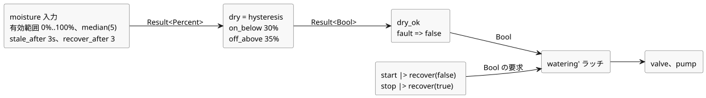

<!-- translation-source: examples/tutorial/03-moisture.ghost.md -->
[英語の原文](03-moisture.ghost.md)
> 閲覧用の翻訳です。コンパイルには、リンク先の原本 `.ghost.md` ファイルを使用してください。

# 土壌水分で制御する灌水

作者の意図：有効な水分信号が乾燥した土壌を報告している間だけ、灌水を ON のままにします。STOP 要求、水分センサの故障、または土壌がもう乾燥していないことのいずれかでラッチが解除されます。

この生成元品質のリビジョン（`issue531-producer-quality-tutorial03-v1`）は、作者が書いた水分故障の分岐をそのまま保持します。START と STOP は、生成元の観測が利用できない場合を明示的に扱います。利用できない START は起動要求なしとみなし、利用できない STOP は停止要求とみなします。正常なボタンの値から物理的な故障を推測することは決してありません。以前のソースは `tests/fixtures/history/issue531/03-moisture.ghost.md.pre-input.txt` に保持されています。

```ghost
// Source revision: issue531-producer-quality-tutorial03-v1
control MoistureDemand {
  input start, stop: Bool;
  input moisture: Percent {
    sample = 1s;
    valid = 0% .. 100%;
    filter = median(5);
    stale_after = 3s;
    recover_after = 3 samples;
  }
  signal dry = hysteresis(moisture,
    on_below: 30%, off_above: 35%, initial: false);
  let dry_ok = case dry { ok(value) => value; fault(_) => false; };
  state watering: Bool = false;
  output pump, valve: Bool;
  let start_requested = start |> recover(false);
  let stop_requested = stop |> recover(true);
  watering' = !stop_requested && dry_ok && (start_requested || watering);
  valve <- watering';
  pump <- watering';
  require pump => valve;
}
```

水分値が判断になるまで：

- **入力の契約。** `moisture` は 1 s ごとのサンプルを想定し、0% から 100% までの値を受け付けます。5 サンプルの中央値フィルタを適用します。最後の実際の有効サンプルから 3 s で古い（stale）状態になります。故障の後は、再び正常になるまでに、連続する 3 つの新しい有効サンプル（とフィルタの準備完了）が必要です。
- **ヒステリシス。** `dry` は 30% 未満で true、35% を超えると false になります。2 つのしきい値の間では前の判断を保持するため、ON/OFF の頻繁な切り替わりを防ぎます。水分センサの故障は `dry` を通して伝播します。
- **故障時のポリシー。** `dry_ok` はあらゆる故障を `false` に対応付けます。そのため、古い、無効、または断線したセンサは灌水を OFF にします。
- **自動再起動なし。** いったん解除されると、ラッチは起動要求があるときにのみ再び ON になります。故障の後にセンサが復旧しても、ポンプは自動では再起動しません。新しい起動要求が必要です。

センサとボタンから出力までのデータの流れ：


