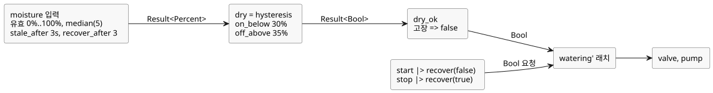

<!-- translation-source: examples/tutorial/03-moisture.ghost.md -->
[영문 원문](03-moisture.ghost.md)

# 수분 조건 관수

작성된 의도는 다음과 같습니다. 유효한 수분 신호가 건조한 토양을 보고하는 동안에만
관수를 켜 둡니다. STOP 요청, 수분 고장, 또는 더 이상 건조하지 않은 토양은 래치를
해제합니다. 이 한국어 파일은 읽기용 번역본이므로, 컴파일할 때는 영문 원문
`.ghost.md`를 사용하세요.

이 producer-quality revision(`issue531-producer-quality-tutorial03-v1`)은 작성된 수분 고장 분기를 유지합니다. START와 STOP은 생산자(producer)가 관측값을 제공하지 못하는 경우를 명시적으로 처리합니다. 사용할 수 없는 START는 시작 요청이 없는 것으로, 사용할 수 없는 STOP은 정지 요청으로 간주합니다. 정상 버튼 값으로 물리적 고장을 추론하지는 않습니다. 이전 소스는 `tests/fixtures/history/issue531/03-moisture.ghost.md.pre-input.txt`에 보존되어 있습니다.

```ghost
// Source revision: issue531-producer-quality-tutorial03-v1
control MoistureDemand {
  input start, stop: Bool;
  input moisture: Percent {
    sample = 1s;
    valid = 0% .. 100%;
    filter = median(5);
    stale_after = 3s;
    recover_after = 3 samples;
  }
  signal dry = hysteresis(moisture,
    on_below: 30%, off_above: 35%, initial: false);
  let dry_ok = case dry { ok(value) => value; fault(_) => false; };
  state watering: Bool = false;
  output pump, valve: Bool;
  let start_requested = start |> recover(false);
  let stop_requested = stop |> recover(true);
  watering' = !stop_requested && dry_ok && (start_requested || watering);
  valve <- watering';
  pump <- watering';
  require pump => valve;
}
```

수분 값이 판단으로 바뀌는 과정:

- **입력 계약.** `moisture`는 1 s마다 샘플을 기대하고 0%부터 100%까지의 값을
  받아들입니다. 5개 샘플 median 필터를 적용합니다. 마지막으로 실제 유효한 샘플을
  받은 뒤 3 s가 지나면 stale이 됩니다. 고장 후에는 다시 정상이 되기 전에 연속된 새
  유효 샘플 3개(와 준비된 필터)가 필요합니다.
- **히스테리시스.** `dry`는 30% 미만에서 true, 35% 초과에서 false가 됩니다. 두
  경계 사이에서는 이전 판단을 유지하므로 빠른 켜짐/꺼짐 반복을 막습니다.
  수분 고장은 `dry`를 통해 전파됩니다.
- **고장 정책.** `dry_ok`는 모든 고장을 `false`로 대응시키므로, stale하거나
  유효하지 않거나 연결이 끊긴 센서는 관수를 끕니다.
- **자동 재시작 없음.** 래치가 한 번 해제되면 시작 요청이 있을 때만 다시 켜집니다.
  고장 후 센서가 복구되어도 펌프는 스스로 다시 시작하지 않으며, 새 시작 요청이
  필요합니다.

센서와 버튼에서 출력까지의 데이터 흐름:


