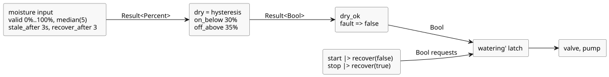

# Moisture-gated watering

The authored intent: watering stays on only while a valid moisture signal reports
dry soil. A STOP request, a moisture fault, or soil that is no longer dry clears the latch.

This producer-quality revision (`issue531-producer-quality-tutorial03-v1`) keeps the authored moisture-fault branch. START and STOP handle unavailable producer observations explicitly: an unavailable START counts as no start request, and an unavailable STOP counts as a stop request. Healthy button values are never used to infer a physical fault. The predecessor is retained at `tests/fixtures/history/issue531/03-moisture.ghost.md.pre-input.txt`.

```ghost
// Source revision: issue531-producer-quality-tutorial03-v1
control MoistureDemand {
  input start, stop: Bool;
  input moisture: Percent {
    sample = 1s;
    valid = 0% .. 100%;
    filter = median(5);
    stale_after = 3s;
    recover_after = 3 samples;
  }
  signal dry = hysteresis(moisture,
    on_below: 30%, off_above: 35%, initial: false);
  let dry_ok = case dry { ok(value) => value; fault(_) => false; };
  state watering: Bool = false;
  output pump, valve: Bool;
  let start_requested = start |> recover(false);
  let stop_requested = stop |> recover(true);
  watering' = !stop_requested && dry_ok && (start_requested || watering);
  valve <- watering';
  pump <- watering';
  require pump => valve;
}
```

How the moisture value becomes a decision:

- **Input contract.** `moisture` expects a sample every 1 s and accepts values
  from 0% to 100%. It applies a 5-sample median filter. It becomes stale 3 s after
  the last actual valid sample. After a fault it needs 3 consecutive new valid
  samples (and a ready filter) before it is healthy again.
- **Hysteresis.** `dry` turns true below 30% and false above 35%. Between the
  limits it keeps its previous decision, which prevents rapid on/off switching.
  A moisture fault propagates through `dry`.
- **Fault policy.** `dry_ok` maps any fault to `false`, so a stale, invalid or
  disconnected sensor turns watering off.
- **No automatic restart.** Once cleared, the latch turns on again only when a
  start request is present. When the sensor recovers after a fault, the pump does
  not restart by itself; a new start request is required.

The data flow from the sensor and the buttons to the outputs:


