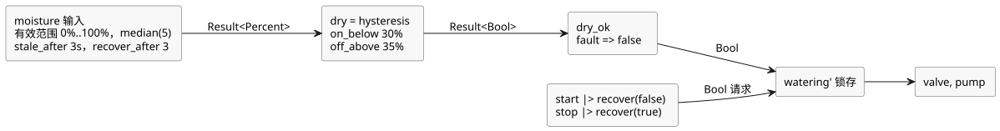

<!-- translation-source: examples/tutorial/03-moisture.ghost.md -->
[英文原文](03-moisture.ghost.md)
> 本文为阅读用译本。编译时请使用上方链接的原始 `.ghost.md` 文件。

# 由湿度控制的浇水

设计意图：只有当有效的湿度信号报告土壤干燥时，浇水才保持开启。STOP 请求、湿度故障，
或土壤不再干燥，都会清除锁存。

这个生产者质量修订版（`issue531-producer-quality-tutorial03-v1`）保留了作者编写的湿度故障分支。START 和 STOP 显式处理不可用的生产者观测：不可用的 START 视为没有启动请求，不可用的 STOP 视为停止请求。绝不会根据正常的按钮值推断物理故障。前一版本保留在 `tests/fixtures/history/issue531/03-moisture.ghost.md.pre-input.txt`。

```ghost
// Source revision: issue531-producer-quality-tutorial03-v1
control MoistureDemand {
  input start, stop: Bool;
  input moisture: Percent {
    sample = 1s;
    valid = 0% .. 100%;
    filter = median(5);
    stale_after = 3s;
    recover_after = 3 samples;
  }
  signal dry = hysteresis(moisture,
    on_below: 30%, off_above: 35%, initial: false);
  let dry_ok = case dry { ok(value) => value; fault(_) => false; };
  state watering: Bool = false;
  output pump, valve: Bool;
  let start_requested = start |> recover(false);
  let stop_requested = stop |> recover(true);
  watering' = !stop_requested && dry_ok && (start_requested || watering);
  valve <- watering';
  pump <- watering';
  require pump => valve;
}
```

湿度值如何变成判定：

- **输入契约。** `moisture` 期望每 1 s 一个样本，接受 0% 到 100% 的值。它应用
  5 个样本的中值滤波。在最后一个实际有效样本之后 3 s 变为陈旧（stale）。故障之后，
  它需要连续 3 个新的有效样本（并且滤波器已就绪）才能重新恢复正常。
- **迟滞。** `dry` 在低于 30% 时变为 true，高于 35% 时变为 false。在两个界限之间
  保持前一个判定，从而防止快速的开关切换。湿度故障会经由 `dry` 传播。
- **故障策略。** `dry_ok` 将任何故障映射为 `false`，因此陈旧、无效或断线的传感器
  都会关闭浇水。
- **不自动重启。** 锁存一旦被清除，只有存在启动请求时才会再次开启。传感器在故障后
  恢复时，泵不会自行重启；需要一个新的启动请求。

从传感器和按钮到输出的数据流：


