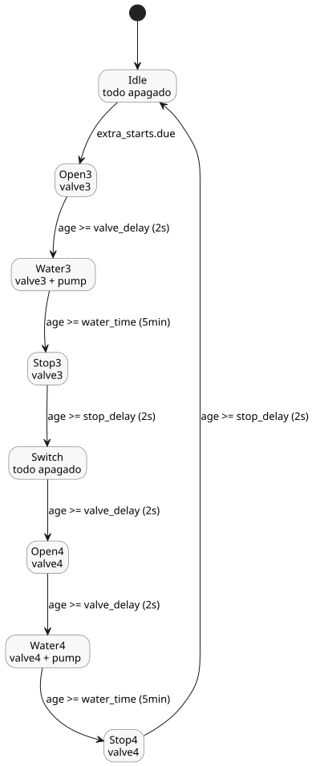

<!-- translation-source: examples/tutorial/04-extra-valves.ghost.md -->
[Original en inglés](04-extra-valves.ghost.md)
> Traducción de lectura. Para compilar, use el archivo original `.ghost.md` enlazado.

# Válvulas adicionales de la estación

Este control canónico independiente comparte la bomba de la estación, cuya titularidad
corresponde al host. A su propia hora seleccionada, hace funcionar las válvulas tres y
cuatro una después de la otra.

```ghost
control ExtraValves {
  schedule extra_starts: DailySlots<15min> {
    timezone = "Asia/Seoul";
    selected = [19:15];
  }
  let water_time = 5min;
  let valve_delay = 2s;
  let stop_delay = 2s;
  type Phase = Idle | Open3 | Water3 | Stop3 | Switch | Open4 | Water4 | Stop4;
  state phase: Phase = Idle;
  timer age = elapsed(phase);
  output pump, valve3, valve4: Bool;
  phase' = case phase {
    Idle => if extra_starts.due then Open3 else Idle;
    Open3 => if age >= valve_delay then Water3 else Open3;
    Water3 => if age >= water_time then Stop3 else Water3;
    Stop3 => if age >= stop_delay then Switch else Stop3;
    Switch => if age >= valve_delay then Open4 else Switch;
    Open4 => if age >= valve_delay then Water4 else Open4;
    Water4 => if age >= water_time then Stop4 else Water4;
    Stop4 => if age >= stop_delay then Idle else Stop4;
  };
  valve3 <- phase' in {Open3, Water3, Stop3};
  valve4 <- phase' in {Open4, Water4, Stop4};
  pump <- phase' in {Water3, Water4};
  require pump => (valve3 || valve4);
  require !(valve3 && valve4);
}
```

El control sigue el mismo patrón que [Riego programado](02-watering.ghost.es.md):

- **Programación.** `extra_starts` pasa a pendiente (due) una vez al día a las 19:15
  (`Asia/Seoul`).
- **Secuencia.** Cada válvula se abre 2 s antes de que arranque la bomba, riega
  durante 5 min y permanece abierta 2 s después de que la bomba se detiene. La fase
  `Switch` mantiene todo apagado durante `valve_delay` (2 s) antes de que se abra la
  válvula cuatro.
- **Requisitos.** La bomba solo puede funcionar cuando la válvula tres o la cuatro
  está abierta, y las dos válvulas nunca están abiertas a la vez.
- **Bomba compartida.** Este control declara su propia salida `pump`. El host la
  vincula a la misma bomba de la estación que usa el control de riego programado.


