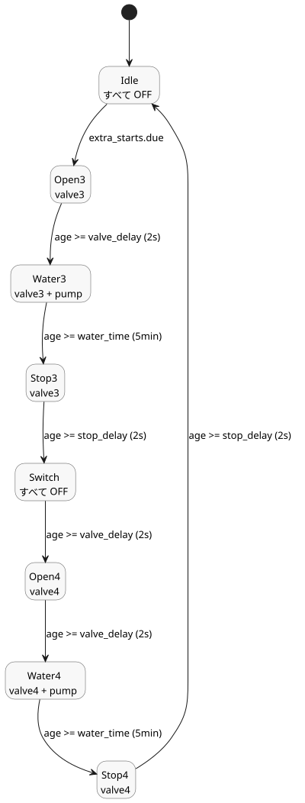

<!-- translation-source: examples/tutorial/04-extra-valves.ghost.md -->
[英語の原文](04-extra-valves.ghost.md)
> 閲覧用の翻訳です。コンパイルには、リンク先の原本 `.ghost.md` ファイルを使用してください。

# 追加のステーションバルブ

この独立した正本制御は、ホストが所有するステーションポンプを共有します。自身で選択した時刻に、バルブ 3 とバルブ 4 を順番に運転します。

```ghost
control ExtraValves {
  schedule extra_starts: DailySlots<15min> {
    timezone = "Asia/Seoul";
    selected = [19:15];
  }
  let water_time = 5min;
  let valve_delay = 2s;
  let stop_delay = 2s;
  type Phase = Idle | Open3 | Water3 | Stop3 | Switch | Open4 | Water4 | Stop4;
  state phase: Phase = Idle;
  timer age = elapsed(phase);
  output pump, valve3, valve4: Bool;
  phase' = case phase {
    Idle => if extra_starts.due then Open3 else Idle;
    Open3 => if age >= valve_delay then Water3 else Open3;
    Water3 => if age >= water_time then Stop3 else Water3;
    Stop3 => if age >= stop_delay then Switch else Stop3;
    Switch => if age >= valve_delay then Open4 else Switch;
    Open4 => if age >= valve_delay then Water4 else Open4;
    Water4 => if age >= water_time then Stop4 else Water4;
    Stop4 => if age >= stop_delay then Idle else Stop4;
  };
  valve3 <- phase' in {Open3, Water3, Stop3};
  valve4 <- phase' in {Open4, Water4, Stop4};
  pump <- phase' in {Water3, Water4};
  require pump => (valve3 || valve4);
  require !(valve3 && valve4);
}
```

この制御は、[スケジュール灌水](02-watering.ghost.ja.md)と同じパターンに従います。

- **スケジュール。** `extra_starts` は毎日 1 回、19:15（`Asia/Seoul`）に到来します。
- **シーケンス。** 各バルブはポンプ起動の 2 s 前に開き、5 min 灌水し、ポンプ停止後も 2 s 開いたままです。`Switch` フェーズは、バルブ 4 が開く前に `valve_delay`（2 s）の間すべてを OFF に保ちます。
- **要件。** ポンプはバルブ 3 または 4 が開いているときだけ運転してもかまいません。また、2 つのバルブが同時に開くことは決してありません。
- **共有ポンプ。** この制御は独自の `pump` 出力を宣言します。ホストはそれを、スケジュール灌水の制御が使うのと同じステーションポンプにバインドします。


