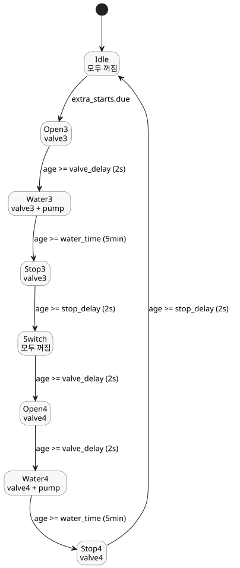

<!-- translation-source: examples/tutorial/04-extra-valves.ghost.md -->
[영문 원문](04-extra-valves.ghost.md)

# 추가 스테이션 밸브

이 독립된 정본 제어는 호스트가 소유한 스테이션 펌프를 공유합니다. 자체적으로
선택한 시각에 밸브 3과 밸브 4를 차례로 운전합니다. 이 한국어 파일은 읽기용
번역본이므로, 컴파일할 때는 영문 원문 `.ghost.md`를 사용하세요.

```ghost
control ExtraValves {
  schedule extra_starts: DailySlots<15min> {
    timezone = "Asia/Seoul";
    selected = [19:15];
  }
  let water_time = 5min;
  let valve_delay = 2s;
  let stop_delay = 2s;
  type Phase = Idle | Open3 | Water3 | Stop3 | Switch | Open4 | Water4 | Stop4;
  state phase: Phase = Idle;
  timer age = elapsed(phase);
  output pump, valve3, valve4: Bool;
  phase' = case phase {
    Idle => if extra_starts.due then Open3 else Idle;
    Open3 => if age >= valve_delay then Water3 else Open3;
    Water3 => if age >= water_time then Stop3 else Water3;
    Stop3 => if age >= stop_delay then Switch else Stop3;
    Switch => if age >= valve_delay then Open4 else Switch;
    Open4 => if age >= valve_delay then Water4 else Open4;
    Water4 => if age >= water_time then Stop4 else Water4;
    Stop4 => if age >= stop_delay then Idle else Stop4;
  };
  valve3 <- phase' in {Open3, Water3, Stop3};
  valve4 <- phase' in {Open4, Water4, Stop4};
  pump <- phase' in {Water3, Water4};
  require pump => (valve3 || valve4);
  require !(valve3 && valve4);
}
```

이 제어는 [예약 관수](02-watering.ghost.ko.md)와 같은 패턴을 따릅니다.

- **예약.** `extra_starts`는 매일 한 번 19:15(`Asia/Seoul`)에 due가 됩니다.
- **순서.** 각 밸브는 펌프가 시작되기 2 s 전에 열리고, 5 min 동안 관수한 뒤,
  펌프가 멈춘 후에도 2 s 동안 열려 있습니다. `Switch` 단계는 밸브 4가 열리기 전에
  `valve_delay`(2 s) 동안 모든 출력을 끈 상태로 유지합니다.
- **요구 조건.** 펌프는 밸브 3 또는 밸브 4가 열려 있을 때만 돌 수 있고, 두 밸브는
  절대 동시에 열리지 않습니다.
- **공유 펌프.** 이 제어는 자체 `pump` 출력을 선언합니다. 호스트는 이 출력을
  예약 관수 제어가 사용하는 것과 같은 스테이션 펌프에 바인딩합니다.


