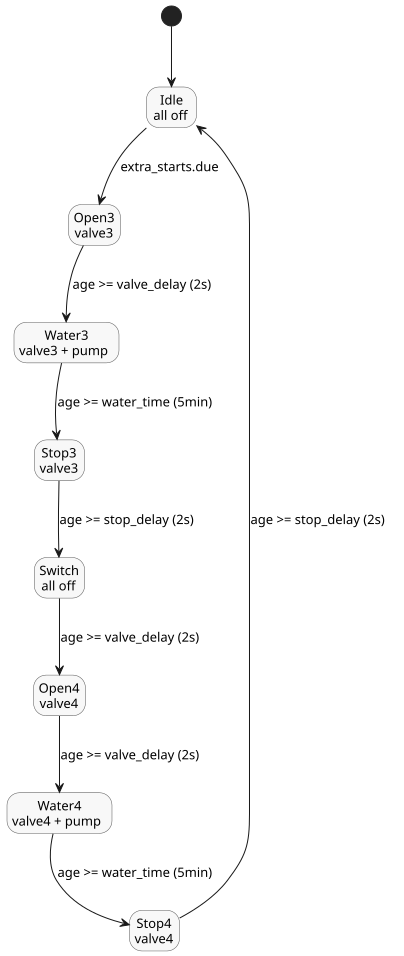

# Extra station valves

This independent canonical control shares the host-owned station pump. At its own
selected time, it runs valves three and four one after the other.

```ghost
control ExtraValves {
  schedule extra_starts: DailySlots<15min> {
    timezone = "Asia/Seoul";
    selected = [19:15];
  }
  let water_time = 5min;
  let valve_delay = 2s;
  let stop_delay = 2s;
  type Phase = Idle | Open3 | Water3 | Stop3 | Switch | Open4 | Water4 | Stop4;
  state phase: Phase = Idle;
  timer age = elapsed(phase);
  output pump, valve3, valve4: Bool;
  phase' = case phase {
    Idle => if extra_starts.due then Open3 else Idle;
    Open3 => if age >= valve_delay then Water3 else Open3;
    Water3 => if age >= water_time then Stop3 else Water3;
    Stop3 => if age >= stop_delay then Switch else Stop3;
    Switch => if age >= valve_delay then Open4 else Switch;
    Open4 => if age >= valve_delay then Water4 else Open4;
    Water4 => if age >= water_time then Stop4 else Water4;
    Stop4 => if age >= stop_delay then Idle else Stop4;
  };
  valve3 <- phase' in {Open3, Water3, Stop3};
  valve4 <- phase' in {Open4, Water4, Stop4};
  pump <- phase' in {Water3, Water4};
  require pump => (valve3 || valve4);
  require !(valve3 && valve4);
}
```

The control follows the same pattern as [Scheduled watering](02-watering.ghost.md):

- **Schedule.** `extra_starts` becomes due once a day at 19:15 (`Asia/Seoul`).
- **Sequence.** Each valve opens 2 s before the pump starts, waters for 5 min,
  and stays open 2 s after the pump stops. The `Switch` phase keeps everything
  off for `valve_delay` (2 s) before valve four opens.
- **Requirements.** The pump may run only when valve three or four is open, and
  the two valves are never open together.
- **Shared pump.** This control declares its own `pump` output. The host binds
  it to the same station pump used by the scheduled-watering control.


