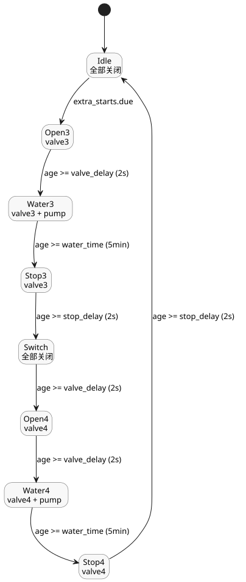

<!-- translation-source: examples/tutorial/04-extra-valves.ghost.md -->
[英文原文](04-extra-valves.ghost.md)
> 本文为阅读用译本。编译时请使用上方链接的原始 `.ghost.md` 文件。

# 额外的站点阀门

这个独立的规范控制共享由宿主拥有的站点泵。在自己选定的时间，它依次运行
第三和第四个阀门。

```ghost
control ExtraValves {
  schedule extra_starts: DailySlots<15min> {
    timezone = "Asia/Seoul";
    selected = [19:15];
  }
  let water_time = 5min;
  let valve_delay = 2s;
  let stop_delay = 2s;
  type Phase = Idle | Open3 | Water3 | Stop3 | Switch | Open4 | Water4 | Stop4;
  state phase: Phase = Idle;
  timer age = elapsed(phase);
  output pump, valve3, valve4: Bool;
  phase' = case phase {
    Idle => if extra_starts.due then Open3 else Idle;
    Open3 => if age >= valve_delay then Water3 else Open3;
    Water3 => if age >= water_time then Stop3 else Water3;
    Stop3 => if age >= stop_delay then Switch else Stop3;
    Switch => if age >= valve_delay then Open4 else Switch;
    Open4 => if age >= valve_delay then Water4 else Open4;
    Water4 => if age >= water_time then Stop4 else Water4;
    Stop4 => if age >= stop_delay then Idle else Stop4;
  };
  valve3 <- phase' in {Open3, Water3, Stop3};
  valve4 <- phase' in {Open4, Water4, Stop4};
  pump <- phase' in {Water3, Water4};
  require pump => (valve3 || valve4);
  require !(valve3 && valve4);
}
```

该控制遵循与[定时浇水](02-watering.ghost.zh.md)相同的模式：

- **调度计划。** `extra_starts` 每天在 19:15（`Asia/Seoul`）到期一次。
- **顺序。** 每个阀门在泵启动前 2 s 打开，浇水 5 min，并在泵停止后继续保持打开 2 s。
  `Switch` 阶段在第四个阀门打开前让所有输出关闭 `valve_delay`（2 s）。
- **要求。** 只有在第三或第四个阀门打开时泵才可以运行，并且两个阀门绝不会同时打开。
- **共享泵。** 该控制声明了自己的 `pump` 输出。宿主将其绑定到定时浇水控制所使用的
  同一个站点泵。


