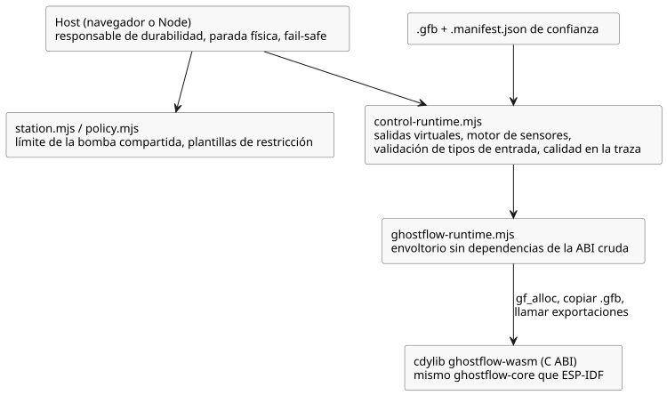

<!-- translation-source: runtimes/wasm/README.md -->
[Original en inglés](README.md)

# Runtime WASM de GhostFlow

Este crate compila una `cdylib` (una biblioteca dinámica compatible con C) para
WebAssembly. Usa exactamente el mismo crate `ghostflow-core` que la compilación para
ESP-IDF, de modo que el navegador y el dispositivo ejecutan el mismo código de la VM.
No depende de JavaScript ni de wasm-bindgen.

**ABI cruda.** Un navegador carga un módulo en tres pasos:

1. Reserva espacio para los bytes del módulo con `gf_alloc`.
2. Copia un módulo `.gfb` en la memoria lineal de WASM.
3. Llama a las funciones exportadas de la C ABI.

Cada módulo cargado recibe su propio handle, por lo que varios handles pueden
ejecutarse en paralelo; por ejemplo, la línea de tiempo real junto a una línea de
tiempo ghost (ejecución fantasma, hipotética). `ghostflow-runtime.mjs` es un pequeño
envoltorio de JavaScript, sin dependencias, para esta ABI cruda.

**Adaptador de control.** Las nuevas fuentes de control deberían usar
`control-runtime.mjs`, que recibe tanto el `.gfb` como su `.manifest.json` de
confianza. El adaptador:

- instala capacidades (capabilities) de salida **virtuales**;
- conecta el motor de sensores de Rust;
- valida los tipos de entrada;
- registra la calidad de las entradas junto con la traza de la VM.

No descubre dispositivos ni emite comandos GPIO.

El diagrama siguiente muestra cómo se sitúan estos módulos de JavaScript sobre la
biblioteca WASM y qué responsabilidades quedan a cargo del host.



**Estación compartida.** `station.mjs` expone el límite de la bomba compartida: su
modo, su titularidad, su cuota y su durabilidad. `policy.mjs` vincula las plantillas
de restricción independientes a una estación. La estación no puede verificar que un
callback de persistencia de JavaScript haya hecho realmente duraderos los bytes, ni
que un renderizador se haya detenido físicamente. Esas son responsabilidades del host.

**Parada segura.** Llame a `requestStop()` de forma síncrona y aplique la directiva
segura que devuelve *antes* de esperar (await) al almacenamiento. `advance()` devuelve
una directiva segura accionable cuando vence una concesión (lease) o el día. Ante
cualquier error del runtime, un host físico debe pasar a estado seguro (fail safe); no
debe reutilizar una intención obsoleta.

**Reproducción de un programa core simple.** Para un programa core simple,
`GhostFlowRuntime.replayCore({ count, maxJsonBytes })` reproduce los escaneos
retenidos:

- `count` debe ser positivo y no mayor que la longitud del registro (journal)
  retenido.
- `maxJsonBytes` es un presupuesto positivo de bytes para el búfer JSON de
  reproducción acotado ya existente.
- El resultado usa el sobre heredado existente `GhostFlow/temporal-replay-v1` e
  incluye `checkpointTick` junto con los registros reproducidos. El nombre del sobre
  no convierte en temporal a un programa simple.
- Si falla, la reproducción deja sin cambios el estado en vivo, las entradas
  pendientes y el búfer de la reproducción exitosa anterior.

La VM comprueba el módulo y la estrategia que registró. Para obtener evidencia del
mismo programa, el host debe conservar la misma revisión de la fuente, los mismos
eventos de ajustes y las mismas vinculaciones de capacidades. Las sesiones temporales,
de proveedor y de objetivo usan sus propios contratos de reproducción, o no se admiten
en este punto de entrada.

Consulte [el tutorial](../../docs/TUTORIAL.es.md),
[los límites de la implementación](../../docs/IMPLEMENTATION.es.md) y
[la evidencia de verificación](../../docs/VERIFICATION.es.md). Ejecute todas las
compuertas de software con `npm test` desde la raíz del repositorio. `npm run tutorial`
también compila los artefactos nativos/WASM y ejecuta las aserciones del tutorial.

Agregue el destino WASM y luego compile:

```sh
rustup target add wasm32-unknown-unknown
cargo build -p ghostflow-wasm --target wasm32-unknown-unknown --release
```
