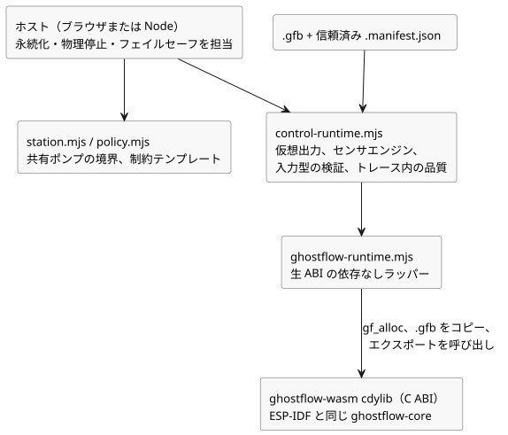

<!-- translation-source: runtimes/wasm/README.md -->
[英語の原文](README.md)

# GhostFlow WASM ランタイム

このクレートは、WebAssembly 向けの `cdylib`（C 互換の動的ライブラリ）をビルドします。ESP-IDF ビルドとまったく同じ `ghostflow-core` クレートを使うため、ブラウザとデバイスは同じ VM コードを実行します。JavaScript や wasm-bindgen への依存はありません。

**生 ABI。** ブラウザは 3 つの手順でモジュールを読み込みます。

1. `gf_alloc` でモジュールのバイト列用の領域を確保します。
2. `.gfb` モジュールを WASM の線形メモリにコピーします。
3. エクスポートされた C ABI 関数を呼び出します。

読み込まれたモジュールはそれぞれ独自のハンドルを持つため、複数のハンドルを並べて実行できます。たとえば、実際のタイムラインとゴースト（what-if）タイムラインを並べて実行できます。`ghostflow-runtime.mjs` は、この生 ABI を包む、依存関係のない小さな JavaScript ラッパーです。

**制御アダプタ。** 新しい制御ソースは `control-runtime.mjs` を使うべきです。これは `.gfb` と、信頼済みの `.manifest.json` の両方を受け取ります。このアダプタは次のことを行います。

- **仮想**の出力ケイパビリティをインストールします。
- Rust のセンサエンジンを接続します。
- 入力の型を検証します。
- VM トレースと並べて入力の品質を記録します。

デバイスの検出や GPIO コマンドの発行は行いません。

次の図は、これらの JavaScript モジュールが WASM ライブラリの上にどのように重なっているか、そしてどの責任がホストに残るかを示しています。



**共有ステーション。** `station.mjs` は共有ポンプの境界、すなわちそのモード、所有権、割り当て量（クォータ）、永続性を公開します。`policy.mjs` は、単独の制約テンプレートを 1 つのステーションにバインドします。ステーションは、JavaScript の永続化コールバックが本当にバイト列を永続化したかどうかや、レンダラーが物理的に停止したかどうかを検証できません。それらはホストの責任です。

**安全な停止。** `requestStop()` を同期的に呼び出し、ストレージを await する*前に*、それが返す安全指令を適用してください。リースまたはその日が期限切れになると、`advance()` は実行可能な安全指令を返します。ランタイムエラーが発生した場合、物理ホストはフェイルセーフにしなければなりません。古い意図を再利用してはなりません。

**プレーンなコアプログラムのリプレイ。** プレーンなコアプログラムでは、`GhostFlowRuntime.replayCore({ count, maxJsonBytes })` が保持されたスキャンをリプレイします。

- `count` は正の値で、保持されたジャーナルの長さ以下でなければなりません。
- `maxJsonBytes` は、既存の有界なリプレイ JSON バッファに対する正のバイト予算です。
- 結果は既存の `GhostFlow/temporal-replay-v1` レガシーエンベロープを使い、`checkpointTick` とリプレイされたレコードを含みます。エンベロープの名前は、プレーンなプログラムを時間的（temporal）なものにするわけではありません。
- 失敗した場合、リプレイはライブ状態、保留中の入力、および直前に成功したリプレイバッファを変更しません。

VM は、記録されたモジュールと戦略を検査します。同一プログラムの証拠とするには、ホストは同じソースリビジョン、設定イベント、ケイパビリティのバインディングを維持しなければなりません。時間的（temporal）、プロバイダ、目標（objective）のセッションは、それぞれ独自のリプレイ契約を使うか、このエントリポイントではサポートされていません。

[チュートリアル](../../docs/TUTORIAL.ja.md)、[実装の境界](../../docs/IMPLEMENTATION.ja.md)、[検証の証拠](../../docs/VERIFICATION.ja.md)を参照してください。すべてのソフトウェアゲートは、リポジトリのルートで `npm test` を実行すると動きます。`npm run tutorial` は、ネイティブ/WASM の成果物もビルドし、チュートリアルのアサーションを実行します。

WASM ターゲットを追加してから、ビルドします。

```sh
rustup target add wasm32-unknown-unknown
cargo build -p ghostflow-wasm --target wasm32-unknown-unknown --release
```
