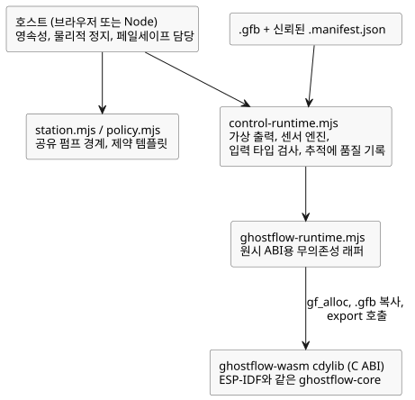

<!-- translation-source: runtimes/wasm/README.md -->
[영문 원문](README.md)

# GhostFlow WASM 런타임

이 크레이트는 WebAssembly용 `cdylib`(C 호환 동적 라이브러리)를 빌드합니다.
ESP-IDF 빌드와 정확히 같은 `ghostflow-core` 크레이트를 사용하므로, 브라우저와
장치가 같은 VM 코드를 실행합니다. JavaScript나 wasm-bindgen 의존성은 없습니다.

**원시 ABI.** 브라우저는 세 단계로 모듈을 로드합니다.

1. `gf_alloc`으로 모듈 바이트를 담을 공간을 할당합니다.
2. `.gfb` 모듈을 WASM 선형 메모리에 복사합니다.
3. 내보낸(export) C ABI 함수를 호출합니다.

로드된 모듈마다 자체 핸들이 생기므로 여러 핸들을 나란히 실행할 수 있습니다.
예를 들어 실제 timeline 옆에 ghost(what-if) timeline을 실행할 수 있습니다.
`ghostflow-runtime.mjs`는 이 원시 ABI를 위한 작고 의존성 없는 JavaScript
래퍼입니다.

**제어 어댑터.** 새 제어 소스에는 `.gfb`와 신뢰된 `.manifest.json`을 함께 받는
`control-runtime.mjs`를 사용해야 합니다. 이 어댑터는 다음을 수행합니다.

- **가상** 출력 capability를 설치합니다.
- Rust 센서 엔진을 연결합니다.
- 입력 타입을 검증합니다.
- VM 추적(trace)과 함께 입력 품질을 기록합니다.

장치를 탐색하지 않으며 GPIO 명령을 보내지도 않습니다.

아래 다이어그램은 이 JavaScript 모듈들이 WASM 라이브러리 위에 어떻게 놓이는지,
그리고 어떤 책임이 호스트에 남는지 보여 줍니다.



**공유 스테이션.** `station.mjs`는 공유 펌프의 경계, 즉 모드, 소유권, 할당량,
영속성(durability)을 노출합니다. `policy.mjs`는 독립 제약 템플릿을 하나의
스테이션에 바인딩합니다. 스테이션은 JavaScript 영속화 콜백이 실제로 바이트를
영구 저장했는지, 또는 렌더러가 물리적으로 멈췄는지 검증할 수 없습니다. 이는 호스트의
책임입니다.

**안전한 정지.** `requestStop()`을 동기적으로 호출하고, 저장소를 기다리기(await)
*전에* 반환된 안전 지시를 적용하세요. `advance()`는 임대(lease)나 하루가 만료되면
조치 가능한 안전 지시를 반환합니다. 런타임 오류가 발생하면 물리 호스트는 반드시
페일세이프로 전환해야 하며, 오래된(stale) 의도를 재사용해서는 안 됩니다.

**일반 코어 프로그램 재생.** 일반 코어 프로그램에서는
`GhostFlowRuntime.replayCore({ count, maxJsonBytes })`가 보존된 스캔을 재생합니다.

- `count`는 양수여야 하며 보존된 journal 길이보다 클 수 없습니다.
- `maxJsonBytes`는 기존의 제한된(bounded) 재생 JSON 버퍼에 대한 양수 바이트
  예산입니다.
- 결과는 기존 `GhostFlow/temporal-replay-v1` 레거시 엔벌로프를 사용하며,
  `checkpointTick`과 재생된 기록을 포함합니다. 엔벌로프 이름 때문에 일반 프로그램이
  시간(temporal) 프로그램이 되지는 않습니다.
- 실패하면 재생은 live 상태, 대기 중인 입력, 이전에 성공한 재생 버퍼를 바꾸지
  않습니다.

VM은 기록된 모듈과 전략을 검사합니다. 같은 프로그램에 대한 증거를 얻으려면 호스트가
같은 소스 revision, 설정 이벤트, capability 바인딩을 유지해야 합니다. 시간(temporal),
provider, objective 세션은 각자의 재생 계약을 사용하거나, 이 진입점에서 지원되지
않습니다.

[튜토리얼](../../docs/TUTORIAL.ko.md),
[구현 경계](../../docs/IMPLEMENTATION.ko.md),
[검증 증거](../../docs/VERIFICATION.ko.md)를 참고하세요. 모든 소프트웨어 게이트는
저장소 루트에서 `npm test`로 실행합니다. `npm run tutorial`은 native/WASM
아티팩트도 빌드하고 튜토리얼의 단언(assertion)을 실행합니다.

WASM 타깃을 추가한 다음 빌드합니다.

```sh
rustup target add wasm32-unknown-unknown
cargo build -p ghostflow-wasm --target wasm32-unknown-unknown --release
```
