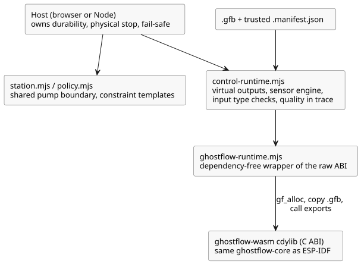

# GhostFlow WASM runtime

This crate builds a `cdylib` (a C-compatible dynamic library) for WebAssembly. It
uses exactly the same `ghostflow-core` crate as the ESP-IDF build, so the
browser and the device run the same VM code. It has no JavaScript or wasm-bindgen
dependency.

**Raw ABI.** A browser loads a module in three steps:

1. Allocate space for the module bytes with `gf_alloc`.
2. Copy a `.gfb` module into the WASM linear memory.
3. Call the exported C ABI functions.

Each loaded module gets its own handle, so several handles can run side by side —
for example, the actual timeline next to a ghost (what-if) timeline.
`ghostflow-runtime.mjs` is a small, dependency-free JavaScript wrapper for this
raw ABI.

**Control adapter.** New control sources should use `control-runtime.mjs`, which
takes both the `.gfb` and its trusted `.manifest.json`. The adapter:

- installs **virtual** output capabilities;
- connects the Rust sensor engine;
- validates input types;
- records input quality alongside the VM trace.

It does not discover devices and does not issue GPIO commands.

The diagram below shows how these JavaScript modules sit on top of the WASM
library, and which responsibilities stay with the host.



**Shared station.** `station.mjs` exposes the boundary of the shared pump: its
mode, ownership, quota and durability. `policy.mjs` binds the standalone
constraint templates to one station. The station cannot verify that a
JavaScript persistence callback really made bytes durable, or that a renderer
physically stopped. Those are host responsibilities.

**Stopping safely.** Call `requestStop()` synchronously and apply the safe
directive it returns *before* awaiting storage. `advance()` returns an
actionable safe directive when a lease or the day expires. On any runtime error,
a physical host must fail safe; it must not reuse a stale intent.

**Replaying a plain core program.** For a plain core program,
`GhostFlowRuntime.replayCore({ count, maxJsonBytes })` replays retained scans:

- `count` must be positive and no larger than the retained journal length.
- `maxJsonBytes` is a positive byte budget for the existing bounded replay JSON
  buffer.
- The result uses the existing `GhostFlow/temporal-replay-v1` legacy envelope and
  includes `checkpointTick` plus the replayed records. The envelope name does
  not make a plain program temporal.
- On failure, replay leaves the live state, pending inputs and the previous
  successful replay buffer unchanged.

The VM checks its recorded module and strategy. For same-program evidence, the
host must keep the same source revision, settings events and capability
bindings. Temporal, provider and objective sessions use their own replay
contracts, or are not supported by this entry point.

See [the tutorial](../../docs/TUTORIAL.md),
[implementation boundaries](../../docs/IMPLEMENTATION.md), and
[verification evidence](../../docs/VERIFICATION.md). Run all software gates with
`npm test` from the repository root. `npm run tutorial` also builds the
native/WASM artifacts and executes the tutorial's assertions.

Add the WASM target, then build:

```sh
rustup target add wasm32-unknown-unknown
cargo build -p ghostflow-wasm --target wasm32-unknown-unknown --release
```
