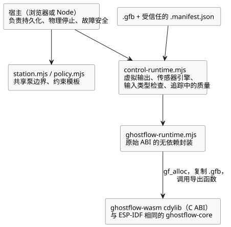

<!-- translation-source: runtimes/wasm/README.md -->
[英文原文](README.md)

# GhostFlow WASM 运行时

该 crate 为 WebAssembly 构建一个 `cdylib`（C 兼容的动态库）。它与 ESP-IDF 构建使用完全
相同的 `ghostflow-core` crate，因此浏览器和设备运行相同的 VM 代码。它不依赖 JavaScript
或 wasm-bindgen。

**原始 ABI。** 浏览器分三步加载一个模块：

1. 使用 `gf_alloc` 为模块字节分配空间。
2. 将一个 `.gfb` 模块复制到 WASM 线性内存中。
3. 调用导出的 C ABI 函数。

每个已加载的模块都有自己的句柄，因此多个句柄可以并行运行——例如，实际时间线与
ghost（影子运行，what-if）时间线并排运行。`ghostflow-runtime.mjs` 是这个原始 ABI 的一个
小型、无依赖的 JavaScript 封装。

**控制适配器。** 新的控制源应当使用 `control-runtime.mjs`，它同时接收 `.gfb` 及其受信任的
`.manifest.json`。该适配器：

- 安装**虚拟**输出能力（capability）；
- 连接 Rust 传感器引擎；
- 校验输入类型；
- 在 VM 追踪旁记录输入质量。

它不会发现设备，也不会发出 GPIO 命令。

下图展示了这些 JavaScript 模块如何位于 WASM 库之上，以及哪些职责仍由宿主承担。



**共享站点。** `station.mjs` 暴露共享泵的边界：其模式、所有权、配额和持久性。
`policy.mjs` 将独立的约束模板绑定到一个站点。站点无法验证 JavaScript 持久化回调是否真的
使字节持久化，也无法验证渲染器（renderer）是否已物理停止。这些是宿主的职责。

**安全停止。** 同步调用 `requestStop()`，并在等待存储*之前*应用它返回的安全指令。
当租约或当天到期时，`advance()` 返回一个可执行的安全指令。发生任何运行时错误时，
物理宿主必须进入故障安全状态；不得重用陈旧的意图。

**重放普通核心程序。** 对于普通核心程序，`GhostFlowRuntime.replayCore({ count, maxJsonBytes })`
会重放保留的扫描：

- `count` 必须为正数，且不大于保留的日志（journal）长度。
- `maxJsonBytes` 是现有有界重放 JSON 缓冲区的正字节预算。
- 结果使用现有的 `GhostFlow/temporal-replay-v1` 旧版信封，并包含 `checkpointTick` 以及
  重放的记录。信封名称并不会使普通程序变为时间性程序。
- 失败时，重放不会改变实时状态、待处理输入以及上一次成功的重放缓冲区。

VM 会检查其记录的模块和策略。对于同一程序的证据，宿主必须保持相同的源修订版、设置事件
和能力绑定。时间性、提供者和目标会话使用各自的重放契约，或者不受此入口点支持。

参见[教程](../../docs/TUTORIAL.zh.md)、[实现边界](../../docs/IMPLEMENTATION.zh.md)
和[验证证据](../../docs/VERIFICATION.zh.md)。在仓库根目录运行 `npm test` 以执行所有软件
门禁。`npm run tutorial` 还会构建原生/WASM 产物并执行教程中的断言。

添加 WASM 目标，然后构建：

```sh
rustup target add wasm32-unknown-unknown
cargo build -p ghostflow-wasm --target wasm32-unknown-unknown --release
```
