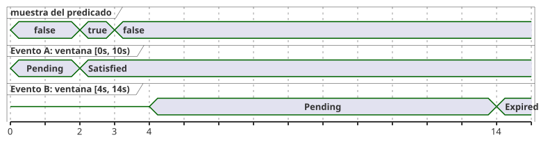

<!-- translation-source: tasks/after-event-design.md -->
[Original en inglés](after-event-design.md)

# Registro de diseño de `after_event`

Estado: **comportamiento del producto seleccionado; requisito previo acotado en Rust
implementado**. Este registro cubre la Referencia §4.4 y REF-04-026. No afirma que la
implementación del compilador esté aceptada.

En este documento:

- el significado requerido de `after_event` y lo que está implementado hoy;
- la evidencia y el estado que una implementación debe conservar;
- el comportamiento seleccionado para eventos superpuestos;
- los contratos que siguen abiertos y el próximo contrato de artefacto GFB.

## Significado requerido

`after_event(event, predicate, window: d, quality: measured)` evalúa el predicado a
partir de la marca de tiempo `e` del evento identificado, sobre el intervalo
semiabierto `[e, e + d)`. El límite final exacto `e + d` queda excluido. El resultado
se sigue por separado para cada identidad de evento distinta. No debe reducirse a un
único temporizador global, salvo que eso se seleccione explícitamente como contrato
del producto.

El diagrama de tiempos siguiente ilustra la regla por identidad con `d = 10s`. Una
muestra del predicado a los 2 s cae dentro de la ventana del evento A, por lo que A
queda satisfecho. El evento B empieza a los 4 s, después de esa muestra, así que la
muestra no puede contar para B; B vence en el extremo excluido de su propia ventana.
A no reemplaza a B, y B no reemplaza a A.

**Estado del compilador.** El compilador ahora analiza `event started: Event;` y
verifica los tipos de la forma directa
`after_event(started, valve_open, window: 10s, quality: measured)`. Registra lo
siguiente en un descriptor de manifiesto no ejecutable:

- el Event identificado;
- el sensor Bool declarado directamente;
- la calidad medida;
- la Duration constante positiva.

La ruta pública `compileSource` sigue rechazando el programa en el operador
`after_event` hasta que estén disponibles la ABI de entrega de Event y la ABI de
resultados por identidad. Evidencia RED/GREEN:
`node --test tests/after-event-contract.test.mjs` (0/7 antes, 7/7 después). El
fixture de aceptación de REF-04-026 todavía no demuestra una semántica ejecutable.

**Requisito previo en Rust.** El bloque de construcción nativo es
`crates/ghostflow-core::after_event::AfterEvent<N>`. Este:

- usa almacenamiento fijo `[Option<EventResult>; N]`;
- sigue cada `EventKey` de forma independiente;
- aplica los predicados medidos solo en `[e,e+d)`;
- hace vencer un resultado en el límite final exclusivo;
- prepara el reconocimiento de los resultados terminales de forma transaccional.

La prueba específica es `cargo test -p ghostflow-core --test after_event` (10/10).

`stage_batch` prepara un tick de forma atómica, en este orden: vencimiento,
reconocimiento de los resultados terminales, inicios en orden de identidad de
origen y, por último, la observación del predicado. Consecuencias:

- Un predicado en la marca de tiempo de inicio puede satisfacer todos los inicios
  simultáneos.
- Un predicado en el final exacto de un evento más antiguo no puede satisfacer ese
  evento más antiguo.
- Un error de capacidad o de observación descarta toda mutación preparada, incluidos
  los reconocimientos, el vencimiento, la marca máxima (high-water mark) de identidad
  de origen y el avance del reloj. Una reversión (rollback) explícita ofrece el mismo
  aislamiento.

Se trata de un requisito previo de la API nativa. No es una vinculación pública de
Event ni un contrato de proyección escalar de señales. La codificación GFB/WASM, la
vinculación de eventos, la proyección por identidad, el checkpoint/replay y la
integración de la procedencia siguen abiertos.

## Evidencia y estado requeridos

- Cada muestra física del predicado lleva una marca de tiempo de muestra, una época,
  un id, una calidad y un valor. La ocurrencia del evento lleva su propia marca de
  tiempo y una identidad distinta.
- La identidad del evento debe seguir siendo opaca y segura frente a colisiones según
  el contrato de vinculación. Un atajo con un hash corto no es un esquema de identidad
  aprobado.
- La implementación debe definir entradas generadas de presencia de Event, época de
  Event, id de Event y marca de tiempo de Event, o una ABI explícita equivalente. Su
  retención y su vinculación de origen deben poder inspeccionarse.
- Las evaluaciones aceptadas, rechazadas, en fallo y de límite deben seguir las mismas
  reglas de transacción/checkpoint/prueba que el resto de la evidencia temporal. Un
  tick rechazado no puede hacer avanzar parcialmente el estado del evento ni la
  evidencia del predicado.
- Los datos de replay/checkpoint deben conservar la identidad del evento, la marca de
  tiempo de origen, la época y la evidencia necesaria para distinguir un evento nuevo
  de un duplicado.

## Comportamiento seleccionado para eventos superpuestos

Se conserva un resultado independiente para cada identidad de evento distinta. Los
eventos superpuestos siguen siendo distinguibles. Un evento nuevo no reemplaza un
resultado anterior pendiente o completado. Esta decisión fija el comportamiento del
lenguaje. Todavía no elige la proyección acotada, la retención, la codificación de
replay ni la geometría de recursos.

## Otros contratos sin resolver

- **Proyección escalar y retención de varios resultados de eventos activos.** Por
  ejemplo, si el evento A ha vencido y el evento superpuesto B está satisfecho, la
  forma de la Referencia `opened |> recover(false)` no indica qué identidad aporta el
  Bool escalar. Codificar ahora una proyección GFB elegiría en silencio `latest`,
  `oldest` o `any`. Ninguna de ellas preserva por sí sola el contrato seleccionado de
  resultados por identidad. El artefacto necesita una vista de resultados indexada por
  identidad (o una regla de proyección explícita) y un límite para los resultados
  retenidos.
- El significado de los resultados pendientes y negativos.
- Los límites de retraso y de entrega para los eventos y las muestras del predicado.
- El dominio de fallos de los eventos y las transiciones de calidad.
- El dominio de reloj monotónico y el comportamiento al reiniciarse la época.
- Los límites de recursos para eventos superpuestos y pruebas de checkpoint.

## Próximo contrato de artefacto GFB

Un nuevo preludio versionado puede contener:

- el sitio/nombre;
- la etiqueta/nombre de origen del Event;
- la etiqueta/nombre de origen del sensor Bool;
- la ventana positiva y la calidad medida;
- vinculaciones de entrada fijas para la presencia del Event, la época de origen, el
  id y la marca de tiempo, y para la identidad, la marca de tiempo, el valor y la
  calidad de la muestra del predicado.

Antes de la activación, el cargador debe verificar los tipos de los campos, que las
vinculaciones sean distintas, la identidad de origen y los límites de recursos. Su
proyección de resultados por evento debe incluir la clave del Event y un estado
Pending/Satisfied/Expired.

El procesamiento de ticks del runtime ya puede usar `AfterEvent<N>::stage_batch` para
los inicios y una observación del predicado en la misma marca de tiempo, con una sola
consolidación o reversión. El host todavía necesita una vinculación de entrega
explícita y una geometría de recursos. La proyección indexada por identidad y el
significado de su consumidor escalar deben resolverse antes de que un descriptor GFB
público pueda afirmar soporte ejecutable. Hasta entonces, el diagnóstico localizado
actual del compilador sigue siendo el límite de aceptación.

La candidata de entradas generadas Event-present/epoch/id/timestamp es solo una
dirección de implementación. No es una ABI ni una extensión del lenguaje aprobadas.
La evidencia de programas instalados, las identidades duraderas de §6.8, la entrega
de eventos por hardware y la E/S física quedan fuera de este registro de diseño.
