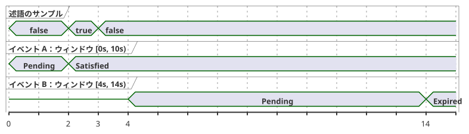
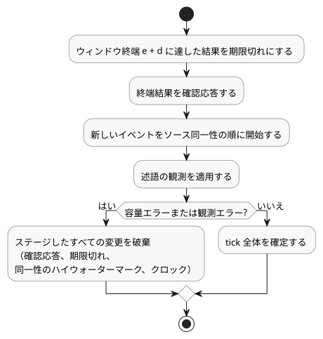

<!-- translation-source: tasks/after-event-design.md -->
[英語の原文](after-event-design.md)

# `after_event` の設計記録

ステータス：**製品の振る舞いは選定済み。有界な Rust の前提部品は実装済み**。この記録は Reference §4.4 と REF-04-026 を対象とします。コンパイラの実装が受け入れられたとは主張しません。

この文書の内容：

- `after_event` に求められる意味と、現時点で実装されている内容
- 実装が保持しなければならない証拠と状態
- 重なり合うイベントについて選定した振る舞い
- まだ未解決の契約と、次の GFB 成果物の契約

## 求められる意味

`after_event(event, predicate, window: d, quality: measured)` は、識別されたイベントのタイムスタンプ `e` から始まる半開区間 `[e, e + d)` で述語を評価します。終端の境界 `e + d` そのものは含まれません。結果は、異なるイベント同一性（identity）ごとに個別に追跡されます。製品の契約として明示的に選定されない限り、1 つのグローバルなタイマーに縮約してはなりません。

次のタイミング図は、`d = 10s` の場合の同一性ごとのルールを示しています。2 s の述語サンプルはイベント A のウィンドウ内にあるため、A は満たされます。イベント B はそのサンプルの後の 4 s に始まるため、そのサンプルは B には数えられません。B は自身のウィンドウの除外された終端で期限切れになります。A が B を置き換えることはなく、B が A を置き換えることもありません。

**コンパイラの状況。** コンパイラは現在、`event started: Event;` を構文解析し、直接形式の `after_event(started, valve_open, window: 10s, quality: measured)` を型検査します。そして、実行不可能なマニフェストのディスクリプタに次の内容を記録します。

- 識別された Event
- 直接宣言された Bool センサ
- measured の品質
- 正の定数 Duration

公開の `compileSource` 経路は、Event 配信 ABI と同一性ごとの結果 ABI が利用可能になるまで、引き続き `after_event` 演算子の位置でプログラムを拒否します。RED/GREEN の証拠：`node --test tests/after-event-contract.test.mjs`（変更前 0/7、変更後 7/7）。REF-04-026 の受け入れフィクスチャは、まだ実行可能なセマンティクスを証明していません。

**Rust の前提部品。** ネイティブの構成要素は `crates/ghostflow-core::after_event::AfterEvent<N>` です。これは次のように動作します。

- 固定の `[Option<EventResult>; N]` ストレージを使います。
- 各 `EventKey` を独立して追跡します。
- measured の述語を `[e,e+d)` の範囲内でのみ適用します。
- 排他的な終端境界で結果を期限切れにします。
- 終端結果の確認応答をトランザクションとしてステージします。

焦点を絞った証明は `cargo test -p ghostflow-core --test after_event`（10/10）です。

`stage_batch` は、1 つの tick を次の順序でアトミックにステージします：期限切れ、終端結果の確認応答、ソース同一性の順での開始、そして述語の観測。その結果、次のことが成り立ちます。

- 開始タイムスタンプにおける述語は、同時に開始したすべてのイベントを満たすことができます。
- 古いイベントのちょうど終端における述語は、その古いイベントを満たすことはできません。
- 容量エラーまたは観測エラーが発生すると、確認応答、期限切れ、ソース同一性のハイウォーターマーク、クロックの前進を含む、ステージしたすべての変更が破棄されます。明示的なロールバックでも同じ分離が得られます。

これはネイティブ API の前提部品です。公開の Event バインディングでも、スカラー信号の射影の契約でもありません。GFB/WASM のエンコーディング、イベントのバインディング、同一性ごとの射影、チェックポイント/リプレイ、来歴（provenance）の統合は未解決のままです。

## 求められる証拠と状態

- 物理的な述語サンプルはそれぞれ、サンプルのタイムスタンプ、エポック、ID、品質、値を持ちます。イベントの発生は、自身のタイムスタンプと別個の同一性を持ちます。
- イベントの同一性は、バインディング契約のもとで不透明（opaque）かつ衝突に対して安全でなければなりません。短いハッシュによる近道は、承認された同一性の方式ではありません。
- 実装は、生成される Event-present、Event-epoch、Event-id、Event-timestamp の入力、またはそれと同等の明示的な ABI を定義しなければなりません。その保持とソースへのバインディングは検査可能でなければなりません。
- 受け入れられた評価、拒否された評価、故障した評価、境界での評価は、他の時間的証拠と同じトランザクション/チェックポイント/証明のルールに従わなければなりません。拒否された tick が、イベントの状態や述語の証拠を部分的に進めることはできません。
- リプレイ/チェックポイントのデータは、イベントの同一性、ソースのタイムスタンプ、エポック、および新しいイベントと重複を区別するのに必要な証拠を保持しなければなりません。

## 重なり合うイベントについて選定した振る舞い

異なるイベント同一性ごとに独立した結果を保持します。重なり合うイベントは区別可能なままです。新しいイベントが、保留中または完了済みの古い結果を置き換えることはありません。この決定は言語の振る舞いを確定するものです。有界な射影、保持、リプレイのエンコーディング、リソースの構成はまだ選定していません。

## その他の未解決の契約

- **複数のアクティブなイベント結果のスカラー射影と保持。** たとえば、イベント A が期限切れになり、重なり合うイベント B が満たされた場合、Reference の形式 `opened |> recover(false)` は、どの同一性がスカラーの Bool を供給するかを定めていません。いま GFB の射影をエンコードすると、`latest`、`oldest`、`any` のいずれかを暗黙のうちに選ぶことになります。これらのどれも、それだけでは選定した同一性ごとの結果の契約を保ちません。成果物には、明示的な同一性インデックス付きの結果ビュー（または明示的な射影ルール）と、保持する結果の上限が必要です。
- 保留中の結果と否定的な結果の意味。
- イベントと述語サンプルの遅延と配信の上限。
- イベントの故障ドメインと品質の遷移。
- 単調クロックの領域とエポックのリセット時の振る舞い。
- 重なり合うイベントとチェックポイント証明のリソース上限。

## 次の GFB 成果物の契約

新しいバージョン付きのプレリュードは、次の内容を持つことができます。

- サイト/名前
- Event のソースタグ/名前
- Bool センサのソースタグ/名前
- 正のウィンドウと measured の品質
- Event の存在、ソースのエポック、ID、タイムスタンプ、および述語サンプルの同一性、タイムスタンプ、値、品質に対する固定の入力バインディング

アクティベーションの前に、ローダーはフィールドの型、バインディングの重複がないこと、ソースの同一性、リソースの上限を検証しなければなりません。イベントごとの結果の射影には、Event のキーと Pending/Satisfied/Expired のステータスを含めなければなりません。

ランタイムの tick 処理では、現在、同じタイムスタンプでの開始と述語の観測に `AfterEvent<N>::stage_batch` を使い、1 回の確定またはロールバックを行えます。ホストには依然として、明示的な配信バインディングとリソースの構成が必要です。公開の GFB ディスクリプタが実行可能なサポートを主張できるようになる前に、同一性インデックス付きの射影と、そのスカラーの利用側の意味を解決しなければなりません。それまでは、コンパイラの現在の位置付き診断が受け入れの境界のままです。

生成される Event-present/epoch/id/timestamp 入力という候補は、実装の方向性にすぎません。承認された ABI や言語拡張ではありません。インストール済みプログラムの証拠、永続的な §6.8 の同一性、ハードウェアによるイベント配信、物理的な I/O は、この設計記録の対象外です。
