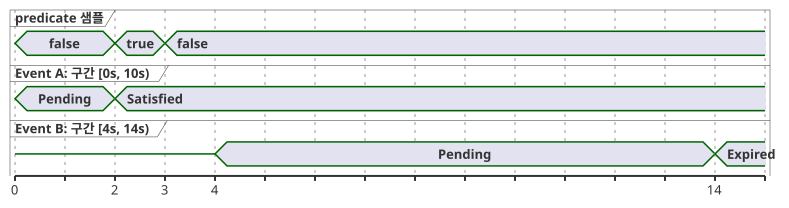
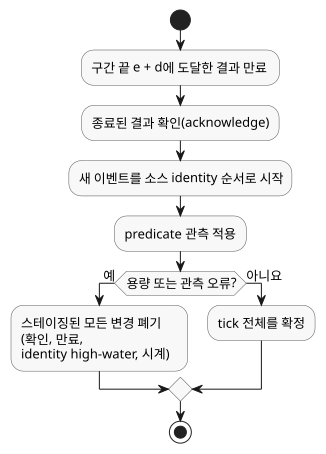

<!-- translation-source: tasks/after-event-design.md -->
[영문 원문](after-event-design.md)

# `after_event` 설계 기록

상태: **제품 동작 선택됨, 제한된(bounded) Rust 선행 구성 요소 구현됨**.
이 기록은 Reference §4.4와 REF-04-026을 다룹니다. 컴파일러 구현이 수용되었다고
주장하지 않습니다.

이 문서의 내용:

- `after_event`의 요구 의미와 현재 구현된 범위
- 구현이 유지해야 하는 증거와 상태
- 겹치는 이벤트에 대해 선택된 동작
- 아직 열려 있는 계약과 다음 GFB 아티팩트 계약

## 요구 의미

`after_event(event, predicate, window: d, quality: measured)`는 식별된 이벤트의
타임스탬프 `e`부터 시작해 반개구간 `[e, e + d)`에서 predicate를 평가합니다.
정확한 끝 경계 `e + d`는 포함하지 않습니다. 결과는 서로 다른 이벤트 identity마다
따로 추적합니다. 제품 계약으로 명시적으로 선택하지 않는 한, 이를 하나의 전역
타이머로 축약해서는 안 됩니다.

아래 타이밍 다이어그램은 `d = 10s`일 때의 identity별 규칙을 보여 줍니다. 2 s의
predicate 샘플은 이벤트 A의 구간 안에 있으므로 A는 충족(Satisfied)됩니다. 이벤트
B는 그 샘플 이후인 4 s에 시작하므로, 그 샘플은 B에 대해 셀 수 없습니다. B는 자신의
구간의 제외된 끝에서 만료(Expired)됩니다. A가 B를 대체하지 않고, B도 A를 대체하지
않습니다.

**컴파일러 상태.** 컴파일러는 이제 `event started: Event;`를 파싱하고, 직접 형태
`after_event(started, valve_open, window: 10s, quality: measured)`를 타입 검사합니다.
실행할 수 없는 manifest descriptor에 다음을 기록합니다.

- 식별된 Event
- 직접 선언된 Bool 센서
- measured 품질
- 양수인 상수 Duration

공개 `compileSource` 경로는 Event 전달 ABI와 identity별 결과 ABI가 마련될
때까지 여전히 `after_event` 연산자에서 프로그램을 거부합니다. RED/GREEN 증거:
`node --test tests/after-event-contract.test.mjs`(이전 0/7, 이후 7/7).
REF-04-026의 수용 fixture는 아직 실행 가능한 의미를 증명하지 않습니다.

**Rust 선행 구성 요소.** native 빌딩 블록은
`crates/ghostflow-core::after_event::AfterEvent<N>`입니다. 이 구성 요소는 다음과
같습니다.

- 고정 크기 `[Option<EventResult>; N]` 저장소를 사용합니다.
- 각 `EventKey`를 독립적으로 추적합니다.
- measured predicate를 `[e,e+d)` 안에서만 적용합니다.
- 배타적 끝 경계에서 결과를 만료시킵니다.
- 종료된 결과의 확인(acknowledgement)을 트랜잭션으로 스테이징합니다.

집중 증명은 `cargo test -p ghostflow-core --test after_event`(10/10)입니다.

`stage_batch`는 한 tick을 원자적으로 스테이징하며, 순서는 다음과 같습니다. 만료,
종료된 결과의 확인, 소스 identity 순서에 따른 시작, 그리고 predicate 관측입니다.
그 결과는 다음과 같습니다.

- 시작 타임스탬프의 predicate는 동시에 시작된 모든 이벤트를 충족시킬 수 있습니다.
- 더 오래된 이벤트의 정확한 끝 시점에 있는 predicate는 그 오래된 이벤트를 충족시킬
  수 없습니다.
- 용량 오류나 관측 오류가 발생하면 스테이징된 모든 변경을 폐기합니다. 여기에는
  확인, 만료, 소스 identity high-water mark, 시계 진행이 포함됩니다. 명시적
  rollback도 같은 격리를 제공합니다.

이것은 native API 선행 구성 요소입니다. 공개 Event 바인딩도, 스칼라 신호 투영
계약도 아닙니다. GFB/WASM 인코딩, 이벤트 바인딩, identity별 투영,
checkpoint/replay, provenance 통합은 아직 열려 있습니다.

## 요구되는 증거와 상태

- 각 물리 predicate 샘플은 샘플 타임스탬프, epoch, id, 품질, 값을 가집니다. 이벤트
  발생은 자체 타임스탬프와 구별되는 identity를 가집니다.
- 이벤트 identity는 바인딩 계약 아래에서 불투명(opaque)하고 충돌에 안전해야 합니다.
  짧은 해시를 쓰는 지름길은 승인된 identity 방식이 아닙니다.
- 구현은 생성된 Event-present, Event-epoch, Event-id, Event-timestamp 입력이나
  이에 상응하는 명시적 ABI를 정의해야 합니다. 이들의 보존 방식과 소스 바인딩은
  검사할 수 있어야 합니다.
- 수용, 거부, 고장, 경계 평가는 다른 temporal evidence와 같은
  트랜잭션/checkpoint/증명 규칙을 따라야 합니다. 거부된 tick은 이벤트 상태나
  predicate 증거를 부분적으로 진행시킬 수 없습니다.
- replay/checkpoint 데이터는 이벤트 identity, 소스 타임스탬프, epoch, 그리고 새
  이벤트와 중복을 구별하는 데 필요한 증거를 보존해야 합니다.

## 선택된 겹치는 이벤트 동작

서로 다른 이벤트 identity마다 독립된 결과를 유지합니다. 겹치는 이벤트는 계속
구별할 수 있습니다. 새 이벤트가 더 오래된 대기 중 결과나 완료된 결과를 대체하지
않습니다. 이 결정은 언어 동작을 고정합니다. 다만 제한된 투영, 보존, 재생 인코딩,
자원 구조(resource geometry)는 아직 선택하지 않습니다.

## 그 밖의 미해결 계약

- **여러 활성 이벤트 결과의 스칼라 투영과 보존.** 예를 들어 이벤트 A가 만료되고
  겹치는 이벤트 B가 충족된 경우, Reference 형태 `opened |> recover(false)`는 어느
  identity가 스칼라 Bool을 제공하는지 말하지 않습니다. 지금 GFB 투영을 인코딩하면
  `latest`, `oldest`, `any` 중 하나를 암묵적으로 선택하게 됩니다. 이들 중 어느 것도
  그 자체로는 선택된 identity별 결과 계약을 보존하지 않습니다. 아티팩트에는 명시적인
  identity 색인 결과 뷰(또는 명시적 투영 규칙)와 보존 결과 수의 상한이 필요합니다.
- 대기 중(pending) 결과와 부정(negative) 결과의 의미
- 이벤트와 predicate 샘플의 지연(lateness) 및 전달 한도
- 이벤트 고장 영역과 품질 전이
- 단조 시계 영역과 epoch 재설정 동작
- 겹치는 이벤트와 checkpoint 증명에 대한 자원 한도

## 다음 GFB 아티팩트 계약

새로운 버전의 prelude는 다음을 담을 수 있습니다.

- site/이름
- Event 소스 태그/이름
- Bool 센서 소스 태그/이름
- 양수 구간과 measured 품질
- Event 존재 여부, 소스 epoch, id, 타임스탬프, 그리고 predicate 샘플의 identity,
  타임스탬프, 값, 품질에 대한 고정 입력 바인딩

활성화 전에 로더는 필드 타입, 서로 다른 바인딩, 소스 identity, 자원 한도를
검증해야 합니다. 이벤트별 결과 투영에는 Event 키와 Pending/Satisfied/Expired
상태가 포함되어야 합니다.

이제 런타임 tick 처리는 같은 타임스탬프의 시작과 predicate 관측에 대해
`AfterEvent<N>::stage_batch`를 사용하여 한 번의 확정 또는 rollback으로 처리할 수
있습니다. 호스트에는 여전히 명시적인 전달 바인딩과 자원 구조가 필요합니다. 공개 GFB
descriptor가 실행 지원을 주장하려면 그 전에 identity 색인 투영과 그 스칼라
소비자의 의미가 해결되어야 합니다. 그때까지는 컴파일러의 현재 위치 지정 진단이
수용 경계로 남습니다.

생성된 Event-present/epoch/id/timestamp 입력이라는 후보는 구현 방향일 뿐입니다.
승인된 ABI나 언어 확장이 아닙니다. 설치된 프로그램 증거, 영속적인 §6.8 identity,
하드웨어 이벤트 전달, 물리 입출력은 이 설계 기록의 범위 밖입니다.
