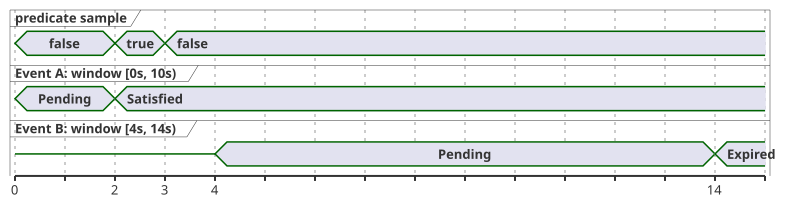
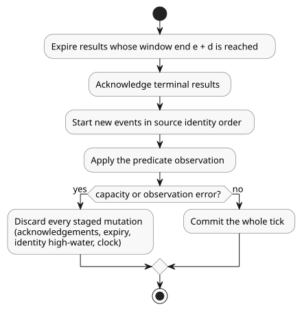

# `after_event` design record

Status: **product behavior selected; bounded Rust prerequisite implemented**.
This record covers Reference §4.4 and REF-04-026. It does not claim that the
compiler implementation is accepted.

In this document:

- the required meaning of `after_event` and what is implemented today;
- the evidence and state an implementation must keep;
- the selected behavior for overlapping events;
- contracts that are still open, and the next GFB artifact contract.

## Required meaning

`after_event(event, predicate, window: d, quality: measured)` evaluates the
predicate starting at the identified event's timestamp `e`, over the half-open
interval `[e, e + d)`. The exact end boundary `e + d` is excluded. The result is
tracked separately for each distinct event identity. It must not be reduced to
one global timer unless that is explicitly selected as the product contract.

The timing diagram below illustrates the per-identity rule with `d = 10s`. A
predicate sample at 2 s falls inside event A's window, so A is satisfied. Event
B starts at 4 s, after that sample, so the sample cannot count for B; B expires
at the excluded end of its own window. A does not replace B, and B does not
replace A.

**Compiler status.** The compiler now parses `event started: Event;` and type
checks the direct `after_event(started, valve_open, window: 10s, quality: measured)`
form. It records the following in a non-executable manifest descriptor:

- the identified Event;
- the directly declared Bool sensor;
- the measured quality;
- the positive constant Duration.

The public `compileSource` path still rejects the program at the `after_event`
operator until the Event delivery ABI and the per-identity result ABI are
available. RED/GREEN evidence: `node --test tests/after-event-contract.test.mjs`
(0/7 before, 7/7 after). REF-04-026's acceptance fixture does not yet prove
executable semantics.

**Rust prerequisite.** The native building block is
`crates/ghostflow-core::after_event::AfterEvent<N>`. It:

- uses fixed `[Option<EventResult>; N]` storage;
- tracks each `EventKey` independently;
- applies measured predicates only in `[e,e+d)`;
- expires a result at the exclusive end boundary;
- stages terminal acknowledgement transactionally.

The focused proof is `cargo test -p ghostflow-core --test after_event` (10/10).

`stage_batch` stages one tick atomically, in this order: expiry, acknowledgement
of terminal results, starts in source identity order, then the predicate
observation. Consequences:

- A predicate at the start timestamp can satisfy all simultaneous starts.
- A predicate at an older event's exact end cannot satisfy that older event.
- A capacity or observation error discards every staged mutation, including
  acknowledgements, expiry, the source identity high-water mark, and clock
  advancement. An explicit rollback gives the same isolation.

This is a native API prerequisite. It is not a public Event binding and not a
scalar signal projection contract. GFB/WASM encoding, event binding,
per-identity projection, checkpoint/replay, and provenance integration remain
open.

## Required evidence and state

- Each physical predicate sample carries a sample timestamp, epoch, id, quality,
  and value. The event occurrence carries its own timestamp and a distinct
  identity.
- Event identity must remain opaque and collision-safe under the binding
  contract. A short-hash shortcut is not an approved identity scheme.
- The implementation must define generated Event-present, Event-epoch,
  Event-id, and Event-timestamp inputs, or an equivalent explicit ABI. Their
  retention and source binding must be inspectable.
- Accepted, rejected, faulted, and boundary evaluations must follow the same
  transaction/checkpoint/proof rules as other temporal evidence. A rejected
  tick cannot partially advance event state or predicate evidence.
- Replay/checkpoint data must preserve event identity, source timestamp, epoch,
  and the evidence needed to tell a new event from a duplicate.

## Selected overlapping-event behavior

Keep an independent result for every distinct event identity. Overlapping
events remain distinguishable. A new event does not replace an older pending or
completed result. This decision fixes the language behavior. It does not yet
choose the bounded projection, retention, replay encoding, or resource geometry.

## Other unresolved contracts

- **Scalar projection and retention of multiple active event results.** For
  example, if event A has expired and overlapping event B is satisfied, the
  Reference form `opened |> recover(false)` does not say which identity supplies
  the scalar Bool. Encoding a GFB projection now would silently choose `latest`,
  `oldest`, or `any`. None of these preserves the selected per-identity result
  contract by itself. The artifact needs an explicit identity-indexed result
  view (or an explicit projection rule) and a bound on retained results.
- The meaning of pending and negative results.
- Lateness and delivery bounds for events and predicate samples.
- The event fault domain and quality transitions.
- The monotonic clock domain and epoch reset behavior.
- Resource limits for overlapping events and checkpoint proofs.

## Next GFB artifact contract

A new versioned prelude can carry:

- the site/name;
- the Event source tag/name;
- the Bool sensor source tag/name;
- the positive window and the measured quality;
- fixed input bindings for Event presence, source epoch, id and timestamp, and
  for the predicate sample's identity, timestamp, value and quality.

Before activation, the loader must verify field types, distinct bindings, source
identity, and resource bounds. Its per-event result projection must include the
Event key and a Pending/Satisfied/Expired status.

Runtime tick processing can now use `AfterEvent<N>::stage_batch` for starts and
a predicate observation at the same timestamp, with one commit or rollback. The
host still needs an explicit delivery binding and resource geometry. The
identity-indexed projection and the meaning of its scalar consumer must be
resolved before a public GFB descriptor can claim executable support. Until
then, the compiler's current located diagnostic remains the acceptance boundary.

The candidate of generated Event-present/epoch/id/timestamp inputs is only an
implementation direction. It is not an approved ABI or language extension.
Installed-program evidence, durable §6.8 identities, hardware event delivery,
and physical I/O are outside this design record.
