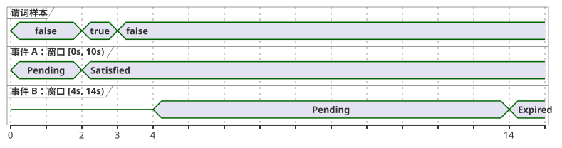
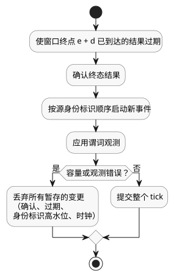

<!-- translation-source: tasks/after-event-design.md -->
[英文原文](after-event-design.md)

# `after_event` 设计记录

状态：**已选定产品行为；有界的 Rust 前置条件已实现**。
本记录涵盖 Reference §4.4 和 REF-04-026。它并不声称编译器实现已被验收。

本文内容：

- `after_event` 的必需含义以及目前已实现的部分；
- 实现必须保留的证据和状态；
- 针对重叠事件选定的行为；
- 仍未确定的契约，以及下一个 GFB 产物契约。

## 必需含义

`after_event(event, predicate, window: d, quality: measured)` 从所识别事件的时间戳 `e`
开始，在半开区间 `[e, e + d)` 上对谓词求值。确切的结束边界 `e + d` 不包含在内。结果按每个
不同的事件身份标识分别跟踪。除非明确将其选定为产品契约，否则不得将其归约为一个全局定时器。

下面的时序图以 `d = 10s` 说明按身份标识区分的规则。2 s 时的谓词样本落在事件 A 的窗口内，
因此 A 被满足。事件 B 在 4 s 开始，晚于该样本，因此该样本不能计入 B；B 在其自身窗口的
不包含的终点处过期。A 不会取代 B，B 也不会取代 A。

**编译器状态。** 编译器现在可以解析 `event started: Event;`，并对直接形式
`after_event(started, valve_open, window: 10s, quality: measured)` 进行类型检查。它在一个
不可执行的清单（manifest）描述符中记录以下内容：

- 所识别的 Event；
- 直接声明的 Bool 传感器；
- measured 质量；
- 正的常量 Duration。

在 Event 投递 ABI 和按身份标识的结果 ABI 可用之前，公共的 `compileSource` 路径仍会在
`after_event` 运算符处拒绝该程序。RED/GREEN 证据：`node --test tests/after-event-contract.test.mjs`
（之前 0/7，之后 7/7）。REF-04-026 的验收夹具尚未证明可执行语义。

**Rust 前置条件。** 原生构建块是 `crates/ghostflow-core::after_event::AfterEvent<N>`。它：

- 使用固定的 `[Option<EventResult>; N]` 存储；
- 独立跟踪每个 `EventKey`；
- 仅在 `[e,e+d)` 内应用测量的谓词；
- 在不包含的结束边界处使结果过期；
- 以事务方式暂存终态确认。

针对性证明是 `cargo test -p ghostflow-core --test after_event`（10/10）。

`stage_batch` 以原子方式暂存一个 tick，顺序为：过期、终态结果的确认、按源身份标识顺序
启动，然后是谓词观测。由此得出：

- 位于开始时间戳的谓词可以满足所有同时开始的事件。
- 位于较早事件确切终点的谓词不能满足该较早事件。
- 容量错误或观测错误会丢弃所有暂存的变更，包括确认、过期、源身份标识高水位和时钟推进。
  显式回滚提供相同的隔离。

这是一个原生 API 前置条件。它不是公共的 Event 绑定，也不是标量信号投影契约。GFB/WASM
编码、事件绑定、按身份标识的投影、检查点/重放以及来源（provenance）集成仍未确定。

## 必需的证据和状态

- 每个物理谓词样本都带有样本时间戳、纪元（epoch）、id、质量和值。事件触发带有自己的
  时间戳和不同的身份标识。
- 在绑定契约下，事件身份标识必须保持不透明且防冲突。短哈希捷径不是经批准的身份标识方案。
- 实现必须定义生成的 Event-present、Event-epoch、Event-id 和 Event-timestamp 输入，
  或等价的显式 ABI。它们的保留和源绑定必须可检查。
- 被接受、被拒绝、出现故障以及位于边界的求值，必须遵循与其他时间证据相同的
  事务/检查点/证明规则。被拒绝的 tick 不能部分推进事件状态或谓词证据。
- 重放/检查点数据必须保留事件身份标识、源时间戳、纪元，以及区分新事件与重复事件所需的证据。

## 选定的重叠事件行为

为每个不同的事件身份标识保留独立的结果。重叠的事件保持可区分。新事件不会取代较早的
待定或已完成结果。此决定确定了语言行为。它尚未选定有界投影、保留、重放编码或资源几何。

## 其他未解决的契约

- **多个活动事件结果的标量投影与保留。** 例如，如果事件 A 已过期而重叠的事件 B 被满足，
  Reference 形式 `opened |> recover(false)` 并未说明由哪个身份标识提供标量 Bool。现在就编码
  一个 GFB 投影，会悄悄地选择 `latest`、`oldest` 或 `any`。这些选择本身都无法保持选定的
  按身份标识结果契约。产物需要一个显式的按身份标识索引的结果视图（或显式的投影规则），
  以及保留结果数量的上限。
- 待定结果和否定结果的含义。
- 事件和谓词样本的延迟及投递界限。
- 事件故障域和质量转换。
- 单调时钟域以及纪元重置行为。
- 重叠事件和检查点证明的资源限制。

## 下一个 GFB 产物契约

一个新的带版本的前导（prelude）可以携带：

- 站点/名称；
- Event 源标签/名称；
- Bool 传感器源标签/名称；
- 正的窗口以及 measured 质量；
- 用于 Event 存在、源纪元、id 和时间戳，以及谓词样本的身份标识、时间戳、值和质量的
  固定输入绑定。

在激活之前，加载器必须验证字段类型、不同的绑定、源身份标识和资源界限。它的按事件结果
投影必须包含 Event 键以及 Pending/Satisfied/Expired 状态。

运行时 tick 处理现在可以使用 `AfterEvent<N>::stage_batch`，在同一时间戳处理开始和谓词观测，
并进行一次提交或回滚。宿主仍需要显式的投递绑定和资源几何。在公共 GFB 描述符能够声称
支持可执行之前，必须先解决按身份标识索引的投影及其标量消费者的含义。在此之前，编译器
当前带位置信息的诊断仍是验收边界。

生成 Event-present/epoch/id/timestamp 输入这一候选方案只是一个实现方向。它不是经批准的
ABI 或语言扩展。已安装程序的证据、持久的 §6.8 身份标识、硬件事件投递以及物理 I/O
不在本设计记录的范围内。
