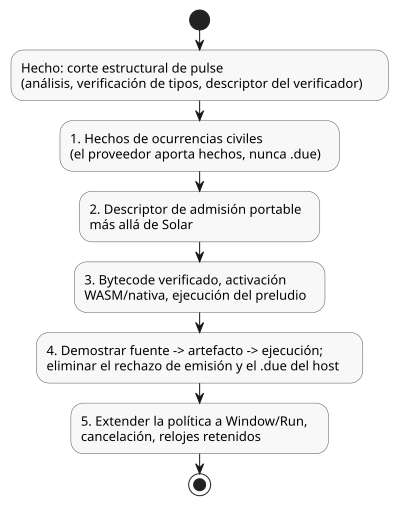

<!-- translation-source: tasks/civil-schedule-reference-integration.md -->
[Original en inglés](civil-schedule-reference-integration.md)

# Integración de las programaciones civiles con la Referencia

Fuente de verdad: [Referencia §3.5–3.8](../docs/reference/03-time-and-schedules.es.md).
Este es un registro de implementación. No sustituye al contrato del lenguaje.

## Corte estructural implementado

`REF-03-024` (`Daily`) y `REF-03-032` (`DailySlots<15min>`) ahora analizan y
verifican los tipos de su política de pulso explícita. El verificador conserva:

- el sitio estable de la declaración;
- la zona horaria;
- el disparador exacto;
- las opciones de DST;
- el predicado Bool;
- las políticas comunes.

`Daily` conserva los milisegundos exactos de TimeOfDay, incluidos 00:00 y
23:59:59.999. `DailySlots` conserva franjas de minutos ordenadas y únicas, y su
cuadrícula de 15 minutos.

La política estructural admitida en este corte es `pulse`, `trusted_only`,
`skip_after(positive constant Duration)`, `baseline`, `skip`. Los siguientes casos
reciben diagnósticos: campos ausentes o duplicados, un tipo o dominio inválido, un
predicado que no es Bool, una zona inválida y franjas inválidas. Los valores enum de
DST se conservan sin aparentar que un proveedor ya haya resuelto los solapamientos
(folds) o los huecos (gaps).

El descriptor es solo una salida del verificador. No define una ABI aceptada de
bytecode, de paquete ni de activación. Las programaciones con una política explícita
no reciben el antiguo `dueInput` del host. La compilación pública se detiene
deliberadamente con:

```text
Daily policy execution requires verified occurrence provider and native admission bindings
DailySlots policy execution requires verified occurrence provider and native admission bindings
```

Por lo tanto, **REF-03-024 y REF-03-032 siguen siendo fallos de aceptación
ejecutables**. Sus expectativas de aceptación originales no cambian. La antigua ruta
de `DailySlots` sin política todavía no ha sido reemplazada por una implementación
aceptada, y este corte no certifica esa ruta frente a la Referencia. Una vez que el
reemplazo canónico se ejecute y se verifique, elimine la ruta antigua y migre sus
llamadores activos.

Evidencia: `tests/daily-slots-policy.test.mjs` usa directamente ambos fixtures de la
Referencia. Las pruebas iniciales fallaron en la antigua sintaxis no admitida. Tras la
implementación, las nuevas pruebas estructurales/de diagnóstico, junto con las
comprobaciones existentes de duplicados y de control, pasan (52 pruebas;
`build/daily-policy-green.log`). La compilación pública de la Referencia sigue
fallando en el diagnóstico explícito de vinculación de runtime ausente.

## Integración pendiente, en orden

El diagrama siguiente resume en qué punto está el corte estructural y los cinco pasos
restantes, que deben realizarse en este orden.



1. Definir hechos de ocurrencias civiles acotados y completos; una identidad estable
   de fecha/hora local/fold; revisiones de IANA/contexto; y la cobertura del reloj.
   El proveedor aporta los hechos; no debe calcular `.due`.
2. Extender el descriptor de admisión portable más allá de Solar. Preservar la
   evaluación de predicados arbitrarios, la marca máxima (high-water mark) del reloj
   de los escaneos aceptados, la línea base de recuperación, la terminalización de
   huecos, los resultados por ocurrencia y la omisión ante varios cruces. El
   descriptor de programación GFB5 existente es específicamente
   `SolarPulseDescriptor`; reutilizar su etiqueta para un disparador distinto sería un
   contrato de transmisión inválido.
3. Agregar bytecode verificado, la vinculación de activación WASM/nativa y la
   ejecución del preludio ordenada por dependencias. Incluir las dependencias del
   predicado respecto de lets/signals/schedules, la reversión de transacciones, la
   contabilización acotada de recursos y replay/restore.
4. Demostrar fuente literaria pública -> artefacto -> ejecución nativa/WASM para: un
   cruce diario, un predicado falso, un límite exacto de hueco, la recuperación, la
   reversión, varios cruces, gap/fold de DST y la reversión ante un fallo aguas abajo.
   Luego, eliminar el rechazo explícito de emisión y la ruta `.due` del host que quedó
   reemplazada.
5. Extender la política común a Window/Run, la cancelación y los relojes retenidos,
   con su significado de ejecución completo. El corte estructural de pulse no completa
   esas formas válidas de la Referencia.

## Otros casos solicitados de la Referencia: primer fallo observado

Estos diagnósticos se observaron mediante `compileSource` sobre los fixtures reales
del catálogo antes de este corte. Cada uno describe solo el primer bloqueo, no el
alcance completo del trabajo.

| Caso | Fallo observado | Contrato adicional requerido |
|---|---|---|
| REF-03-036 | Se rechaza el tipo de programación Periodic | ancla explícita, fase/revisión del intervalo en vivo, proveedor de ocurrencias y admisión |
| REF-03-038 | Se rechaza el tipo de programación Cron | analizador de cron5 y comprobaciones de dominio, proveedor de ocurrencias civiles y admisión |
| REF-03-042/045 | Se rechaza la opción `basis` de Solar | reducción (lowering) pública de la política común a los requisitos previos estructurales/de admisión nativa de GFB5 existentes; sigue siendo necesaria la vinculación de proveedor/runtime |
| REF-03-057 | Se rechaza la configuración `TimeSlots<15min,8>` | tipo de conjunto finito, validación/atomicidad de ajustes en vivo, vinculación a la cuadrícula de la programación y línea base/identidad ante ediciones |
| REF-03-059 | Se rechaza la declaración `calendar` | proveedor tipado de WorkCalendar, regla de días y observación de revisión/calidad |
| REF-03-060 | Se rechaza la declaración `provider` | hechos de Tide con identidad de evento estable, cancelación y admisión Run/within |
| REF-03-062 | Se rechaza la declaración `provider` | declaraciones de proveedores naturales y semántica de Result de `tide_is`/`moon_is` consciente de la calidad |
