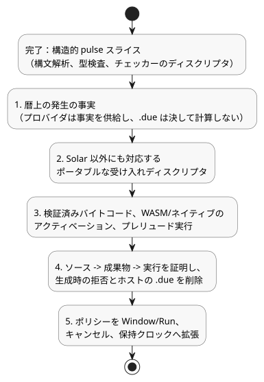

<!-- translation-source: tasks/civil-schedule-reference-integration.md -->
[英語の原文](civil-schedule-reference-integration.md)

# 暦スケジュールの Reference 統合

基準となる仕様：[Reference §3.5–3.8](../docs/reference/03-time-and-schedules.ja.md)。これは実装の記録です。言語の契約を置き換えるものではありません。

## 実装済みの構造的スライス

`REF-03-024`（`Daily`）と `REF-03-032`（`DailySlots<15min>`）は、現在、明示的な pulse ポリシーを構文解析し、型検査します。チェッカーは次の内容を保持します。

- 安定した宣言位置
- タイムゾーン
- 正確なトリガー
- DST の選択肢
- Bool の述語
- 共通ポリシー

`Daily` は、00:00 や 23:59:59.999 を含め、正確な TimeOfDay のミリ秒を保持します。`DailySlots` は、ソート済みで重複のない分単位のスロットと、その 15 分グリッドを保持します。

このスライスでサポートする構造的なポリシーは、`pulse`、`trusted_only`、`skip_after(positive constant Duration)`、`baseline`、`skip` です。次のものには診断が出されます：フィールドの欠落または重複、無効な型またはドメイン、Bool でない述語、無効なゾーン、無効なスロット。DST の列挙値は保持されますが、プロバイダがすでにフォールド（重複時刻）やギャップを解決したかのようには扱いません。

ディスクリプタはチェッカーの出力にすぎません。受け入れられたバイトコード、パッケージ、アクティベーション ABI を定義するものではありません。明示的なポリシーを持つスケジュールは、古いホストの `dueInput` を受け取りません。公開のコンパイルは、意図的に次のエラーで停止します。

```text
Daily policy execution requires verified occurrence provider and native admission bindings
DailySlots policy execution requires verified occurrence provider and native admission bindings
```

したがって、**REF-03-024 と REF-03-032 は、引き続き実行可能性の受け入れに失敗します**。それらの元の受け入れ期待値は変更されていません。ポリシーなしの古い `DailySlots` 経路は、まだ受け入れられた実装に置き換えられておらず、このスライスはその経路が Reference に適合することを保証しません。正本の置き換えが実行され検証されたら、古い経路を削除し、それを使っている呼び出し元を移行してください。

証拠：`tests/daily-slots-policy.test.mjs` は、両方の Reference フィクスチャを直接使います。最初のテストは、古いサポート外の構文で失敗しました。実装後は、新しい構造/診断テストに加え、既存の重複検査と制御の検査が合格します（52 テスト、`build/daily-policy-green.log`）。公開の Reference のコンパイルは、引き続き、ランタイムバインディングの欠落を示す明示的な診断で失敗します。

## 残りの統合作業（順序どおり）

次の図は、構造的スライスの現状と、この順序で行わなければならない残り 5 つの手順をまとめたものです。



1. 有界かつ完全な暦上の発生（occurrence）の事実、安定したローカル日付/時刻/フォールドの同一性、IANA/コンテキストのリビジョン、クロックのカバレッジを定義します。プロバイダは事実を供給します。`.due` を計算してはなりません。
2. ポータブルな受け入れ（admission）ディスクリプタを Solar 以外にも拡張します。任意の述語の評価、受け入れたスキャンのクロックのハイウォーターマーク、復旧のベースライン、ギャップの終端処理、発生ごとの結果、複数回の通過のスキップを保持します。既存の GFB5 のスケジュールディスクリプタは、明確に `SolarPulseDescriptor` です。そのタグを別のトリガーに再利用すると、無効なワイヤ契約になります。
3. 検証済みのバイトコード、WASM/ネイティブのアクティベーションバインディング、依存関係順のプレリュード実行を追加します。lets/signals/schedules への述語の依存関係、トランザクションのロールバック、有界なリソース計上、リプレイ/復元を含めます。
4. 公開の文芸的ソース -> 成果物 -> ネイティブ/WASM 実行を、次の場合について証明します：1 日 1 回の通過、false の述語、正確なギャップ境界、復旧、ロールバック、複数回の通過、DST のギャップ/フォールド、下流の失敗時のロールバック。その後、明示的な生成時の拒否と、置き換えられたホストの `.due` 経路を削除します。
5. 共通ポリシーを Window/Run、キャンセル、保持クロックへ、完全な実行上の意味とともに拡張します。pulse の構造的スライスは、それらの有効な Reference 形式を完成させるものではありません。

## 要求されたその他の Reference ケース：観測された最初の失敗

これらの診断は、このスライスの前に、実際のカタログのフィクスチャに対して `compileSource` を通して観測されたものです。それぞれ最初の阻害要因だけを示しており、作業範囲全体を示すものではありません。

| ケース | 観測された失敗 | 追加で必要な契約 |
|---|---|---|
| REF-03-036 | Periodic スケジュールの種類が拒否される | 明示的なアンカー、ライブな間隔の位相/リビジョン、発生プロバイダと受け入れ |
| REF-03-038 | Cron スケジュールの種類が拒否される | cron5 のパーサー/ドメイン検査、暦上の発生プロバイダと受け入れ |
| REF-03-042/045 | Solar の `basis` オプションが拒否される | 既存の GFB5 の構造的/ネイティブ受け入れの前提部品への、公開の共通ポリシーの変換。プロバイダ/ランタイムのバインディングは引き続き必要 |
| REF-03-057 | `TimeSlots<15min,8>` の設定が拒否される | 有限集合型、ライブ設定の検証/アトミック性、スケジュールグリッドのバインディング、編集時のベースライン/同一性 |
| REF-03-059 | `calendar` 宣言が拒否される | 型付きの WorkCalendar プロバイダ、日ルール、リビジョン/品質の観測 |
| REF-03-060 | `provider` 宣言が拒否される | 安定したイベント同一性を持つ Tide の事実、キャンセル、Run/within の受け入れ |
| REF-03-062 | `provider` 宣言が拒否される | 自然なプロバイダ宣言と、品質を考慮した `tide_is`/`moon_is` の Result セマンティクス |
