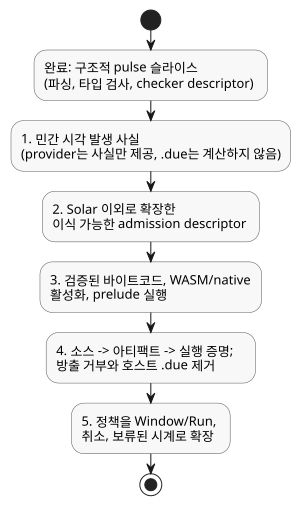

<!-- translation-source: tasks/civil-schedule-reference-integration.md -->
[영문 원문](civil-schedule-reference-integration.md)

# 민간 시각 예약의 Reference 통합

기준: [Reference §3.5–3.8](../docs/reference/03-time-and-schedules.md).
이 문서는 구현 기록입니다. 언어 계약을 대체하지 않습니다.

## 구현된 구조적 슬라이스

`REF-03-024`(`Daily`)와 `REF-03-032`(`DailySlots<15min>`)는 이제 명시적인 pulse
정책을 파싱하고 타입 검사합니다. checker는 다음을 보존합니다.

- 안정적인 선언 위치
- 시간대
- 정확한 트리거
- DST 선택
- Bool predicate
- 공통 정책

`Daily`는 00:00과 23:59:59.999를 포함한 정확한 TimeOfDay 밀리초 값을 보존합니다.
`DailySlots`는 정렬되고 중복 없는 분 단위 슬롯과 15분 격자를 보존합니다.

이 슬라이스에서 지원하는 구조적 정책은 `pulse`, `trusted_only`,
`skip_after(positive constant Duration)`, `baseline`, `skip`입니다. 다음 경우에는
진단이 발생합니다. 필드 누락 또는 중복, 잘못된 타입 또는 도메인, Bool이 아닌
predicate, 잘못된 시간대, 잘못된 슬롯. DST enum 값은 provider가 이미 fold나 gap을
해석한 것처럼 가장하지 않고 그대로 보존합니다.

descriptor는 checker 출력일 뿐입니다. 수용된 바이트코드, 패키지, 활성화 ABI를
정의하지 않습니다. 명시적 정책이 있는 예약은 기존 호스트 `dueInput`을 받지
않습니다. 공개 컴파일은 의도적으로 다음 메시지와 함께 중단됩니다.

```text
Daily policy execution requires verified occurrence provider and native admission bindings
DailySlots policy execution requires verified occurrence provider and native admission bindings
```

따라서 **REF-03-024와 REF-03-032는 여전히 실행 수용 실패입니다**.
원래의 수용 기대값은 바뀌지 않았습니다. 정책이 없는 기존 `DailySlots` 경로는 아직
수용된 구현으로 대체되지 않았으며, 이 슬라이스는 그 경로를 Reference에 비추어
인증하지 않습니다. 정본 대체 구현이 실행되고 검증되면 기존 경로를 제거하고, 그
경로를 쓰는 활성 호출자를 이전해야 합니다.

증거: `tests/daily-slots-policy.test.mjs`는 두 Reference fixture를 직접 사용합니다.
초기 테스트는 지원되지 않던 기존 구문에서 실패했습니다. 구현 후에는 새
구조/진단 테스트와 기존 중복 검사 및 제어 검사가 통과합니다(52개 테스트;
`build/daily-policy-green.log`). 공개 Reference 컴파일은 여전히 명시적인
런타임 바인딩 누락 진단에서 실패합니다.

## 남은 통합 작업(순서대로)

아래 다이어그램은 구조적 슬라이스의 현재 위치와, 반드시 이 순서대로 수행해야 하는
남은 다섯 단계를 요약합니다.



1. 제한되고 완전한 민간 시각 발생(occurrence) 사실, 안정적인
   local-date/time/fold identity, IANA/컨텍스트 revision, 시계 커버리지를
   정의합니다. provider는 사실을 제공하며, `.due`를 계산해서는 안 됩니다.
2. 이식 가능한 admission descriptor를 Solar 이외로 확장합니다. 임의의 predicate
   평가, 수용된 스캔의 시계 high-water mark, 복구 baseline, gap 종결 처리,
   발생별 결과, 여러 번의 경계 통과에 대한 skip을 보존해야 합니다. 기존 GFB5 예약
   descriptor는 특히 `SolarPulseDescriptor`이므로, 그 태그를 다른 트리거에
   재사용하면 잘못된 wire 계약이 됩니다.
3. 검증된 바이트코드, WASM/native 활성화 바인딩, 의존성 순서에 따른 prelude 실행을
   추가합니다. let/signal/예약에 대한 predicate 의존성, 트랜잭션 rollback, 제한된
   자원 집계, replay/restore를 포함해야 합니다.
4. 공개 문서형 소스 -> 아티팩트 -> native/WASM 실행을 다음 경우에 대해 증명합니다.
   하루 한 번의 경계 통과, false predicate, 정확한 gap 경계, 복구, rollback, 여러 번의
   경계 통과, DST gap/fold, 하위 단계 실패 rollback. 그런 다음 명시적인 방출 거부와
   대체된 호스트 `.due` 경로를 제거합니다.
5. 공통 정책을 Window/Run, 취소, 보류된 시계까지 그 완전한 실행 의미와 함께
   확장합니다. pulse 구조적 슬라이스는 이러한 유효한 Reference 형태를 완성하지
   않습니다.

## 요청된 그 밖의 Reference 사례: 관측된 첫 실패

이 진단은 이 슬라이스 이전에 실제 카탈로그 fixture에 대해 `compileSource`로
관측한 것입니다. 각 항목은 첫 번째 차단 요인만 설명하며, 전체 작업 범위를 나타내지
않습니다.

| 사례 | 관측된 실패 | 추가로 필요한 계약 |
|---|---|---|
| REF-03-036 | Periodic 예약 종류 거부 | 명시적 anchor, live 주기 위상/revision, 발생 provider와 admission |
| REF-03-038 | Cron 예약 종류 거부 | cron5 파서/도메인 검사, 민간 시각 발생 provider와 admission |
| REF-03-042/045 | Solar `basis` 옵션 거부 | 기존 GFB5 구조/native admission 선행 요건으로의 공개 공통 정책 lowering; provider/런타임 바인딩은 여전히 필요 |
| REF-03-057 | `TimeSlots<15min,8>` config 거부 | 유한 집합 타입, live 설정 검증/원자성, 예약 격자 바인딩, 편집 시 baseline/identity |
| REF-03-059 | `calendar` 선언 거부 | 타입이 있는 WorkCalendar provider, 날짜 규칙, revision/품질 관측 |
| REF-03-060 | `provider` 선언 거부 | 안정적인 이벤트 identity가 있는 Tide 사실, 취소, Run/within admission |
| REF-03-062 | `provider` 선언 거부 | 자연 현상 provider 선언과 품질을 고려한 `tide_is`/`moon_is` Result 의미 |
