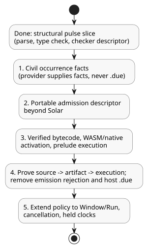

# Civil schedule Reference integration

Ground truth: [Reference §3.5–3.8](../docs/reference/03-time-and-schedules.md).
This is an implementation record. It does not replace the language contract.

## Implemented structural slice

`REF-03-024` (`Daily`) and `REF-03-032` (`DailySlots<15min>`) now parse and type
check their explicit pulse policy. The checker retains:

- the stable declaration site;
- the timezone;
- the exact trigger;
- the DST choices;
- the Bool predicate;
- the common policies.

`Daily` retains exact TimeOfDay milliseconds, including 00:00 and 23:59:59.999.
`DailySlots` retains sorted, unique minute slots and its 15-minute grid.

The structural policy supported in this slice is `pulse`, `trusted_only`,
`skip_after(positive constant Duration)`, `baseline`, `skip`. The following
receive diagnostics: missing or duplicate fields, an invalid type or domain, a
non-Bool predicate, an invalid zone, and invalid slots. DST enum values are
retained without pretending that a provider has already resolved folds or gaps.

The descriptor is checker output only. It does not define an accepted bytecode,
package or activation ABI. Schedules with an explicit policy do not receive the
old host `dueInput`. Public compilation deliberately stops with:

```text
Daily policy execution requires verified occurrence provider and native admission bindings
DailySlots policy execution requires verified occurrence provider and native admission bindings
```

Therefore **REF-03-024 and REF-03-032 remain executable acceptance failures**.
Their original acceptance expectations remain unchanged. The old no-policy
`DailySlots` route has not yet been replaced by an accepted implementation, and
this slice does not certify that route against the Reference. Once the canonical
replacement executes and is verified, remove the old route and migrate its
active callers.

Evidence: `tests/daily-slots-policy.test.mjs` uses both Reference fixtures
directly. The initial tests failed at the old unsupported syntax. After
implementation, the new structural/diagnostic tests plus the existing duplicate
and control checks pass (52 tests; `build/daily-policy-green.log`). Public
Reference compilation still fails at the explicit missing-runtime-binding
diagnostic.

## Remaining integration, in order

The diagram below summarizes where the structural slice stands and the five
remaining steps, which must be done in this order.



1. Define bounded, complete civil occurrence facts; a stable
   local-date/time/fold identity; IANA/context revisions; and clock coverage.
   The provider supplies facts; it must not compute `.due`.
2. Extend the portable admission descriptor beyond Solar. Preserve arbitrary
   predicate evaluation, the accepted-scan clock high-water mark, the recovery
   baseline, gap terminalization, per-occurrence outcomes and multiple-crossing
   skip. The existing GFB5 schedule descriptor is specifically
   `SolarPulseDescriptor`; reusing its tag for a different trigger would be an
   invalid wire contract.
3. Add verified bytecode, WASM/native activation binding and dependency-ordered
   prelude execution. Include predicate dependencies on lets/signals/schedules,
   transaction rollback, bounded resource accounting and replay/restore.
4. Prove public literate source -> artifact -> native/WASM execution for: one
   daily crossing, a false predicate, an exact gap boundary, recovery, rollback,
   multiple crossings, DST gap/fold, and downstream failure rollback. Then
   remove the explicit emission rejection and the superseded host `.due` path.
5. Extend the common policy to Window/Run, cancellation and held clocks, with
   their full execution meaning. The pulse structural slice does not complete
   those valid Reference forms.

## Other requested Reference cases: observed first failure

These diagnostics were observed through `compileSource` on the actual catalog
fixtures before this slice. Each describes the first blocker only, not the
complete scope of work.

| Case | Observed failure | Required additional contract |
|---|---|---|
| REF-03-036 | Periodic schedule kind rejected | explicit anchor, live interval phase/revision, occurrence provider and admission |
| REF-03-038 | Cron schedule kind rejected | cron5 parser/domain checks, civil occurrence provider and admission |
| REF-03-042/045 | Solar `basis` option rejected | public common-policy lowering into existing GFB5 structural/native admission prerequisites; provider/runtime binding still required |
| REF-03-057 | `TimeSlots<15min,8>` config rejected | finite set type, live setting validation/atomicity, schedule grid binding and baseline/identity on edits |
| REF-03-059 | `calendar` declaration rejected | typed WorkCalendar provider, day rule and revision/quality observation |
| REF-03-060 | `provider` declaration rejected | Tide facts with stable event identity, cancellation and Run/within admission |
| REF-03-062 | `provider` declaration rejected | natural provider declarations and quality-aware `tide_is`/`moon_is` Result semantics |
