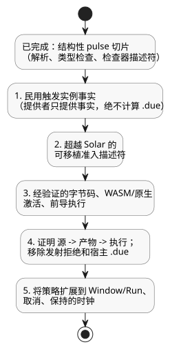

<!-- translation-source: tasks/civil-schedule-reference-integration.md -->
[英文原文](civil-schedule-reference-integration.md)

# 民用调度计划的 Reference 集成

基准：[Reference §3.5–3.8](../docs/reference/03-time-and-schedules.zh.md)。
这是一份实现记录。它不取代语言契约。

## 已实现的结构性切片

`REF-03-024`（`Daily`）和 `REF-03-032`（`DailySlots<15min>`）现在可以解析并类型检查其
显式的 pulse 策略。检查器保留：

- 稳定的声明位置；
- 时区；
- 确切的触发器；
- DST 选项；
- Bool 谓词；
- 通用策略。

`Daily` 保留精确的 TimeOfDay 毫秒数，包括 00:00 和 23:59:59.999。
`DailySlots` 保留经排序、唯一的分钟时段及其 15 分钟网格。

本切片支持的结构性策略是 `pulse`、`trusted_only`、`skip_after(positive constant Duration)`、
`baseline`、`skip`。以下情况会得到诊断：缺失或重复的字段、无效的类型或定义域、非 Bool
谓词、无效的时区以及无效的时段。DST 枚举值会被保留，但不会假装提供者已经解析了重叠
（fold）或间隙（gap）。

该描述符仅是检查器输出。它并未定义被接受的字节码、包或激活 ABI。带有显式策略的调度计划
不会接收旧的宿主 `dueInput`。公共编译会有意地停止并报告：

```text
Daily policy execution requires verified occurrence provider and native admission bindings
DailySlots policy execution requires verified occurrence provider and native admission bindings
```

因此，**REF-03-024 和 REF-03-032 仍然是可执行验收失败**。它们原有的验收预期保持不变。
旧的无策略 `DailySlots` 路径尚未被已验收的实现取代，本切片也未依据 Reference 认证该路径。
一旦规范的替代实现能够执行并通过验证，就移除旧路径并迁移其现有调用方。

证据：`tests/daily-slots-policy.test.mjs` 直接使用两个 Reference 夹具。最初的测试在旧的
不受支持语法处失败。实现之后，新的结构/诊断测试以及现有的重复与控制检查均通过
（52 个测试；`build/daily-policy-green.log`）。公共 Reference 编译仍在显式的
缺失运行时绑定诊断处失败。

## 剩余集成工作（按顺序）

下图总结了结构性切片目前所处的位置以及剩余的五个步骤，这些步骤必须按此顺序完成。



1. 定义有界、完整的民用触发实例（occurrence）事实；稳定的本地日期/时间/重叠身份标识；
   IANA/上下文修订版；以及时钟覆盖范围。提供者提供事实；它不得计算 `.due`。
2. 将可移植的准入描述符扩展到 Solar 之外。保留任意谓词求值、已接受扫描的时钟高水位、
   恢复基线、间隙终结、每个触发实例的结果以及多次跨越的跳过。现有的 GFB5 调度计划
   描述符专门是 `SolarPulseDescriptor`；将其标签重用于不同的触发器将构成无效的线路契约。
3. 添加经验证的字节码、WASM/原生激活绑定以及按依赖顺序的前导执行。包括谓词对
   let/signal/schedule 的依赖、事务回滚、有界资源核算以及重放/恢复。
4. 针对以下情况证明公共文学式源文件 -> 产物 -> 原生/WASM 执行：一次每日跨越、为 false
   的谓词、确切的间隙边界、恢复、回滚、多次跨越、DST 间隙/重叠以及下游失败回滚。
   然后移除显式的发射拒绝以及已被取代的宿主 `.due` 路径。
5. 将通用策略扩展到 Window/Run、取消和保持的时钟，并赋予其完整的执行含义。pulse 结构性
   切片并未完成这些有效的 Reference 形式。

## 其他请求的 Reference 用例：观察到的首个失败

这些诊断是在本切片之前，通过 `compileSource` 在实际目录夹具上观察到的。每一项只描述
第一个阻碍，而不是完整的工作范围。

| 用例 | 观察到的失败 | 所需的附加契约 |
|---|---|---|
| REF-03-036 | Periodic 调度计划类型被拒绝 | 显式锚点、实时间隔相位/修订版、触发实例提供者和准入 |
| REF-03-038 | Cron 调度计划类型被拒绝 | cron5 解析器/定义域检查、民用触发实例提供者和准入 |
| REF-03-042/045 | Solar `basis` 选项被拒绝 | 将公共通用策略降级到现有 GFB5 结构/原生准入前置条件；仍需要提供者/运行时绑定 |
| REF-03-057 | `TimeSlots<15min,8>` 配置被拒绝 | 有限集合类型、实时设置校验/原子性、调度计划网格绑定以及编辑时的基线/身份标识 |
| REF-03-059 | `calendar` 声明被拒绝 | 有类型的 WorkCalendar 提供者、日规则以及修订版/质量观测 |
| REF-03-060 | `provider` 声明被拒绝 | 具有稳定事件身份标识的 Tide 事实、取消以及 Run/within 准入 |
| REF-03-062 | `provider` 声明被拒绝 | 自然的提供者声明以及考虑质量的 `tide_is`/`moon_is` Result 语义 |
