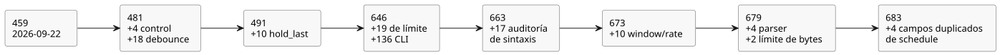

<!-- translation-source: tasks/compiler-diagnostics-plan.md -->
[Original en inglés](compiler-diagnostics-plan.md)

# Aceptación de los diagnósticos del compilador

Solicitud del usuario: probar que los errores de sintaxis se informan correctamente,
cubriendo todos los errores del compilador. Esto complementa el objetivo TDD activo de
Referencia/compilador/runtime.

En este documento: el alcance y los responsables del trabajo, las aserciones que debe
hacer cada caso, la regla de finalización y un registro fechado de la evidencia
aceptada. El registro sigue el tamaño del **catálogo de diagnósticos/límites**: el
conjunto finito de casos de prueba, informados de forma independiente, para los
diagnósticos del compilador sobre fuentes escritas por el autor y para la entrada por
CLI. El catálogo actual tiene **683 casos de diagnóstico/límite** (véase la última
sección).

## Alcance y responsables

| Capa | Responsable | Evidencia |
|---|---|---|
| Fuente literaria, analizador léxico, parser, enlaces de intención de la fuente, CLI | Sol | pruebas y casos de compiler-syntax-diagnostics |
| Resolución de nombres y verificación de tipos, constantes, funciones, Result, límites | Astra | pruebas y casos de compiler-semantic-diagnostics |
| Inventario mecánico de fuentes y mantenimiento de los fixtures existentes | Luna | compiler-diagnostics-inventory.md |
| Alcance, revisión del mapeo, integración y aceptación | Root | revisión de las aserciones reales y de los resultados de ejecución conservados |

El inventario mecánico es solo una ayuda de búsqueda. Una línea coincidente no es
necesariamente un diagnóstico, una ruta alcanzable ni un caso cubierto. Las
definiciones de funciones auxiliares, los relanzamientos (rethrows), las múltiples
llamadas en una misma línea y las expectativas parametrizadas requieren una revisión
explícita.

Los errores del compilador que se pueden alcanzar mediante la fuente canónica deben
probarse a través de esa ruta pública. Las guardas internas de IR/artefactos se
clasifican por separado; una prueba con IR malformada no sustituye a una prueba de
diagnóstico sobre fuente escrita por el autor.

## Aserciones requeridas

- Cada familia de diagnósticos alcanzable tiene un caso estable, informado de forma
  independiente, o un localizador exacto de una prueba existente. No se supone que
  sean equivalentes distintos puntos de llamada que comparten el texto del mensaje.
- La prueba rechaza el error previsto, con aserciones específicas de
  categoría/mensaje. No basta con una excepción genérica ni con un diagnóstico
  anterior no relacionado.
- Cuando el diagnóstico se refiere a una posición de la fuente, se comprueban el
  nombre de archivo, la línea y la columna originales. Se ejercitan CRLF, Unicode,
  varios bloques ejecutables y EOF.
- La fuente malformada se empareja con una forma válida cercana, para mostrar que se
  alcanza la ruta prevista del parser/verificación de tipos. Los límites se validan en
  sus fronteras significativas.
- Un rechazo de la CLI tiene un código de salida distinto de cero y un diagnóstico en
  stderr. No debe escribir un nuevo artefacto ejecutable. Los errores de uso y los
  rechazos de la fuente son distintos.
- Los fallos permanecen en RED hasta que se corrigen. No se omiten pruebas, no se
  debilitan mensajes ni se cambia una expectativa de válido/inválido para que coincida
  con un defecto de la implementación.

## Finalización

Cada candidato del inventario debe quedar mapeado a un caso, consolidado con una ruta
de diagnóstico compartida justificada, o excluido con una clasificación concreta de
interno o inalcanzable. Todo caso requerido debe ejecutarse. Los fallos nuevos deben
corregirse y volver a verificarse antes de poder afirmar una cobertura completa de los
diagnósticos.

Las infinitas cadenas malformadas y las combinaciones de fallos externos del sistema
operativo no constituyen un catálogo finito de diagnósticos del compilador.

## Evidencia aceptada (2026-09-22)

La auditoría de las familias actuales de diagnósticos de fuente canónica y de CLI está
completa. Las 450 coincidencias mecánicas iniciales se concilian por alcance en
`compiler-diagnostics-inventory.md`. La evidencia se divide así:

- casos y exclusiones del parser/entrada: `tests/fixtures/compiler-syntax-diagnostics.json`;
- rutas semánticas/de literales/GFB: `compiler-semantic-diagnostics-coverage.md`;
- emisión opcional de interacciones: `compiler-interaction-diagnostics-coverage.md`.

No se afirma ningún porcentaje de cobertura de ramas, ni una cobertura exhaustiva de la
restauración de artefactos ni de los fallos del runtime.

| Suite | Pruebas hoja independientes | Resultado |
|---|---:|---|
| Sintaxis, literaria, intención y CLI | 187 | Pasa; 196 incluidos los grupos padre |
| Semántica, tipos y límites del compilador | 258 | Pasa; 257 iniciales más un caso de límite de tamaño de módulo añadido después |
| Identidad de interacciones y procedencia | 14 | Pasa |
| Total | 459 | Pasa; 468 incluidos los grupos padre |

Las pruebas encontraron, e impulsaron correcciones para: diagnósticos de tokens
sobrantes al final, campos de ubicación de la intención, aridad de operandos de la CLI
y entrada estricta en UTF-8, ubicaciones de errores de magnitudes, captura de
programaciones en funciones puras y ocultamiento (shadowing) de miembros locales. Las
regresiones de la CLI también preservan la identidad de fuentes con BOM, los
diagnósticos del sistema de archivos y los archivos de salida existentes.

La compuerta completa de Batch6 (`build/compiler-runtime-batch6-full.log`) terminó con
código 1: 1543 pruebas de Node, 1347 pasan, 32 fallan, 164 TODO, cero omitidas. Los 32
fallos son casos existentes de la Referencia; no queda ningún fallo ajeno a la
Referencia. La verificación del tutorial no se ejecutó después de ese fallo. La
adición posterior, solo de pruebas, del límite de tamaño de módulo pasó por separado
(`build/compiler-semantic-module-limit.log`). El código de producción no cambió después
de la compuerta completa. El objetivo global de compilador/runtime sigue sin terminar.

## Auditoría incremental (2026-09-23)

Luna revisó la entrada de fuentes/CLI y no encontró ninguna familia de diagnósticos
adicional sin cubrir; véase la [auditoría de entrada](compiler-ingress-diagnostics-extra.es.md).
Sol revisó las guardas actuales del parser/lowerer y agregó cuatro casos
independientes de fuente pública: tipado de la carga útil de Result, tipado inicial de
enum nominal, contabilización de estado del debounce físico y contabilización de
entradas de muestra generadas. Véase el
[mapeo de casos](compiler-control-diagnostics-extra.es.md).

La nueva suite está registrada explícitamente en `tools/verify-language.mjs`. Junto con
los 459 casos anteriores y los 18 casos de debounce, esto da 481 casos independientes.
Es un catálogo finito de diagnósticos de fuente/CLI. No afirma que estén cubiertas
todas las cadenas malformadas, todos los fallos del runtime ni todos los fallos de
integridad de artefactos. La evidencia anterior de la compuerta completa de batch8 es
previa a esta adición solo de pruebas.

Verificación específica: `node --test tests/compiler-control-diagnostics-extra.test.mjs`
terminó con código 0; **4/4 pasaron**, sin omisiones ni TODO. Evidencia:
`build/compiler-control-diagnostics-extra.log`. Los vecinos aceptados en el límite del
presupuesto también comprueban 126 estados generados distintos y 128 entradas
distintas, respectivamente. Root revisó los cuatro casos y el registro;
`git diff --check` pasó. Las suites existentes sin cambios y la compuerta completa de
compilador/runtime no se volvieron a ejecutar.

## Diagnósticos de hold y batch9

El siguiente corte medido de `hold_last` agrega diez casos independientes de
diagnóstico/límite en `tests/hold-last-diagnostics.test.mjs`. Incluyen el límite sin
cambios de 128 estados: nueve holds de raíz única usan 117 estados y se aceptan; diez
requieren 130 y se rechazan. Total de casos específicos de diagnóstico/límite:
**491**. `build/hold-last-focused-final.log` registra que los nuevos casos pasan.

La compuerta completa posterior `build/compiler-runtime-batch9-full.log` incluye todas
las suites de diagnóstico y no tiene fallos ajenos a la Referencia. Sus otros 30 fallos
de la Referencia y sus 164 casos TODO siguen impidiendo completar el objetivo global de
compilador/runtime.

## Seguimiento de diagnósticos (2026-09-23)

El usuario solicitó pruebas adicionales de sintaxis/errores, delegadas según su
dificultad. El catálogo finito sigue siendo el de diagnósticos del compilador sobre
fuentes escritas por el autor y la entrada por CLI. Las mutaciones de restauración de
artefactos, los fallos del runtime y los fallos arbitrarios del sistema operativo son
contratos separados. Los 491 casos existentes son la línea base, no una afirmación de
cobertura de ramas.

- Luna: reproducir cada fixture de sintaxis mediante el check y el build reales de la
  CLI, comprobando los diagnósticos exactos y la preservación o ausencia de cada
  archivo de artefacto ejecutable.
- Sol: gramática anidada, delimitadores ausentes y EOF prematuro, con posiciones
  exactas en el Markdown original y documentos válidos adyacentes.
- Astra: revisión adversarial de las exclusiones de cobertura y de la corrección de los
  diagnósticos.
- Root: integración, la corrección de la posición en la fuente, revisión de las pruebas
  y evidencia de aceptación.

Las nuevas pruebas pusieron de manifiesto un defecto de mapeo de EOF. El salto de línea
final sintético del código extraído situaba el error fuera del mapa de fuente copiado,
y el compilador público filtraba entonces coordenadas del código extraído. La regla
es: un EOF terminal debe apuntar a la posición de inserción al final de la última
línea de código escrita por el autor. Los separadores generados y las coordenadas no
válidas no relacionadas del mapa de fuente deben quedar sin mapear.

La revisión adversarial también reprodujo una corrupción cuando un nombre de archivo
válido contiene `:1:2: `. La eliminación del prefijo usa ahora el nombre de
archivo/línea/columna originales exactos en lugar de una expresión regular que podía
consumir parte del nombre de archivo.

Evidencia específica aceptada:

- `compiler-syntax-boundaries.test.mjs`: 19 casos hoja nuevos, 23 incluidos los grupos
  padre. RED: `build/compiler-syntax-boundaries-red.log`; GREEN:
  `build/compiler-syntax-boundaries-green.log`.
- `compiler-cli-diagnostics.test.mjs`: los 135 fixtures de sintaxis existentes se
  ejercitan mediante check y build, más un control válido de build: 136 hojas, 137
  incluido el padre. La alternancia de los destinos de build demuestra que `.gfb`,
  `.manifest.json` y `.map.json` no se crean o se preservan idénticos byte a byte.
- Ambas suites están registradas explícitamente en `tools/verify-language.mjs`.
- Diagnósticos combinados más regresión de literaria/validación de fuentes/cadena de
  herramientas: `build/compiler-diagnostics-followup.log`, código de salida 0,
  **729 pasan / 0 fallan / 0 omitidas / 0 TODO**, incluidos los grupos padre. No se
  volvió a ejecutar el `npm test` completo.

El catálogo de diagnósticos/límites tiene ahora **646 casos independientes** (491
existentes + 19 casos de límite + 136 casos de CLI). No son 646 tipos de error
distintos y no se afirma una implementación completa de la Referencia.

La revisión también encontró, por separado, que faltaba un caso de aceptación de
fuente válida para los ajustes operativos `Int`. Se agregó `REF-05-108` con su
expectativa de aceptación sin cambios; su ejecución inicial específica de check/build
estuvo en RED. Más tarde se corrigió en batch10 con metadatos de compilador/runtime y
pruebas de paquetes firmados. Véase
[el registro aparte de la carencia](compiler-int-settings-gap.es.md). Este caso no
estaba en la suite de batch9.

## Auditoría adicional de sintaxis (2026-09-23)

- Luna mapeó las guardas actuales de diagnósticos de Int a casos existentes y aclaró
  que las filas `UNMAPPED` originales del inventario son registros históricos de
  descubrimiento.
- Astra corrigió una exclusión falsa del límite público de bytes del módulo compilado:
  la reutilización de expresiones con nombre puede alcanzarlo, y la prueba semántica de
  límite existente ya lo ejercita. El fixture de sintaxis ahora delega explícitamente
  en esa prueba.
- Seis pruebas nuevas de límite de tokens ejercitan un documento válido con
  exactamente 8.192 tokens, y un token número 8.193 que es un identificador, un número,
  un símbolo, una fecha etiquetada o una cadena JSON. Cada rechazo comprueba el mensaje
  exacto, el nombre de archivo, la línea y la columna originales.
- El caso de la cadena puso de manifiesto un defecto real de diagnóstico: un catch que
  rodeaba tanto `JSON.parse` como la inserción de tokens convertía los fallos por
  límite de tokens en `invalid string literal`. El catch ahora cubre solo la
  decodificación JSON. Astra revisó de forma independiente el recuento de tokens y la
  corrección acotada.
- Sol agregó once casos anidados de function/case/if/pipeline y de delimitadores, con
  ubicaciones exactas de los diagnósticos y documentos válidos adyacentes. Ejecución
  específica: `build/compiler-syntax-structure.log`, **11/11 pasan**, código de salida
  0.
- Ambas suites nuevas están registradas explícitamente en `tools/verify-language.mjs`.
  Root revisó sus aserciones y la corrección. Las suites de diagnóstico combinadas,
  incluidos check/build de la CLI, semántica, ajustes Int, y errores de debounce y de
  hold, pasaron **687/687**, código de salida 0, sin omisiones ni TODO:
  `build/compiler-diagnostics-audit-final.log`. Con las once pruebas estructurales
  aparte, esta verificación suma **698 pruebas que pasan** (incluidos los grupos
  padre). No se volvió a ejecutar la compuerta completa de compilador/runtime.

Este incremento agrega **17 casos independientes** al catálogo de diagnósticos
anterior.

## Seguimiento de saltos de línea con CR aislado

Cuatro casos adicionales de fuente pública cubren las posiciones y los diagnósticos de
saltos de línea con retorno de carro (CR) aislado. La evidencia RED se conserva en
`build/compiler-newline-diagnostics-red.log`; la suite afectada pasó **233/233** en
`build/compiler-newline-affected.log`. El catálogo actual tiene **687 casos
independientes**. Es solo evidencia específica; no se afirma ningún resultado de la
compuerta completa.

> **Nota editorial.** La cifra de 687 del párrafo anterior no coincide con el recuento
> acumulado del catálogo en los registros que la rodean (646 + 17 = 663, luego 673, 679
> y 683). Los cuatro casos de CR aislado no aparecen incluidos de forma visible en ese
> recuento acumulado. Ambas cifras se conservan exactamente como se registraron.

Por lo tanto, el catálogo contiene **663 casos independientes de
diagnóstico/límite**. La revisión final acotada de Luna no encontró ninguna familia
concreta, activa y sin mapear de diagnósticos de fuente escrita por el autor o de CLI.
Es una auditoría del catálogo, no una cobertura exhaustiva de ramas. La compuerta
completa del host de batch11 también ejecutó estas suites sin fallos de diagnóstico.
Esa compuerta siguió fallando en otros 27 casos de la Referencia y en cuatro fallos de
pruebas de integración o de mantenimiento del catálogo; véase la línea base más
reciente de la Referencia para el seguimiento.

Estos registros establecen familias de diagnósticos con nombre y límites probados. No
demuestran todas las ramas de condiciones compuestas ni todas las combinaciones
malformadas. La integración no relacionada de GFB4/ventanas sigue sin terminar y no
queda certificada por esta ejecución específica de diagnósticos.

## Seguimiento actual de diagnósticos de window/rate (2026-09-23)

- Luna auditó los mapeos y el registro actuales. Root corrigió dos distinciones en
  `compiler-diagnostics-current-audit.md`: los diagnósticos alcanzables de tamaño del
  parser frente a las guardas internas de funciones auxiliares, y los casos de prueba
  frente a las suites.
- Sol agregó diez casos de diagnóstico y de límite de window/rate, informados de forma
  independiente, en `tests/compiler-window-diagnostics.test.mjs`. El mapeo está en
  `compiler-window-diagnostics-coverage.md`.
- Cada rechazo nuevo comprueba `ControlCompileError`, el mensaje exacto y el nombre de
  archivo, la línea y la columna originales del Markdown. Cada caso compila además un
  vecino válido. La prueba del presupuesto temporal acepta 127 estados escalares más
  una ventana y rechaza 128 estados escalares más una ventana.
- Root revisó las aserciones y registró la suite en `tools/verify-language.mjs`.
  Ningún comportamiento del compilador ni del runtime cambió en este seguimiento.
- Las diez suites de diagnóstico existentes: **677/677 pasan**, cero omitidas/TODO,
  código de salida 0, `build/compiler-diagnostics-current-regression.log`.
- Suite nueva: **10/10 pasan**, cero omitidas/TODO, código de salida 0,
  `build/compiler-window-diagnostics.log`.
  Estas dos ejecuciones específicas suman **687 pruebas que pasan**, incluidos los
  grupos padre de las suites existentes. No se volvió a ejecutar la compuerta completa
  de compilador/runtime.

El catálogo de diagnósticos/límites con nombre crece de 663 a **673 casos
independientes**. Este recuento no es un recuento de tipos de error distintos. La
auditoría no establece una cobertura exhaustiva de ramas compuestas, artefactos
malformados, fallos del runtime ni errores del sistema operativo.

## Seguimiento de puntos de llamada del parser y del límite de bytes de ventanas anidadas

- Luna auditó los mapeos de entrada del analizador léxico/literaria/CLI y no encontró
  ninguna familia faltante.
- Sol mapeó las funciones auxiliares activas del parser y agregó cuatro casos: un
  nombre de puerto repetido que falta, un miembro de enum repetido, el primer tipo de
  carga útil de Result y un nombre de mutex repetido. Cada uno incluye un vecino válido
  y la clase de error, el nombre de archivo, la línea, la columna y el mensaje exactos.
  `build/compiler-parser-callsites.log`: 4/4 pasaron, código de salida 0.
- Astra encontró una ruta distinta de fuente pública hacia la guarda del límite de
  bytes de la expresión de origen de ventanas de GFB4. Luna agregó los casos de siete
  transformaciones (aceptado) y ocho transformaciones (rechazado).
  `build/compiler-window-byte-limit.log`: 2/2 pasaron, código de salida 0.
- Root revisó las aserciones, registró ambas suites y eliminó una afirmación obsoleta
  de que las ventanas derivadas se rechazan. El comportamiento del compilador/runtime
  no cambia.

Catálogo: **679 casos independientes de diagnóstico/límite** (673 + 4 + 2).
Este incremento verifica seis pruebas; no afirma que se hayan vuelto a ejecutar los
679. La evidencia aceptada existente permanece en los registros anteriores y en
batch13. No se volvió a ejecutar ninguna compuerta completa del host para estas
adiciones solo de pruebas. Las cadenas malformadas arbitrarias, los fallos de
artefactos/runtime y los fallos del sistema operativo no son un dominio exhaustivo de
pruebas de sintaxis.

## Campos duplicados de DailySlots: después de batch15

La Referencia §3.5 exige cada campo de la programación exactamente una vez. Luna agregó
cuatro casos públicos de rechazo en `.ghost.md` para un `timezone` repetido y un
`selected` repetido, cada uno con valores idénticos y con valores distintos. RED: 4/4
fallaron porque la compilación aceptaba los duplicados
(`build/compiler-schedule-duplicates-red.log`). Un conjunto mínimo de campos vistos en
el parser informa ahora del campo repetido. Root solicitó aserciones exactas de clase
de error, mensaje, nombre de archivo, línea y columna, además de un vecino válido.
GREEN: 5/5 incluido ese control positivo (`build/compiler-schedule-duplicates.log`).
Las suites de regresión afectadas de Root pasaron 231/231
(`build/schedule-duplicates-regression.log`). No fue necesario volver a ejecutar la
compuerta completa para esta guarda acotada del parser. Batch15 sigue siendo evidencia
histórica específica de la fuente.

Catálogo actual: **683 casos de diagnóstico/límite** (679 + 4); el control positivo no
se cuenta como otro rechazo. La semántica completa de las políticas de programación
sigue siendo un trabajo aparte y no queda implícita en esta corrección.

El diagrama siguiente resume cómo creció el catálogo a lo largo de estos registros.
Sigue el recuento acumulado usado más arriba; los cuatro casos de CR aislado no se
muestran porque los registros no los sitúan en ese recuento.

