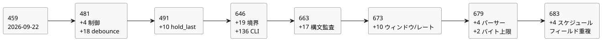

<!-- translation-source: tasks/compiler-diagnostics-plan.md -->
[英語の原文](compiler-diagnostics-plan.md)

# コンパイラ診断の受け入れ

ユーザーの依頼：構文エラーが正しく報告されることを、すべてのコンパイラエラーを対象にテストすること。これは、進行中の Reference/コンパイラ/ランタイムの TDD 目標を補うものです。

この文書の内容：作業の範囲と担当者、すべてのケースが行わなければならないアサーション、完了のルール、そして受け入れた証拠の日付付きログ。ログは**診断/境界カタログ**の規模を追跡します。これは、作者が書いたソースに対するコンパイラ診断と CLI の入口（ingress）について、独立に報告されるテストケースの有限な集合です。現在のカタログは **683 件の診断/境界ケース**です（最後の節を参照）。

## 範囲と担当

| 層 | 担当 | 証拠 |
|---|---|---|
| 文芸的ソース、字句解析器、パーサー、ソースの意図リンク、CLI | Sol | compiler-syntax-diagnostics のテストとケース |
| 名前/型の検査、定数、関数、Result、上限 | Astra | compiler-semantic-diagnostics のテストとケース |
| 機械的なソースインベントリと既存フィクスチャの保守 | Luna | compiler-diagnostics-inventory.md |
| 範囲、対応付けのレビュー、統合と受け入れ | Root | 実際のアサーションと保存された実行結果のレビュー |

機械的なインベントリは検索の補助にすぎません。一致した行が、必ずしも 1 つの診断、到達可能な経路、またはカバー済みのケースであるとは限りません。ヘルパーの定義、再スロー、1 行内の複数の呼び出し、パラメータ化された期待値は、明示的なレビューが必要です。

正本ソースを通して到達できるコンパイラエラーは、その公開経路を通してテストしなければなりません。内部の IR/成果物のガードは別に分類します。不正な IR を使ったテストは、作者が書いたソースに対する診断テストの代わりにはなりません。

## 必須のアサーション

- 到達可能な診断ファミリーごとに、安定して独立に報告されるケース、または既存テストの正確な場所が存在すること。メッセージ文が同じでも、呼び出し箇所が異なれば同等とはみなしません。
- テストは、意図したエラーを、具体的なカテゴリ/メッセージのアサーションとともに拒否すること。一般的な例外のスローや、無関係な先行の診断では不十分です。
- 診断がソースの位置に関するものであれば、元のファイル名、行、列を確認すること。CRLF、Unicode、複数の実行可能フェンス、EOF を試すこと。
- 不正なソースを、近くの有効な形式と組にすること。これにより、意図したパーサー/型検査の経路に到達していることを示します。上限は、意味のある境界で検証すること。
- CLI による拒否は、0 以外の終了ステータスと stderr への診断を伴うこと。新しい実行可能成果物を書き込んではなりません。使い方のエラーとソースの拒否は区別されます。
- 失敗は修正されるまで RED のままにすること。テストをスキップしたり、メッセージを弱めたり、実装の欠陥に合わせて有効/無効の期待値を変えたりしてはなりません。

## 完了

すべてのインベントリ候補は、ケースに対応付けるか、正当な理由のある共有診断経路に統合するか、具体的な内部的または到達不能という分類で除外しなければなりません。必須のケースはすべて実行しなければなりません。診断の完全なカバレッジを主張する前に、新しい失敗は修正し、再検証しなければなりません。

無限に存在する不正な文字列や、外部の OS 障害の組み合わせは、有限なコンパイラ診断カタログではありません。

## 受け入れた証拠（2026-09-22）

現在の正本ソースと CLI の診断ファミリーの監査は完了しています。最初の 450 件の機械的な一致は、`compiler-diagnostics-inventory.md` で範囲ごとに照合されています。証拠は次のように分かれています。

- パーサー/入口のケースと除外：`tests/fixtures/compiler-syntax-diagnostics.json`
- セマンティクス/リテラル/GFB の経路：`compiler-semantic-diagnostics-coverage.md`
- オプションのインタラクションの生成：`compiler-interaction-diagnostics-coverage.md`

分岐カバレッジの割合や、成果物の復元およびランタイム故障の網羅的なカバレッジは主張しません。

| スイート | 独立したリーフテスト | 結果 |
|---|---:|---|
| 構文、文芸的ソース、意図、CLI | 187 | 合格。親グループを含めると 196 |
| セマンティクス、型、コンパイラの上限 | 258 | 合格。最初の 257 件に、後で追加したモジュールサイズの境界ケース 1 件を加えたもの |
| インタラクションの同一性と来歴 | 14 | 合格 |
| 合計 | 459 | 合格。親グループを含めると 468 |

テストは次の問題を発見し、その修正を促しました：末尾トークンの診断、意図の位置フィールド、CLI のオペランド数と厳格な UTF-8 の入口、数量エラーの位置、純粋関数によるスケジュールの捕捉、ローカルメンバーのシャドーイング。CLI の回帰テストは、BOM 付きソースの同一性、ファイルシステムの診断、既存の出力ファイルも保護します。

Batch6 のフルゲート（`build/compiler-runtime-batch6-full.log`）は終了コード 1 で終わりました：Node テスト 1543 件、合格 1347、失敗 32、TODO 164、スキップ 0。32 件の失敗はすべて既存の Reference ケースであり、Reference 以外の失敗は残っていません。チュートリアルの検証はその失敗の後には実行されませんでした。後で追加したテストのみのモジュールサイズのケースは、個別に合格しました（`build/compiler-semantic-module-limit.log`）。フルゲートの後、本番コードは変更されていません。コンパイラ/ランタイム全体の目標は未完了です。

## 追加の監査（2026-09-23）

Luna はソース/CLI の入口をレビューし、カバーされていない診断ファミリーを新たに見つけませんでした。[入口の監査](compiler-ingress-diagnostics-extra.ja.md)を参照してください。Sol は現在のパーサー/ロワラーのガードをレビューし、独立した公開ソースのケースを 4 件追加しました：Result のペイロードの型付け、名前的な列挙型の初期値の型付け、物理的な debounce の状態計上、生成されるサンプル入力の計上です。[ケースの対応付け](compiler-control-diagnostics-extra.ja.md)を参照してください。

新しいスイートは `tools/verify-language.mjs` に明示的に登録されています。以前の 459 件と debounce の 18 件を合わせると、481 件の独立したケースになります。これはソース/CLI の有限な診断カタログです。あらゆる不正な文字列、ランタイム故障、成果物の整合性の失敗をカバーしているとは主張しません。以前の batch8 のフルゲートの証拠は、このテストのみの追加より前のものです。

焦点を絞った検証：`node --test tests/compiler-control-diagnostics-extra.test.mjs` は終了コード 0 で、**4/4 合格**、スキップも TODO もありません。証拠：`build/compiler-control-diagnostics-extra.log`。受け入れられた予算の隣接ケースは、それぞれ 126 個の異なる生成状態と 128 個の異なる入力もアサートします。Root は 4 件のケースすべてと登録をレビューし、`git diff --check` は合格しました。変更していない既存のスイートと、コンパイラ/ランタイムのフルゲートは再実行していません。

## hold の診断と batch9

次に計測した `hold_last` のスライスでは、`tests/hold-last-diagnostics.test.mjs` に 10 件の独立した診断/境界ケースを追加しています。これには変更されていない 128 状態の上限が含まれます：単一ルートの hold 9 個は 117 状態を使って受け入れられ、10 個は 130 状態を必要として拒否されます。焦点を絞った診断/境界ケースの合計：**491**。
`build/hold-last-focused-final.log` に、新しいケースの合格が記録されています。

その後のフルゲート `build/compiler-runtime-batch9-full.log` は、すべての診断スイートを含み、Reference 以外の失敗はありません。その他 30 件の Reference の失敗と 164 件の TODO ケースにより、コンパイラ/ランタイム全体はまだ完了していません。

## 診断のフォローアップ（2026-09-23）

ユーザーは追加の構文/エラーテストを依頼し、難易度ごとに委任しました。有限なカタログは、引き続き作者が書いたソースのコンパイラ診断と CLI の入口です。成果物の復元時の変更、ランタイム故障、任意の OS 障害は別の契約です。既存の 491 件はベースラインであり、分岐カバレッジの主張ではありません。

- Luna：すべての構文フィクスチャを実際の CLI の check と build でリプレイし、正確な診断と、すべての実行可能成果物ファイルの保持または不在を確認します。
- Sol：入れ子の文法、区切り記号の欠落、早すぎる EOF を、元の Markdown の正確な位置と、隣接する有効な文書とともに扱います。
- Astra：カバレッジの除外と診断の正しさを敵対的にレビューします。
- Root：統合、ソース位置の修正、テストのレビュー、受け入れの証拠。

新しいテストは EOF の対応付けの欠陥を明らかにしました。抽出したコードに合成された最後の改行が、エラーをコピーしたソースマップの外側に置き、その結果、公開コンパイラが抽出後の座標を漏らしていました。ルールは次のとおりです：末尾の EOF は、作者が書いた最後のコード行の末尾にある挿入位置を指さなければなりません。生成された区切りや、無関係で無効なソースマップの座標は、対応付けないままにしなければなりません。

敵対的レビューでは、有効なファイル名に `:1:2: ` が含まれるときの破損も再現されました。プレフィックスの除去では、現在、ファイル名の一部を消費しうる正規表現ではなく、正確な元のファイル名/行/列を使います。

受け入れた焦点を絞った証拠：

- `compiler-syntax-boundaries.test.mjs`：新しいリーフケース 19 件、親グループを含めると 23 件。RED：`build/compiler-syntax-boundaries-red.log`。GREEN：`build/compiler-syntax-boundaries-green.log`。
- `compiler-cli-diagnostics.test.mjs`：既存の構文フィクスチャ 135 件すべてを check と build の両方で実行し、さらに有効な build の対照を 1 件加えたもの。リーフ 136 件、親を含めると 137 件。build の出力先を交互に変えることで、`.gfb`、`.manifest.json`、`.map.json` が作成されないか、バイト単位で同一のまま保持されることを証明します。
- 両方のスイートは `tools/verify-language.mjs` に明示的に登録されています。
- 診断と、文芸的ソース/ソース検証/ツールチェーンの回帰を合わせた結果：`build/compiler-diagnostics-followup.log`、終了コード 0、親グループを含めて **合格 729 / 失敗 0 / スキップ 0 / TODO 0**。`npm test` のフル再実行はしていません。

診断/境界カタログは、現在 **646 件の独立したケース**（既存 491 件 + 境界ケース 19 件 + CLI ケース 136 件）です。これは 646 種類の異なるエラーではなく、Reference の完全な実装を主張するものでもありません。

レビューでは、`Int` の運用設定について、有効なソースの受け入れケースが別途欠けていることも見つかりました。`REF-05-108` は期待される受け入れを変えずに追加され、最初の焦点を絞った check/build の実行は RED でした。その後 batch10 で、コンパイラ/ランタイムのメタデータと署名付きパッケージのテストによって修正されました。[別のギャップ記録](compiler-int-settings-gap.ja.md)を参照してください。このケースは batch9 のスイートには含まれていませんでした。

## 追加の構文監査（2026-09-23）

- Luna は現在の Int 診断のガードを既存のケースに対応付け、インベントリの元の `UNMAPPED` 行は過去の発見記録であることを明確にしました。
- Astra は、公開のコンパイル済みモジュールのバイト上限について誤った除外を修正しました：名前付きの式の再利用でこの上限に到達でき、既存のセマンティクスの境界テストがすでにそれを実行しています。構文フィクスチャは現在、そのテストに明示的に委ねています。
- 新しい 6 件のトークン境界テストは、ちょうど 8,192 トークンの有効な文書と、8,193 番目のトークンが識別子、数値、記号、タグ付き日付、JSON 文字列である場合を試します。各拒否では、正確なメッセージ、元のファイル名、行、列を確認します。
- 文字列のケースは実際の診断の欠陥を明らかにしました：`JSON.parse` とトークン挿入の両方を囲む catch が、トークン上限の失敗を `invalid string literal` に変換していました。現在、catch は JSON のデコードだけを囲みます。Astra はトークン数と、この限定的な修正を独立にレビューしました。
- Sol は、入れ子の関数/case/if/パイプラインと区切り記号のケースを 11 件、正確な診断位置と隣接する有効な文書とともに追加しました。焦点を絞った実行：`build/compiler-syntax-structure.log`、**11/11 合格**、終了コード 0。
- 新しい 2 つのスイートは、どちらも `tools/verify-language.mjs` に明示的に登録されています。Root はそれらのアサーションと修正をレビューしました。CLI の check/build、セマンティクス、Int 設定、debounce と hold のエラーを含む診断スイートの組み合わせは、**687/687 合格**、終了コード 0、スキップも TODO もありません：`build/compiler-diagnostics-audit-final.log`。別の 11 件の構造テストを合わせると、この検証は合計 **698 件の合格テスト**（親グループを含む）になります。コンパイラ/ランタイムのフルゲートは再実行していません。

この増分は、以前の診断カタログに **17 件の独立したケース**を追加します。

## 単独 CR 改行のフォローアップ

追加の公開ソースケース 4 件は、単独のキャリッジリターン改行の位置と診断を対象にしています。RED の証拠は `build/compiler-newline-diagnostics-red.log` に保持されています。影響を受けるスイートは `build/compiler-newline-affected.log` で **233/233** 合格しました。現在のカタログは **687 件の独立したケース**です。これは焦点を絞った証拠にすぎず、フルゲートの結果は主張しません。

> **編集上の注記。** 前の段落の 687 という数値は、前後の記録にある累計のカタログ件数（646 + 17 = 663、その後 673、679、683）と一致しません。単独 CR の 4 件は、その累計に含まれていることが明示されていません。どちらの数値も、記録されたとおりにそのまま残しています。

したがって、カタログには **663 件の独立した診断/境界ケース**が含まれます。Luna の最終的な有界のレビューでは、作者が書いたソースまたは CLI の、アクティブで対応付けのない具体的な診断ファミリーは見つかりませんでした。これはカタログの監査であり、網羅的な分岐カバレッジではありません。batch11 のホストのフルゲートでも、これらのスイートは診断の失敗なく実行されました。そのゲートは、他の 27 件の Reference ケースと、4 件の統合テストまたはカタログ保守の失敗で、依然として失敗しました。フォローアップについては最新の Reference のベースラインを参照してください。

これらの記録は、名前付きの診断ファミリーとテスト済みの境界を確立するものです。すべての複合条件の分岐や、すべての不正な組み合わせを証明するものではありません。無関係な GFB4/window の統合は未完了のままであり、この焦点を絞った診断の実行によって認定されるものではありません。

## 現在の window/rate 診断のフォローアップ（2026-09-23）

- Luna は現在の対応付けと登録を監査しました。Root は `compiler-diagnostics-current-audit.md` で 2 つの区別を修正しました：到達可能なパーサーのサイズ診断と内部ヘルパーのガードの区別、そしてテストケースとスイートの区別です。
- Sol は、独立に報告される window/rate の診断および境界ケースを 10 件、`tests/compiler-window-diagnostics.test.mjs` に追加しました。対応付けは `compiler-window-diagnostics-coverage.md` にあります。
- 新しい拒否はすべて、`ControlCompileError`、正確なメッセージ、元の Markdown のファイル名、行、列をアサートします。各ケースは有効な隣接ケースもコンパイルします。時間的予算のテストは、スカラー状態 127 個とウィンドウ 1 個を受け入れ、スカラー状態 128 個とウィンドウ 1 個を拒否します。
- Root はアサーションをレビューし、スイートを `tools/verify-language.mjs` に登録しました。このフォローアップでは、コンパイラやランタイムの振る舞いは変更されていません。
- 既存の 10 個の診断スイート：**677/677 合格**、スキップ/TODO なし、終了コード 0、`build/compiler-diagnostics-current-regression.log`。
- 新しいスイート：**10/10 合格**、スキップ/TODO なし、終了コード 0、`build/compiler-window-diagnostics.log`。この 2 つの焦点を絞った実行は、既存スイートの親グループを含めて合計 **687 件の合格テスト**になります。コンパイラ/ランタイムのフルゲートは再実行していません。

名前付きの診断/境界カタログは、663 件から **673 件の独立したケース**に増えます。この件数は異なるエラーの種類の数ではありません。この監査は、網羅的な複合分岐、不正な成果物、ランタイム故障、OS エラーのカバレッジを確立するものではありません。

## パーサーの呼び出し箇所と入れ子ウィンドウのバイト上限のフォローアップ

- Luna は字句解析器/文芸的ソース/CLI の入口の対応付けを監査し、欠けているファミリーは見つかりませんでした。
- Sol はアクティブなパーサーのヘルパーを対応付け、4 件のケースを追加しました：繰り返しのポート名の欠落、列挙型メンバーの重複、Result の最初のペイロード型、mutex 名の重複です。各ケースには有効な隣接ケースと、正確なエラークラス、ファイル名、行、列、メッセージが含まれます。`build/compiler-parser-callsites.log`：4/4 合格、終了コード 0。
- Astra は、GFB4 のウィンドウのソース式のバイト上限ガードに至る、別個の公開ソース経路を発見しました。Luna は、変換 7 個（受け入れ）と変換 8 個（拒否）のケースを追加しました。`build/compiler-window-byte-limit.log`：2/2 合格、終了コード 0。
- Root はアサーションをレビューし、両方のスイートを登録し、派生ウィンドウが拒否されるという古い記述を削除しました。コンパイラ/ランタイムの振る舞いは変わっていません。

カタログ：**679 件の独立した診断/境界ケース**（673 + 4 + 2）。この増分で検証したのは 6 件のテストです。679 件すべてを再実行したとは主張しません。既存の受け入れた証拠は、上記の記録と batch13 に残っています。これらのテストのみの追加について、ホストのフルゲートは再実行していません。任意の不正な文字列、成果物/ランタイムの故障、OS 障害は、網羅的な構文テストの対象領域ではありません。

## DailySlots のフィールド重複 — batch15 の後

Reference §3.5 は、スケジュールの各フィールドがちょうど 1 回現れることを要求します。Luna は、`timezone` の重複と `selected` の重複について、それぞれ同じ値の場合と異なる値の場合の、公開 `.ghost.md` の拒否ケースを 4 件追加しました。RED：コンパイルが重複を受け入れたため 4/4 が失敗しました（`build/compiler-schedule-duplicates-red.log`）。現在は、パーサーの最小限の既出集合（seen-set）が重複したフィールドを報告します。Root は、正確なエラークラス、メッセージ、ファイル名、行、列のアサーションと、有効な隣接ケースを求めました。GREEN：その肯定的な対照を含めて 5/5（`build/compiler-schedule-duplicates.log`）。Root の影響を受ける回帰スイートは 231/231 合格しました（`build/schedule-duplicates-regression.log`）。この有界なパーサーのガードについては、フルゲートの再実行は不要でした。batch15 は、引き続きソース固有の過去の証拠です。

現在のカタログ：**683 件の診断/境界ケース**（679 + 4）。肯定的な対照は、別の拒否としては数えません。スケジュールポリシーの完全なセマンティクスは別の作業として残っており、この修正によって含意されるものではありません。

次の図は、これらの記録を通じてカタログがどのように増えたかをまとめたものです。上で使った累計に従っています。単独 CR の 4 件は、記録がその累計に位置付けていないため示していません。

