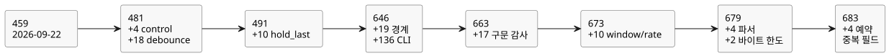

<!-- translation-source: tasks/compiler-diagnostics-plan.md -->
[영문 원문](compiler-diagnostics-plan.md)

# 컴파일러 진단 수용

사용자 요청: 모든 컴파일러 오류를 대상으로 구문 오류가 올바르게 보고되는지
테스트합니다. 이 작업은 현재 진행 중인 Reference/컴파일러/런타임 TDD 목표를
보완합니다.

이 문서의 내용: 작업 범위와 담당자, 모든 사례가 해야 하는 단언(assertion), 완료
규칙, 그리고 날짜별로 수용된 증거 기록. 이 기록은 **진단/경계 카탈로그**의 크기를
추적합니다. 이 카탈로그는 작성된 소스에 대한 컴파일러 진단과 CLI 입력(ingress)을
대상으로, 독립적으로 보고되는 테스트 사례의 유한 집합입니다. 현재 카탈로그는
**683개의 진단/경계 사례**입니다(마지막 절 참조).

## 범위와 담당

| 계층 | 담당 | 증거 |
|---|---|---|
| 문서형 소스, lexer, 파서, 소스 의도 링크, CLI | Sol | compiler-syntax-diagnostics 테스트와 사례 |
| 이름/타입 검사, 상수, 함수, Result, 한도 | Astra | compiler-semantic-diagnostics 테스트와 사례 |
| 기계적 소스 인벤토리와 기존 fixture 유지 관리 | Luna | compiler-diagnostics-inventory.md |
| 범위, 매핑 검토, 통합 및 수용 | Root | 실제 단언과 보존된 실행 결과 검토 |

기계적 인벤토리는 검색 보조 도구일 뿐입니다. 일치한 한 줄이 반드시 하나의 진단,
도달 가능한 경로, 또는 커버된 사례를 뜻하지는 않습니다. 헬퍼 정의, 재던지기(rethrow),
한 줄에 있는 여러 호출, 파라미터화된 기대값은 명시적으로 검토해야 합니다.

정본 소스를 통해 도달할 수 있는 컴파일러 오류는 그 공개 경로를 통해 테스트해야
합니다. 내부 IR/아티팩트 가드는 별도로 분류합니다. 잘못된 IR을 사용하는 테스트는
작성된 소스 진단 테스트를 대신하지 않습니다.

## 필수 단언

- 도달 가능한 각 진단 계열에는 안정적이고 독립적으로 보고되는 사례 또는 정확한
  기존 테스트 위치가 있어야 합니다. 메시지 텍스트가 같은 서로 다른 호출 위치를
  동등하다고 가정하지 않습니다.
- 테스트는 의도한 오류를 구체적인 범주/메시지 단언으로 거부해야 합니다. 일반적인
  예외 발생이나 관련 없는 이전 진단만으로는 충분하지 않습니다.
- 진단이 소스 위치에 관한 것이라면 원래 파일 이름, 줄, 열을 확인합니다. CRLF,
  Unicode, 여러 실행 펜스, EOF를 시험합니다.
- 잘못된 소스를 가까운 유효한 형태와 짝지어, 의도한 파서/타입 검사 경로에
  도달했음을 보입니다. 한도는 의미 있는 경계에서 검증합니다.
- CLI 거부는 0이 아닌 종료 상태와 stderr의 진단을 가져야 합니다. 새 실행 아티팩트를
  쓰면 안 됩니다. 사용법 오류와 소스 거부는 구별됩니다.
- 실패는 수정될 때까지 RED로 남습니다. 구현 결함에 맞추려고 테스트를 건너뛰거나,
  메시지를 약화하거나, 유효/무효 기대값을 바꾸지 않습니다.

## 완료

모든 인벤토리 후보는 사례에 매핑되거나, 정당한 공유 진단 경로로 통합되거나,
구체적인 내부/도달 불가 분류로 제외되어야 합니다. 필요한 모든 사례가 실행되어야
합니다. 진단 커버리지가 완전하다고 주장하기 전에 새로운 실패를 수정하고 다시
검증해야 합니다.

무한히 많은 잘못된 문자열과 외부 OS 실패 조합은 유한한 컴파일러 진단 카탈로그가
아닙니다.

## 수용된 증거 (2026-09-22)

현재 정본 소스 및 CLI 진단 계열에 대한 감사가 완료되었습니다. 초기 450개의 기계적
일치는 `compiler-diagnostics-inventory.md`에서 범위별로 정리되었습니다. 증거는
다음과 같이 나뉩니다.

- 파서/입력 사례와 제외 항목: `tests/fixtures/compiler-syntax-diagnostics.json`
- 의미/리터럴/GFB 경로: `compiler-semantic-diagnostics-coverage.md`
- 선택적 interaction 방출: `compiler-interaction-diagnostics-coverage.md`

분기 커버리지 비율이나, 완전한 아티팩트 복원 또는 런타임 고장 커버리지는 주장하지
않습니다.

| 스위트 | 독립 leaf 테스트 | 결과 |
|---|---:|---|
| 구문, 문서형 소스, 의도, CLI | 187 | 통과; 상위 그룹 포함 196 |
| 의미, 타입, 컴파일러 한도 | 258 | 통과; 초기 257개에 이후 추가된 모듈 크기 경계 사례 1개 |
| interaction identity와 provenance | 14 | 통과 |
| 합계 | 459 | 통과; 상위 그룹 포함 468 |

이 테스트들이 발견하고 수정을 이끈 문제는 다음과 같습니다. 후행 토큰 진단, 의도
위치 필드, CLI 피연산자 개수와 엄격한 UTF-8 입력, 물리량 오류 위치, 순수 함수의 예약
캡처, 지역 멤버 가림(shadowing). CLI 회귀 테스트는 BOM 소스 identity, 파일 시스템
진단, 기존 출력 파일도 보존합니다.

Batch6 전체 게이트(`build/compiler-runtime-batch6-full.log`)는 종료 코드 1로
끝났습니다. Node 테스트 1543개 중 1347 통과, 32 실패, 164 TODO, skip 0입니다.
32개 실패는 모두 기존 Reference 사례이며, Reference 이외의 실패는 남아 있지
않습니다. 이 실패 이후 튜토리얼 검증은 실행되지 않았습니다. 나중에 추가된 테스트
전용 모듈 크기 사례는 별도로 통과했습니다(`build/compiler-semantic-module-limit.log`).
전체 게이트 이후 운영 코드는 바뀌지 않았습니다. 컴파일러/런타임 전체 목표는 아직
끝나지 않았습니다.

## 증분 감사 (2026-09-23)

Luna는 소스/CLI 입력을 검토했고 커버되지 않은 추가 진단 계열을 찾지 못했습니다.
[입력 감사](compiler-ingress-diagnostics-extra.md)를 참조하세요.
Sol은 현재 파서/lowerer 가드를 검토하고 독립적인 공개 소스 사례 네 개를
추가했습니다. Result 페이로드 타입 지정, 명목 enum 초기값 타입 지정, 물리
debounce 상태 집계, 생성된 sample 입력 집계입니다.
[사례 매핑](compiler-control-diagnostics-extra.md)을 참조하세요.

새 스위트는 `tools/verify-language.mjs`에 명시적으로 등록되었습니다. 이전 459개
사례와 debounce 사례 18개를 합치면 독립 사례는 481개입니다. 이는 유한한 소스/CLI
진단 카탈로그입니다. 모든 잘못된 문자열, 런타임 고장, 아티팩트 무결성 실패가
커버된다고 주장하지 않습니다. 이전 batch8 전체 게이트 증거는 이 테스트 전용
추가보다 앞선 것입니다.

집중 검증: `node --test tests/compiler-control-diagnostics-extra.test.mjs`가
종료 코드 0으로 끝났습니다. **4/4 통과**, skip이나 TODO는 없습니다. 증거:
`build/compiler-control-diagnostics-extra.log`. 수용된 예산 인접 사례는 각각
서로 다른 생성 상태 126개와 서로 다른 입력 128개도 단언합니다.
Root는 네 사례와 등록을 모두 검토했으며, `git diff --check`가 통과했습니다.
변경되지 않은 기존 스위트와 컴파일러/런타임 전체 게이트는 다시 실행하지
않았습니다.

## Hold 진단과 batch9

측정된 다음 `hold_last` 슬라이스는 `tests/hold-last-diagnostics.test.mjs`에 독립적인
진단/경계 사례 10개를 추가합니다. 여기에는 변경되지 않은 128-상태 한도가 포함됩니다.
단일 루트 hold 9개는 117개 상태를 사용하여 수용되고, 10개는 130개가 필요하여
거부됩니다. 집중 진단/경계 사례 합계: **491**.
`build/hold-last-focused-final.log`에 새 사례의 통과가 기록되어 있습니다.

이후의 전체 게이트 `build/compiler-runtime-batch9-full.log`는 모든 진단 스위트를
포함하며 Reference 이외의 실패가 없습니다. 그 밖의 Reference 실패 30개와 TODO
사례 164개 때문에 컴파일러/런타임 전체 완료는 여전히 이루어지지 않았습니다.

## 진단 후속 작업 (2026-09-23)

사용자가 추가 구문/오류 테스트를 요청했고, 작업은 난이도별로 위임되었습니다. 유한
카탈로그는 여전히 작성된 소스의 컴파일러 진단과 CLI 입력입니다. 아티팩트 복원 변조,
런타임 고장, 임의의 OS 실패는 별도 계약입니다. 기존 491개 사례는 기준선이며, 분기
커버리지 주장이 아닙니다.

- Luna: 모든 구문 fixture를 실제 CLI check와 build로 재실행하고, 정확한 진단과
  각 실행 아티팩트 파일의 보존 또는 부재를 확인합니다.
- Sol: 중첩 문법, 구분자 누락과 이른 EOF를 정확한 원본 Markdown 위치 및 인접한
  유효 문서와 함께 다룹니다.
- Astra: 커버리지 제외 항목과 진단 정확성에 대한 적대적 검토를 수행합니다.
- Root: 통합, 소스 위치 수정, 테스트 검토, 수용 증거를 담당합니다.

새 테스트는 EOF 매핑 결함을 드러냈습니다. 추출된 코드의 합성된 마지막 줄바꿈 때문에
오류 위치가 복사된 source map 밖에 놓였고, 공개 컴파일러는 추출된 좌표를 그대로
노출했습니다. 규칙은 다음과 같습니다. 마지막 EOF는 마지막으로 작성된 코드 줄 끝의
삽입 위치를 가리켜야 합니다. 생성된 구분자와 관련 없는 잘못된 source-map 좌표는
매핑하지 않은 채로 두어야 합니다.

적대적 검토는 유효한 파일 이름에 `:1:2: `가 포함될 때의 손상도 재현했습니다.
이제 접두사 제거는 파일 이름 일부를 삼킬 수 있는 정규식 대신 정확한 원래 파일
이름/줄/열을 사용합니다.

수용된 집중 증거:

- `compiler-syntax-boundaries.test.mjs`: 새 leaf 사례 19개, 상위 그룹 포함 23개.
  RED: `build/compiler-syntax-boundaries-red.log`; GREEN:
  `build/compiler-syntax-boundaries-green.log`.
- `compiler-cli-diagnostics.test.mjs`: 기존 구문 fixture 135개 전부를 check와 build
  양쪽으로 실행하고, 유효한 build 대조군 하나를 더했습니다. leaf 136개, 상위 포함
  137개입니다. build 출력 위치를 번갈아 바꾸어 `.gfb`, `.manifest.json`,
  `.map.json`이 생성되지 않거나 바이트 단위로 동일하게 보존됨을 증명합니다.
- 두 스위트 모두 `tools/verify-language.mjs`에 명시적으로 등록되었습니다.
- 진단과 문서형 소스/소스 검증/도구 체인 회귀를 합친 결과:
  `build/compiler-diagnostics-followup.log`, 종료 코드 0, 상위 그룹 포함
  **729 pass / 0 fail / 0 skip / 0 TODO**. 전체 `npm test`는 다시 실행하지
  않았습니다.

진단/경계 카탈로그는 이제 **646개의 독립 사례**입니다(기존 491 + 경계 사례 19 +
CLI 사례 136). 이는 646가지의 서로 다른 오류 종류가 아니며, Reference 구현이
완전하다고 주장하지도 않습니다.

검토 과정에서 `Int` 운영 설정에 대한 유효 소스 수용 사례가 별도로 빠져 있음도
발견했습니다. `REF-05-108`을 기대 수용 결과를 바꾸지 않은 채 추가했으며, 초기
집중 check/build 실행은 RED였습니다. 이후 batch10에서 컴파일러/런타임 메타데이터와
서명된 패키지 테스트로 수정되었습니다.
[별도의 결함 기록](compiler-int-settings-gap.md)을 참조하세요. 이 사례는 batch9
스위트에는 없었습니다.

## 추가 구문 감사 (2026-09-23)

- Luna는 현재 Int 진단 가드를 기존 사례에 매핑했고, 인벤토리의 원래 `UNMAPPED`
  행은 과거 탐색 기록임을 명확히 했습니다.
- Astra는 공개 컴파일 모듈 바이트 한도에 대한 잘못된 제외를 바로잡았습니다. 이름 붙은
  식의 재사용으로 이 한도에 도달할 수 있으며, 기존 의미 경계 테스트가 이미 이를
  시험합니다. 구문 fixture는 이제 명시적으로 그 테스트에 위임합니다.
- 새로운 토큰 경계 테스트 6개는 토큰이 정확히 8,192개인 유효 문서와, 8,193번째
  토큰이 식별자, 숫자, 기호, 태그가 붙은 날짜, JSON 문자열인 경우를 시험합니다. 각
  거부는 정확한 메시지, 원래 파일 이름, 줄, 열을 확인합니다.
- 문자열 사례는 실제 진단 결함을 드러냈습니다. `JSON.parse`와 토큰 삽입을 함께
  감싼 catch가 토큰 한도 실패를 `invalid string literal`로 바꾸고 있었습니다.
  이제 catch는 JSON 디코딩만 감쌉니다. Astra는 토큰 개수와 이 좁은 수정을 독립적으로
  검토했습니다.
- Sol은 정확한 진단 위치와 인접한 유효 문서를 갖춘 중첩 function/case/if/pipeline 및
  구분자 사례 11개를 추가했습니다. 집중 실행:
  `build/compiler-syntax-structure.log`, **11/11 통과**, 종료 코드 0.
- 두 새 스위트 모두 `tools/verify-language.mjs`에 명시적으로 등록되었습니다.
  Root는 단언과 수정을 검토했습니다. CLI check/build, 의미, Int 설정, debounce와 hold
  오류를 포함한 진단 스위트 전체가 **687/687** 통과했고, 종료 코드 0, skip이나
  TODO는 없습니다: `build/compiler-diagnostics-audit-final.log`. 별도의 구조 테스트
  11개를 합치면 이 검증은 **통과한 테스트 698개**(상위 그룹 포함)입니다.
  컴파일러/런타임 전체 게이트는 다시 실행하지 않았습니다.

이 증분은 이전 진단 카탈로그에 **독립 사례 17개**를 추가합니다.

## Bare-CR 줄바꿈 후속 작업

추가된 공개 소스 사례 4개가 단독 캐리지 리턴(bare CR) 줄바꿈의 위치와 진단을
다룹니다. RED 증거는 `build/compiler-newline-diagnostics-red.log`에 보존되어 있고,
영향을 받은 스위트는 `build/compiler-newline-affected.log`에서 **233/233**
통과했습니다. 현재 카탈로그는 **687개의 독립 사례**입니다. 이는 집중 증거일 뿐이며,
전체 게이트 결과를 주장하지 않습니다.

> **편집자 주.** 앞 문단의 687이라는 수치는 주변 기록의 누적 카탈로그 수(646 + 17
> = 663, 이어서 673, 679, 683)와 맞지 않습니다. bare-CR 사례 4개는 그 누적 수에
> 포함된 것으로 보이지 않습니다. 두 수치 모두 기록된 그대로 둡니다.

따라서 카탈로그에는 **663개의 독립 진단/경계 사례**가 있습니다.
Luna의 마지막 제한된 검토에서는 매핑되지 않은 활성 작성 소스 또는 CLI 진단 계열을
구체적으로 찾지 못했습니다. 이는 카탈로그 감사이며, 완전한 분기 커버리지가
아닙니다. batch11 전체 호스트 게이트도 이 스위트들을 진단 실패 없이 실행했습니다.
그 게이트는 그 밖의 Reference 사례 27개와 통합 테스트 또는 카탈로그 유지 관리
실패 4개 때문에 여전히 실패했습니다. 후속 조치는 최신 Reference 기준선을
참조하세요.

이 기록들은 이름 붙은 진단 계열과 테스트된 경계를 확립합니다. 모든 복합 조건 분기나
모든 잘못된 조합을 증명하지는 않습니다. 관련 없는 GFB4/window 통합은 아직 끝나지
않았으며, 이 집중 진단 실행으로 인증되지 않습니다.

## 현재 window/rate 진단 후속 작업 (2026-09-23)

- Luna는 현재 매핑과 등록을 감사했습니다. Root는
  `compiler-diagnostics-current-audit.md`에서 두 가지 구분을 바로잡았습니다. 도달
  가능한 파서 크기 진단과 내부 헬퍼 가드의 구분, 그리고 테스트 사례와 스위트의
  구분입니다.
- Sol은 독립적으로 보고되는 window/rate 진단 및 경계 사례 10개를
  `tests/compiler-window-diagnostics.test.mjs`에 추가했습니다. 매핑은
  `compiler-window-diagnostics-coverage.md`에 있습니다.
- 새 거부 사례는 모두 `ControlCompileError`, 정확한 메시지, 원래 Markdown 파일
  이름, 줄, 열을 단언합니다. 각 사례는 유효한 인접 사례도 컴파일합니다. temporal
  예산 테스트는 스칼라 상태 127개와 window 1개는 수용하고, 스칼라 상태 128개와
  window 1개는 거부합니다.
- Root는 단언을 검토하고 스위트를 `tools/verify-language.mjs`에 등록했습니다.
  이 후속 작업에서 컴파일러나 런타임 동작은 바뀌지 않았습니다.
- 기존 진단 스위트 10개: **677/677 통과**, skip/TODO 0, 종료 코드 0,
  `build/compiler-diagnostics-current-regression.log`.
- 새 스위트: **10/10 통과**, skip/TODO 0, 종료 코드 0,
  `build/compiler-window-diagnostics.log`.
  이 두 집중 실행을 합치면 기존 스위트의 상위 그룹을 포함해 **통과한 테스트
  687개**입니다. 컴파일러/런타임 전체 게이트는 다시 실행하지 않았습니다.

이름 붙은 진단/경계 카탈로그는 663개에서 **673개의 독립 사례**로 늘어납니다.
이 수는 서로 다른 오류 종류의 수가 아닙니다. 이 감사는 완전한 복합 분기, 잘못된
아티팩트, 런타임 고장, OS 오류 커버리지를 입증하지 않습니다.

## 파서 호출 위치와 중첩 window 바이트 한도 후속 작업

- Luna는 lexer/문서형 소스/CLI 입력 매핑을 감사했고 누락된 계열을 찾지 못했습니다.
- Sol은 활성 파서 헬퍼를 매핑하고 사례 네 개를 추가했습니다. 반복 포트 이름 누락,
  반복된 enum 멤버, 첫 번째 Result 페이로드 타입, 반복된 mutex 이름입니다. 각
  사례는 유효한 인접 사례와 함께 정확한 오류 클래스, 파일 이름, 줄, 열, 메시지를
  포함합니다. `build/compiler-parser-callsites.log`: 4/4 통과, 종료 코드 0.
- Astra는 GFB4 window 소스 식 바이트 한도 가드에 이르는 별개의 공개 소스 경로를
  찾았습니다. Luna는 변환 7개(수용)와 변환 8개(거부) 사례를 추가했습니다.
  `build/compiler-window-byte-limit.log`: 2/2 통과, 종료 코드 0.
- Root는 단언을 검토하고 두 스위트를 등록했으며, 파생 window가 거부된다는 낡은
  주장을 제거했습니다. 컴파일러/런타임 동작은 바뀌지 않았습니다.

카탈로그: **679개의 독립 진단/경계 사례**(673 + 4 + 2).
이 증분은 테스트 6개를 검증하며, 679개 전부를 다시 실행했다고 주장하지 않습니다.
기존의 수용된 증거는 위 기록과 batch13에 그대로 남아 있습니다. 이 테스트 전용
추가에 대해서는 전체 호스트 게이트를 다시 실행하지 않았습니다. 임의의 잘못된 문자열,
아티팩트/런타임 고장, OS 실패는 완전한 구문 테스트 영역이 아닙니다.

## DailySlots 중복 필드 — batch15 이후

Reference §3.5는 각 예약 필드가 정확히 한 번 나타나도록 요구합니다. Luna는 반복된
`timezone`과 반복된 `selected`에 대해, 각각 같은 값과 다른 값으로 공개 `.ghost.md`
거부 사례 네 개를 추가했습니다. RED: 컴파일이 중복을 수용했기 때문에 4/4가
실패했습니다(`build/compiler-schedule-duplicates-red.log`). 이제 최소한의 파서
seen-set이 반복된 필드를 보고합니다. Root는 정확한 오류 클래스, 메시지, 파일 이름,
줄, 열 단언과 유효한 인접 사례를 요청했습니다. GREEN: 그 양성 대조군을 포함해
5/5(`build/compiler-schedule-duplicates.log`). Root의 영향 범위 회귀 스위트는
231/231 통과했습니다(`build/schedule-duplicates-regression.log`). 이 제한된 파서
가드에는 전체 게이트 재실행이 필요하지 않았습니다. Batch15는 소스별 과거 증거로
남습니다.

현재 카탈로그: **683개의 진단/경계 사례**(679 + 4). 양성 대조군은 또 하나의 거부
사례로 세지 않습니다. 완전한 예약 정책 의미는 별도 작업으로 남으며, 이 수정이 그것을
함의하지 않습니다.

아래 다이어그램은 이 기록들을 거치며 카탈로그가 어떻게 늘었는지 요약합니다. 위에서
사용한 누적 수를 따르며, 기록이 bare-CR 사례 4개를 그 누적 수에 넣지 않았으므로
다이어그램에도 표시하지 않습니다.

