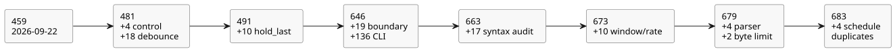

# Compiler diagnostic acceptance

User request: test that syntax errors are reported correctly, covering every
compiler error. This supplements the active Reference/compiler/runtime TDD goal.

In this document: the scope and owners of the work, the assertions every case
must make, the completion rule, and a dated log of accepted evidence. The log
tracks the size of the **diagnostic/boundary catalog** — the finite set of
independently reported test cases for authored-source compiler diagnostics and
CLI ingress. The current catalog is **683 diagnostic/boundary cases** (see the
last section).

## Scope and ownership

| Layer | Owner | Evidence |
|---|---|---|
| Literate source, lexer, parser, source intent links, CLI | Sol | compiler-syntax-diagnostics tests and cases |
| Name/type checking, constants, functions, Result, limits | Astra | compiler-semantic-diagnostics tests and cases |
| Mechanical source inventory and existing fixture maintenance | Luna | compiler-diagnostics-inventory.md |
| Scope, mapping review, integration and acceptance | Root | review of actual assertions and preserved execution results |

The mechanical inventory is a search aid only. A matched line is not necessarily
one diagnostic, a reachable path, or a covered case. Helper definitions,
rethrows, multiple calls on one line and parameterized expectations need explicit
review.

Compiler errors that can be reached through canonical source must be tested
through that public path. Internal IR/artifact guards are classified separately;
a test with malformed IR does not substitute for an authored-source diagnostic
test.

## Required assertions

- Each reachable diagnostic family has a stable, independently reported case or
  an exact existing test locator. Distinct callsites that share message text are
  not assumed to be equivalent.
- The test rejects the intended error, with specific category/message
  assertions. A generic thrown exception or an unrelated earlier diagnostic is
  not enough.
- When the diagnostic concerns a source position, check the original filename,
  line and column. Exercise CRLF, Unicode, multiple executable fences and EOF.
- Pair the malformed source with a valid nearby form, to show that the intended
  parser/type-checking path is reached. Validate limits at their meaningful
  boundaries.
- A CLI rejection has a nonzero exit status and a diagnostic on stderr. It must
  not write a new executable artifact. Usage errors and source rejections are
  distinct.
- Failures stay RED until they are corrected. Do not skip tests, weaken messages
  or change a valid/invalid expectation to match an implementation defect.

## Completion

Every inventory candidate must be either mapped to a case, consolidated with a
justified shared diagnostic path, or excluded with a concrete internal or
unreachable classification. Every required case must run. New failures must be
fixed and reverified before complete diagnostic coverage can be claimed.

Infinitely many malformed strings and external OS failure combinations are not
a finite compiler diagnostic catalog.

## Accepted evidence (2026-09-22)

The audit of the current canonical-source and CLI diagnostic families is
complete. The initial 450 mechanical matches are reconciled by scope in
`compiler-diagnostics-inventory.md`. The evidence is split as follows:

- parser/ingress cases and exclusions: `tests/fixtures/compiler-syntax-diagnostics.json`;
- semantic/literal/GFB paths: `compiler-semantic-diagnostics-coverage.md`;
- optional interaction emission: `compiler-interaction-diagnostics-coverage.md`.

No branch-coverage percentage, and no exhaustive artifact-restore or
runtime-fault coverage, is asserted.

| Suite | Independent leaf tests | Result |
|---|---:|---|
| Syntax, literate, intent and CLI | 187 | Pass; 196 including parent groups |
| Semantic, type and compiler limits | 258 | Pass; initial 257 plus one later module-size boundary case |
| Interaction identity and provenance | 14 | Pass |
| Total | 459 | Pass; 468 including parent groups |

The tests found, and drove fixes for: trailing-token diagnostics, intent location
fields, CLI operand arity and strict UTF-8 ingress, quantity error locations,
pure-function schedule capture, and local member shadowing. CLI regressions also
preserve BOM source identity, filesystem diagnostics and existing output files.

The Batch6 full gate (`build/compiler-runtime-batch6-full.log`) exited 1: 1543
Node tests, 1347 pass, 32 fail, 164 TODO, zero skip. All 32 failures are
existing Reference cases; no non-Reference failures remain. Tutorial
verification did not run after that failure. The later test-only module-size
addition passed separately (`build/compiler-semantic-module-limit.log`).
Production code did not change after the full gate. The overall
compiler/runtime goal is unfinished.

## Incremental audit (2026-09-23)

Luna reviewed source/CLI ingress and found no additional uncovered diagnostic
family; see the [ingress audit](compiler-ingress-diagnostics-extra.md).
Sol reviewed the current parser/lowerer guards and added four independent public
source cases: Result payload typing, nominal enum initial typing, physical
debounce state accounting, and generated sample input accounting. See the
[case mapping](compiler-control-diagnostics-extra.md).

The new suite is explicitly registered in `tools/verify-language.mjs`.
Together with the prior 459 cases and 18 debounce cases, this gives 481
independent cases. This is a finite source/CLI diagnostic catalog. It does not
claim that every malformed string, runtime fault, or artifact integrity failure
is covered. The previous batch8 full-gate evidence predates this test-only
addition.

Focused verification: `node --test tests/compiler-control-diagnostics-extra.test.mjs`
exited 0; **4/4 passed**, with no skip or TODO. Evidence:
`build/compiler-control-diagnostics-extra.log`. The accepted budget neighbors
also assert 126 distinct generated states and 128 distinct inputs respectively.
Root reviewed all four cases and the registration; `git diff --check` passed.
The unchanged existing suites and the full compiler/runtime gate were not rerun.

## Hold diagnostics and batch9

The next measured `hold_last` slice adds ten independent diagnostic/boundary
cases in `tests/hold-last-diagnostics.test.mjs`. They include the unchanged
128-state limit: nine single-root holds use 117 states and are accepted; ten
require 130 and are rejected. Total focused diagnostic/boundary cases: **491**.
`build/hold-last-focused-final.log` records the new cases passing.

The later full gate `build/compiler-runtime-batch9-full.log` includes all
diagnostic suites and has no non-Reference failures. Its 30 other Reference
failures and 164 TODO cases still prevent overall compiler/runtime completion.

## Diagnostic follow-up (2026-09-23)

The user requested additional syntax/error tests, delegated by difficulty. The
finite catalog remains authored-source compiler diagnostics and CLI ingress.
Artifact restore mutations, runtime faults, and arbitrary OS failures are
separate contracts. The existing 491 cases are the baseline, not a
branch-coverage claim.

- Luna: replay every syntax fixture through the real CLI check and build,
  checking the exact diagnostics and the preservation or absence of every
  executable artifact file.
- Sol: nested grammar, missing delimiters and premature EOF, with exact original
  Markdown positions and adjacent valid documents.
- Astra: adversarial review of coverage exclusions and diagnostic correctness.
- Root: integration, the source-position fix, test review and acceptance evidence.

The new tests exposed an EOF mapping defect. The synthetic final newline in the
extracted code placed the error outside the copied source map, and the public
compiler then leaked extracted coordinates. The rule is: a terminal EOF must
point to the insertion position at the end of the last authored code line.
Generated separators and unrelated invalid source-map coordinates must remain
unmapped.

The adversarial review also reproduced corruption when a valid filename contains
`:1:2: `. Prefix removal now uses the exact original filename/line/column instead
of a regex that could consume part of the filename.

Accepted focused evidence:

- `compiler-syntax-boundaries.test.mjs`: 19 new leaf cases, 23 including parent
  groups. RED: `build/compiler-syntax-boundaries-red.log`; GREEN:
  `build/compiler-syntax-boundaries-green.log`.
- `compiler-cli-diagnostics.test.mjs`: all 135 existing syntax fixtures exercised
  through both check and build, plus one valid build control: 136 leaves, 137
  including the parent. Alternating build destinations prove that `.gfb`,
  `.manifest.json`, and `.map.json` are either not created or preserved
  byte-identical.
- Both suites are explicitly registered in `tools/verify-language.mjs`.
- Combined diagnostics plus literate/source-validation/toolchain regression:
  `build/compiler-diagnostics-followup.log`, exit 0, **729 pass / 0 fail /
  0 skip / 0 TODO**, including parent groups. No full `npm test` rerun.

The diagnostic/boundary catalog now has **646 independent cases** (491 existing
+ 19 boundary cases + 136 CLI cases). This is not 646 distinct error kinds and
does not assert a complete Reference implementation.

The review also found a separate missing valid-source acceptance case for `Int`
operating settings. `REF-05-108` was added with its expected acceptance
unchanged; its initial focused check/build run was RED. It was later corrected
in batch10 with compiler/runtime metadata and signed-package tests. See
[the separate gap record](compiler-int-settings-gap.md). This case was absent
from the batch9 suite.

## Additional syntax audit (2026-09-23)

- Luna mapped the current Int diagnostic guards to existing cases and clarified
  that the inventory's original `UNMAPPED` rows are historical discovery records.
- Astra corrected a false exclusion for the public compiled-module byte limit:
  named expression reuse can reach it, and the existing semantic boundary test
  already exercises it. The syntax fixture now delegates to that test explicitly.
- Six new token-boundary tests exercise a valid document with exactly 8,192
  tokens, and an 8,193rd token that is an identifier, number, symbol, tagged
  date, or JSON string. Each rejection checks the exact message, original
  filename, line and column.
- The string case exposed a real diagnostic defect: a catch around both
  `JSON.parse` and token insertion converted token-limit failures into
  `invalid string literal`. The catch now covers only JSON decoding.
  Astra independently reviewed the token count and the narrow fix.
- Sol added eleven nested function/case/if/pipeline and delimiter cases, with
  exact diagnostic locations and adjacent valid documents. Focused execution:
  `build/compiler-syntax-structure.log`, **11/11 pass**, exit 0.
- Both new suites are explicitly registered in `tools/verify-language.mjs`.
  Root reviewed their assertions and the fix. The combined diagnostic suites,
  including CLI check/build, semantics, Int settings, debounce and hold errors,
  passed **687/687**, exit 0, with no skips or TODOs:
  `build/compiler-diagnostics-audit-final.log`. With the separate eleven
  structural tests, this verification totals **698 passing tests** (including
  parent groups). The full compiler/runtime gate was not rerun.

This increment adds **17 independent cases** to the prior diagnostic catalog.

## Bare-CR newline follow-up

Four additional public-source cases cover bare carriage-return newline
positions and diagnostics. RED evidence is retained in
`build/compiler-newline-diagnostics-red.log`; the affected suite passed
**233/233** in `build/compiler-newline-affected.log`. The current catalog is
**687 independent cases**. This is focused evidence only; no full gate result
is claimed.

> **Editorial note.** The 687 figure in the previous paragraph does not match
> the running catalog count in the surrounding records (646 + 17 = 663, then
> 673, 679 and 683). The four bare-CR cases are not visibly included in that
> running count. Both figures are kept exactly as recorded.

The catalog therefore contains **663 independent diagnostic/boundary cases**.
Luna's final bounded review found no concrete unmapped active authored-source or
CLI diagnostic family. This is a catalog audit, not exhaustive branch coverage.
The batch11 full host gate also ran these suites without diagnostic failures.
That gate still failed on 27 other Reference cases and four integration-test or
catalog maintenance failures; see the latest Reference baseline for follow-up.

These records establish named diagnostic families and tested boundaries. They
do not prove every compound-condition branch or every malformed combination.
The unrelated GFB4/window integration remains unfinished and is not certified
by this focused diagnostic run.

## Current window/rate diagnostic follow-up (2026-09-23)

- Luna audited the current mappings and registration. Root corrected two
  distinctions in `compiler-diagnostics-current-audit.md`: reachable
  parser-size diagnostics versus internal helper guards, and test cases versus
  suites.
- Sol added ten independently reported window/rate diagnostic and boundary cases
  in `tests/compiler-window-diagnostics.test.mjs`. The mapping is in
  `compiler-window-diagnostics-coverage.md`.
- Every new rejection asserts `ControlCompileError`, the exact message and the
  original Markdown filename, line and column. Each case also compiles a valid
  neighbor. The temporal budget test accepts 127 scalar states plus one window
  and rejects 128 scalar states plus one window.
- Root reviewed the assertions and registered the suite in `tools/verify-language.mjs`.
  No compiler or runtime behavior changed in this follow-up.
- Existing ten diagnostic suites: **677/677 pass**, zero skips/TODOs, exit 0,
  `build/compiler-diagnostics-current-regression.log`.
- New suite: **10/10 pass**, zero skips/TODOs, exit 0,
  `build/compiler-window-diagnostics.log`.
  These two focused executions total **687 passing tests**, including
  parent groups in the existing suites. The full compiler/runtime gate was not rerun.

The named diagnostic/boundary catalog grows from 663 to **673 independent cases**.
This count is not a count of distinct error kinds. The audit does not establish
exhaustive compound-branch, malformed-artifact, runtime-fault or OS-error coverage.

## Parser callsite and nested-window byte-limit follow-up

- Luna audited the lexer/literate/CLI ingress mappings and found no missing family.
- Sol mapped the active parser helpers and added four cases: a missing repeated
  port name, a repeated enum member, the first Result payload type, and a
  repeated mutex name. Each includes a valid neighbor and the exact error class,
  filename, line, column and message. `build/compiler-parser-callsites.log`:
  4/4 passed, exit 0.
- Astra found a distinct public-source path to the GFB4 window source-expression
  byte-limit guard. Luna added the cases for seven transforms (accepted) and
  eight transforms (rejected). `build/compiler-window-byte-limit.log`: 2/2
  passed, exit 0.
- Root reviewed the assertions, registered both suites, and removed a stale
  claim that derived windows are rejected. Compiler/runtime behavior is unchanged.

Catalog: **679 independent diagnostic/boundary cases** (673 + 4 + 2).
This increment verifies six tests; it does not claim that all 679 were rerun.
Existing accepted evidence remains in the records above and in batch13. No full
host gate was rerun for these test-only additions. Arbitrary malformed strings,
artifact/runtime faults and OS failures are not an exhaustive syntax test domain.

## DailySlots duplicate fields — after batch15

Reference §3.5 requires each schedule field exactly once. Luna added four
public `.ghost.md` rejection cases for a repeated `timezone` and a repeated
`selected`, each with identical and with different values. RED: 4/4 failed
because compilation accepted the duplicates
(`build/compiler-schedule-duplicates-red.log`). A minimal parser seen-set now
reports the repeated field. Root requested exact error class, message,
filename, line and column assertions, plus a valid neighbor. GREEN: 5/5
including that positive control (`build/compiler-schedule-duplicates.log`).
Root's affected regression suites passed 231/231
(`build/schedule-duplicates-regression.log`). No full gate rerun was needed for
this bounded parser guard. Batch15 remains historical source-specific evidence.

Current catalog: **683 diagnostic/boundary cases** (679 + 4); the positive
control is not counted as another rejection. Full schedule policy semantics
remain separate work and are not implied by this fix.

The diagram below summarizes how the catalog grew through these records. It
follows the running count used above; the four bare-CR cases are not shown
because the records do not place them in that count.

