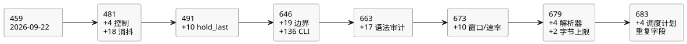

<!-- translation-source: tasks/compiler-diagnostics-plan.md -->
[英文原文](compiler-diagnostics-plan.md)

# 编译器诊断验收

用户请求：测试语法错误是否被正确报告，覆盖每一种编译器错误。这是对当前
Reference/编译器/运行时 TDD 目标的补充。

本文内容：工作的范围和负责人、每个用例必须做出的断言、完成规则，以及已接受证据的
按日期日志。该日志跟踪**诊断/边界目录**的规模——即针对作者编写的源中的编译器诊断和
CLI 入口、可独立报告的有限测试用例集合。当前目录为 **683 个诊断/边界用例**
（见最后一节）。

## 范围和负责人

| 层 | 负责人 | 证据 |
|---|---|---|
| 文学式源文件、词法分析器、解析器、源意图链接、CLI | Sol | compiler-syntax-diagnostics 测试和用例 |
| 名称/类型检查、常量、函数、Result、限制 | Astra | compiler-semantic-diagnostics 测试和用例 |
| 机械式源清单以及现有夹具维护 | Luna | compiler-diagnostics-inventory.md |
| 范围、映射评审、集成和验收 | Root | 对实际断言和保留执行结果的评审 |

机械式清单只是一种搜索辅助。匹配到的一行不一定是一个诊断、一条可达路径或一个已覆盖的
用例。辅助函数定义、重新抛出、同一行上的多次调用以及参数化的预期都需要显式评审。

能够通过规范源到达的编译器错误，必须通过该公共路径进行测试。内部 IR/产物守卫单独分类；
使用畸形 IR 的测试不能替代针对作者编写的源的诊断测试。

## 必需的断言

- 每个可达的诊断族都有一个稳定、可独立报告的用例，或一个精确的现有测试定位符。共享
  消息文本的不同调用点不被视为等价。
- 测试拒绝预期的错误，并做出具体的类别/消息断言。泛泛地抛出异常或一个无关的、更早的
  诊断是不够的。
- 当诊断涉及源位置时，检查原始文件名、行和列。要覆盖 CRLF、Unicode、多个可执行围栏
  以及 EOF。
- 将畸形源与附近的有效形式配对，以证明到达了预期的解析/类型检查路径。在限制具有意义的
  边界处验证这些限制。
- CLI 拒绝具有非零退出状态，并在 stderr 上输出诊断。它不得写入新的可执行产物。用法错误
  与源拒绝是不同的。
- 失败在被修正之前保持 RED。不得跳过测试、弱化消息，或为迁就实现缺陷而改变有效/无效
  预期。

## 完成

每个清单候选项必须被映射到某个用例、以有正当理由的共享诊断路径合并，或以具体的内部或
不可达分类排除。每个必需的用例都必须运行。在能够声称完整的诊断覆盖之前，新的失败必须
被修复并重新验证。

无穷多的畸形字符串和外部 OS 故障组合不是一个有限的编译器诊断目录。

## 已接受的证据（2026-09-22）

对当前规范源和 CLI 诊断族的审计已完成。最初的 450 个机械匹配已在
`compiler-diagnostics-inventory.md` 中按范围核对。证据划分如下：

- 解析器/入口用例和排除项：`tests/fixtures/compiler-syntax-diagnostics.json`；
- 语义/字面量/GFB 路径：`compiler-semantic-diagnostics-coverage.md`；
- 可选的交互发射：`compiler-interaction-diagnostics-coverage.md`。

不声称任何分支覆盖率百分比，也不声称穷尽的产物恢复或运行时故障覆盖。

| 套件 | 独立叶子测试 | 结果 |
|---|---:|---|
| 语法、文学式、意图和 CLI | 187 | 通过；含父组共 196 |
| 语义、类型和编译器限制 | 258 | 通过；最初 257，加上之后一个模块大小边界用例 |
| 交互身份标识和来源 | 14 | 通过 |
| 合计 | 459 | 通过；含父组共 468 |

这些测试发现并推动修复了：尾随记号诊断、意图位置字段、CLI 操作数个数和严格 UTF-8 入口、
物理量错误位置、纯函数对调度计划的捕获，以及局部成员遮蔽。CLI 回归测试还保持了 BOM
源身份标识、文件系统诊断以及现有输出文件。

Batch6 完整门禁（`build/compiler-runtime-batch6-full.log`）以 1 退出：1543 个 Node 测试，
1347 通过，32 失败，164 TODO，零跳过。全部 32 个失败都是现有的 Reference 用例；不存在
非 Reference 失败。在该失败之后，教程验证没有运行。之后仅涉及测试的模块大小用例单独通过
（`build/compiler-semantic-module-limit.log`）。完整门禁之后生产代码没有变化。整体
编译器/运行时目标尚未完成。

## 增量审计（2026-09-23）

Luna 评审了源/CLI 入口，没有发现额外未覆盖的诊断族；见[入口审计](compiler-ingress-diagnostics-extra.zh.md)。
Sol 评审了当前的解析器/降级器守卫，并新增了四个独立的公共源用例：Result 载荷类型、
名义枚举初始值类型、物理消抖状态核算，以及生成的样本输入核算。见
[用例映射](compiler-control-diagnostics-extra.zh.md)。

新套件已在 `tools/verify-language.mjs` 中显式注册。加上之前的 459 个用例和 18 个消抖用例，
共有 481 个独立用例。这是一个有限的源/CLI 诊断目录。它并不声称覆盖了每个畸形字符串、
运行时故障或产物完整性失败。之前的 batch8 完整门禁证据早于这次仅涉及测试的新增。

针对性验证：`node --test tests/compiler-control-diagnostics-extra.test.mjs` 以 0 退出；
**4/4 通过**，没有跳过或 TODO。证据：`build/compiler-control-diagnostics-extra.log`。
被接受的预算相邻用例还分别断言了 126 个不同的生成状态和 128 个不同的输入。Root 评审了
全部四个用例以及注册；`git diff --check` 通过。未变化的现有套件和完整的编译器/运行时
门禁没有重新运行。

## hold 诊断与 batch9

下一个经测量的 `hold_last` 切片在 `tests/hold-last-diagnostics.test.mjs` 中新增了十个独立的
诊断/边界用例。其中包括未改变的 128 状态限制：九个单根 hold 使用 117 个状态并被接受；
十个需要 130 个状态并被拒绝。针对性诊断/边界用例总数：**491**。
`build/hold-last-focused-final.log` 记录了新用例通过。

之后的完整门禁 `build/compiler-runtime-batch9-full.log` 包含所有诊断套件，且没有
非 Reference 失败。其另外 30 个 Reference 失败和 164 个 TODO 用例仍然阻碍整体
编译器/运行时的完成。

## 诊断后续工作（2026-09-23）

用户请求了额外的语法/错误测试，并按难度分派。有限目录仍然是作者编写的源中的编译器诊断
和 CLI 入口。产物恢复变异、运行时故障和任意 OS 故障是单独的契约。现有的 491 个用例是
基线，而不是分支覆盖率声明。

- Luna：通过真实的 CLI check 和 build 重放每个语法夹具，检查确切的诊断，以及每个可执行
  产物文件被保留还是不存在。
- Sol：嵌套语法、缺失分隔符和过早 EOF，附带确切的原始 Markdown 位置以及相邻的有效文档。
- Astra：对覆盖排除项和诊断正确性进行对抗性评审。
- Root：集成、源位置修复、测试评审和验收证据。

新测试暴露了一个 EOF 映射缺陷。提取代码中合成的末尾换行把错误放到了复制的源映射之外，
公共编译器随后泄露了提取后的坐标。规则是：终止 EOF 必须指向最后一行作者编写代码末尾的
插入位置。生成的分隔符和无关的无效源映射坐标必须保持未映射。

对抗性评审还复现了一个有效文件名包含 `:1:2: ` 时的损坏问题。前缀移除现在使用确切的原始
文件名/行/列，而不是可能吞掉部分文件名的正则表达式。

已接受的针对性证据：

- `compiler-syntax-boundaries.test.mjs`：19 个新的叶子用例，含父组共 23 个。RED：
  `build/compiler-syntax-boundaries-red.log`；GREEN：`build/compiler-syntax-boundaries-green.log`。
- `compiler-cli-diagnostics.test.mjs`：全部 135 个现有语法夹具同时经由 check 和 build 执行，
  外加一个有效 build 对照：136 个叶子，含父组共 137 个。交替的 build 目标证明
  `.gfb`、`.manifest.json` 和 `.map.json` 要么未被创建，要么保持字节完全相同。
- 两个套件都已在 `tools/verify-language.mjs` 中显式注册。
- 诊断加上文学式/源校验/工具链回归的合并运行：`build/compiler-diagnostics-followup.log`，
  退出码 0，**729 通过 / 0 失败 / 0 跳过 / 0 TODO**，含父组。没有重新运行完整的 `npm test`。

诊断/边界目录现在有 **646 个独立用例**（491 个现有 + 19 个边界用例 + 136 个 CLI 用例）。
这不是 646 种不同的错误类型，也不声称 Reference 已完整实现。

评审还发现了另一个单独缺失的有效源验收用例：`Int` 运行设置。`REF-05-108` 已被加入，其
预期验收保持不变；最初的针对性 check/build 运行为 RED。它后来在 batch10 中通过编译器/运行时
元数据和签名包测试得到修正。见[单独的缺口记录](compiler-int-settings-gap.zh.md)。该用例
不在 batch9 套件中。

## 额外的语法审计（2026-09-23）

- Luna 将当前的 Int 诊断守卫映射到现有用例，并澄清清单中原有的 `UNMAPPED` 行是历史发现
  记录。
- Astra 纠正了一个针对公共已编译模块字节上限的错误排除：命名表达式重用可以到达该上限，
  而现有的语义边界测试已经覆盖了它。语法夹具现在显式委托给该测试。
- 六个新的记号边界测试覆盖了恰好包含 8,192 个记号的有效文档，以及第 8,193 个记号为
  标识符、数字、符号、带标签日期或 JSON 字符串的情况。每个拒绝都检查确切的消息、原始
  文件名、行和列。
- 字符串用例暴露了一个真实的诊断缺陷：同时包裹 `JSON.parse` 和记号插入的 catch 将
  记号上限失败转换成了 `invalid string literal`。该 catch 现在只覆盖 JSON 解码。
  Astra 独立评审了记号计数和这一窄范围修复。
- Sol 新增了十一个嵌套 function/case/if/pipeline 和分隔符用例，附带确切的诊断位置和相邻的
  有效文档。针对性执行：`build/compiler-syntax-structure.log`，**11/11 通过**，退出码 0。
- 两个新套件都已在 `tools/verify-language.mjs` 中显式注册。Root 评审了它们的断言和修复。
  合并的诊断套件（包括 CLI check/build、语义、Int 设置、消抖和 hold 错误）**687/687**
  通过，退出码 0，没有跳过或 TODO：`build/compiler-diagnostics-audit-final.log`。加上单独的
  十一个结构测试，本次验证共计 **698 个通过的测试**（含父组）。完整的编译器/运行时门禁
  没有重新运行。

本次增量为之前的诊断目录增加了 **17 个独立用例**。

## 裸 CR 换行后续工作

另外四个公共源用例覆盖了裸回车换行的位置和诊断。RED 证据保留在
`build/compiler-newline-diagnostics-red.log`；受影响的套件在
`build/compiler-newline-affected.log` 中 **233/233** 通过。当前目录为
**687 个独立用例**。这只是针对性证据；不声称完整门禁结果。

> **编者注。** 上一段中的 687 这一数字与周围记录中的累计目录计数不一致
> （646 + 17 = 663，随后是 673、679 和 683）。这四个裸 CR 用例并未明显计入该累计
> 计数。两个数字都按记录原样保留。

因此，目录包含 **663 个独立的诊断/边界用例**。
Luna 最终的有界评审没有发现具体的、未映射的现行作者编写源或 CLI 诊断族。这是一次目录
审计，而不是穷尽的分支覆盖。batch11 完整宿主门禁也运行了这些套件，没有诊断失败。
该门禁仍在另外 27 个 Reference 用例以及四个集成测试或目录维护失败上失败；后续工作请参见
最新的 Reference 基线。

这些记录确立了具名的诊断族和经测试的边界。它们并不证明每个复合条件分支或每个畸形组合。
无关的 GFB4/窗口集成仍未完成，本次针对性诊断运行也不对其作认证。

## 当前窗口/速率诊断后续工作（2026-09-23）

- Luna 审计了当前的映射和注册。Root 在 `compiler-diagnostics-current-audit.md` 中纠正了
  两处区分：可达的解析器大小诊断与内部辅助守卫，以及测试用例与套件。
- Sol 在 `tests/compiler-window-diagnostics.test.mjs` 中新增了十个可独立报告的窗口/速率诊断
  和边界用例。映射见 `compiler-window-diagnostics-coverage.md`。
- 每个新拒绝都断言 `ControlCompileError`、确切的消息以及原始 Markdown 文件名、行和列。
  每个用例还会编译一个有效的相邻形式。时间预算测试接受 127 个标量状态加一个窗口，
  并拒绝 128 个标量状态加一个窗口。
- Root 评审了断言，并在 `tools/verify-language.mjs` 中注册了该套件。本次后续工作没有改变
  任何编译器或运行时行为。
- 现有的十个诊断套件：**677/677 通过**，零跳过/TODO，退出码 0，
  `build/compiler-diagnostics-current-regression.log`。
- 新套件：**10/10 通过**，零跳过/TODO，退出码 0，
  `build/compiler-window-diagnostics.log`。
  这两次针对性执行共计 **687 个通过的测试**，包含现有套件中的父组。完整的编译器/运行时
  门禁没有重新运行。

具名的诊断/边界目录从 663 增长到 **673 个独立用例**。该计数不是不同错误类型的计数。
本次审计并未确立穷尽的复合分支、畸形产物、运行时故障或 OS 错误覆盖。

## 解析器调用点与嵌套窗口字节上限后续工作

- Luna 审计了词法分析器/文学式/CLI 入口映射，没有发现缺失的族。
- Sol 映射了现行的解析器辅助函数，并新增了四个用例：缺失的重复端口名、重复的枚举成员、
  第一个 Result 载荷类型，以及重复的 mutex 名称。每个用例都包含一个有效的相邻形式，以及
  确切的错误类、文件名、行、列和消息。`build/compiler-parser-callsites.log`：
  4/4 通过，退出码 0。
- Astra 找到了一条到达 GFB4 窗口源表达式字节上限守卫的不同公共源路径。Luna 新增了七个
  变换（被接受）和八个变换（被拒绝）的用例。`build/compiler-window-byte-limit.log`：2/2
  通过，退出码 0。
- Root 评审了断言，注册了两个套件，并删除了一条声称派生窗口会被拒绝的过时说法。
  编译器/运行时行为没有变化。

目录：**679 个独立的诊断/边界用例**（673 + 4 + 2）。
本次增量验证了六个测试；它并不声称全部 679 个都重新运行过。现有的已接受证据仍保留在上述
记录和 batch13 中。对于这些仅涉及测试的新增，没有重新运行完整的宿主门禁。任意畸形字符串、
产物/运行时故障和 OS 故障不是穷尽语法测试的定义域。

## DailySlots 重复字段——batch15 之后

Reference §3.5 要求每个调度计划字段恰好出现一次。Luna 新增了四个公共 `.ghost.md` 拒绝用例，
分别针对重复的 `timezone` 和重复的 `selected`，每种都包括值相同和值不同两种情况。RED：
4/4 失败，因为编译接受了重复字段（`build/compiler-schedule-duplicates-red.log`）。一个最小的
解析器已见集合现在会报告重复字段。Root 要求断言确切的错误类、消息、文件名、行和列，并加上
一个有效的相邻形式。GREEN：含该正向对照共 5/5（`build/compiler-schedule-duplicates.log`）。
Root 的受影响回归套件 231/231 通过（`build/schedule-duplicates-regression.log`）。对于这一
有界的解析器守卫，不需要重新运行完整门禁。Batch15 仍是特定于源的历史证据。

当前目录：**683 个诊断/边界用例**（679 + 4）；正向对照不计为另一个拒绝。完整的调度计划
策略语义仍是单独的工作，本次修复并不意味着已完成。

下图总结了目录在这些记录中的增长过程。它遵循上文使用的累计计数；四个裸 CR 用例没有显示，
因为记录并未将其计入该计数。

