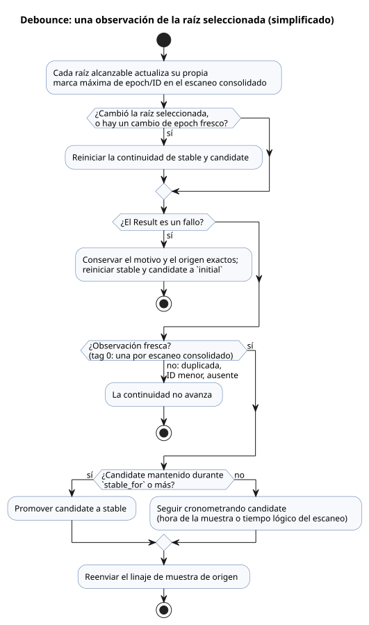

<!-- translation-source: tasks/debounce-design.md -->
[Original en inglés](debounce-design.md)

# Contrato vertical de debounce

Este contrato describe cómo funciona `debounce` de extremo a extremo: la sintaxis
de origen, el descriptor de manifiesto que emite el compilador, los estados
privados de la VM que genera, cómo se cuentan las muestras de sensores físicos y
cómo un tick (paso de decisión lógica) consolida o revierte. Una «raíz física» (o
simplemente «raíz») es una fuente de sensor físico que una expresión de debounce
puede alcanzar estáticamente.

**Sintaxis y tipos**

- `signal x = debounce(source, stable_for: duration, initial: value);` acepta un
  Bool o una enumeración (enum) finita con nombre.
- `stable_for` es una `Duration` constante y positiva.
- `initial` tiene el tipo de la carga útil (payload).

**Descriptor de manifiesto**

- Un descriptor de manifiesto de debounce es
  `{kind:"debounce",name,payloadType,errorType,sourceMode,stableForMs,initial,clockInput,sources,states}`.
- `errorType` es `null` para valores sin procesar. Para un `Result` es la
  enumeración de fallos propiedad del compilador.
- `sourceMode` es `sample` cuando se puede seleccionar cualquier raíz de sensor
  físico. En caso contrario es `scan`.
- `sources` es la lista de raíces físicas únicas, ordenada por `tag` numérico
  ascendente. El nombre de la fuente resuelve los empates de forma determinista.
- Los descriptores de enumeración también contienen el arreglo ordenado
  `members`. Los descriptores Bool lo omiten.

**Estados privados generados**

- `states` tiene exactamente estos roles: `stable`, `candidate`,
  `candidateActive`, `candidateSince` y `lastSourceTag`.
- Cada estado generado se llama `__gf_debounce_<role>_<signal>`. Los nombres de
  rol en camelCase se convierten a snake_case.
- `stable` y `candidate` usan el tipo de máquina de la carga útil.
  `candidateActive` es Bool. Los estados restantes son Number.
- Cada entrada de fuente física es `{name,tag,states:{lastEpoch,lastId}}`. Sus
  nombres de estado son `__gf_debounce_source_epoch_<signal>_<tag>` y
  `__gf_debounce_source_id_<signal>_<tag>`, inicializados en `0` y `-1`.
- Cantidad de estados: un debounce sin procesar tiene cinco estados privados. Un
  debounce físico tiene esos cinco más dos por cada raíz alcanzable
  estáticamente.

**Entradas de muestra desde sensores físicos**

- Un descriptor de sensor físico asigna el grupo de entradas generadas
  `samplePresentInput`, `sampleEpochInput`, `sampleIdInput` y
  `sampleTimestampInput` solo cuando una expresión de debounce puede observar esa
  raíz. El grupo es de todo o nada: o existen las cuatro entradas o no existe
  ninguna.
- *Presente* significa que quien llama proporcionó una muestra **y** que el
  acondicionador conserva una identidad aceptada para ella.
- El epoch, el ID, la marca de tiempo y la carga útil provienen de esa muestra
  autorizada y aceptada por el acondicionador. Nunca provienen de una tupla
  duplicada o más antigua que el acondicionador ignoró.
- El compilador proporciona como `sourceTag` el ID positivo del nodo de origen
  del sensor.

**Linaje de muestras a través de las expresiones**

- Un `Result` transitorio reducido (lowered) transporta el linaje de la muestra
  por separado de la procedencia del fallo: `{sourceTag,present,epoch,id,timestamp}`.
- `map` y `and_then` preservan el linaje de origen.
- `if` y `case` seleccionan cada campo del linaje (no solo la carga útil).
- Los constructores sin linaje físico son observaciones de escaneo:
  `sourceTag=0`, presentes, y timestamp=`__gf_now_ms`.

**Frescura y continuidad**

- El tag de origen cero significa una observación lógica por cada escaneo
  consolidado.
- Para un tag positivo, una muestra es *fresca* cuando está presente y, o bien
  su epoch difiere del epoch de marca máxima (high-water) de esa raíz, o bien su
  epoch es el mismo y su ID es mayor.
- Cada raíz alcanzable estáticamente actualiza su propio estado de marca máxima
  en cada escaneo consolidado, incluso mientras no está seleccionada o está en
  fallo.
- Las muestras físicas duplicadas, con ID menor o ausentes no hacen avanzar la
  continuidad.
- Un cambio de la raíz seleccionada reinicia la continuidad de stable y
  candidate, independientemente de que haya muestra presente. Un cambio de epoch
  fresco en la raíz seleccionada también reinicia la continuidad.
- El historial de marca máxima por raíz sobrevive a los cambios de raíz y a los
  fallos. Por lo tanto, volver a una raíz no puede reproducir una identidad
  antigua.

**Fallos**

- Un fallo conserva el motivo y el origen exactos de su `Result`, y reinicia los
  estados stable y candidate al valor `initial` escrito por el autor.
- Una identidad de fallo fresca se sigue consumiendo en el estado de marca
  máxima de esa raíz.
- Un debounce exitoso reenvía el linaje de la muestra de origen. Por lo tanto,
  los nodos de debounce posteriores ven cada muestra física de origen, incluidas
  las muestras cuya carga útil estable no cambió.

**Temporización y promoción**

- El tiempo del candidato usa la marca de tiempo de la muestra física para el
  linaje de `Result`, y el tiempo lógico del escaneo para los valores sin
  procesar.
- La promoción ocurre en la primera observación fresca en `stable_for` o
  después.
- La transición y la carga útil del mismo tick comparten una única expresión
  pura de estado siguiente.

El diagrama siguiente resume cómo se clasifica una observación de la raíz
seleccionada. Es una vista simplificada de las reglas anteriores, no el orden de
evaluación exacto de la expresión generada.

**Traza**

- La traza de origen registra, sobre un nodo de origen analizado con
  `signalMode:"debounce"`, los cinco estados privados comunes más vinculaciones
  `sourceEpoch` y `sourceId` emparejadas para cada raíz física.

**Transacciones y reversión**

- Un tick inicia una transacción propiedad de Rust en cada acondicionador de
  sensor y de señal antes del acondicionamiento.
- Un rechazo conocido de la VM o previo a la consolidación (precommit) revierte
  esas transacciones junto con los estados de debounce y de marca máxima
  propiedad de la VM. Por lo tanto, un reintento parte de la última identidad de
  muestra y carga útil completamente consolidadas.
- Consulte [transacciones de escaneo de sensores](sensor-atomicity-design.es.md)
  para el estado de consolidación nativo y el manejo de errores posteriores a la
  consolidación (postcommit). Estas transacciones en memoria no proporcionan
  puntos de control (checkpoints) duraderos ante reinicios.
