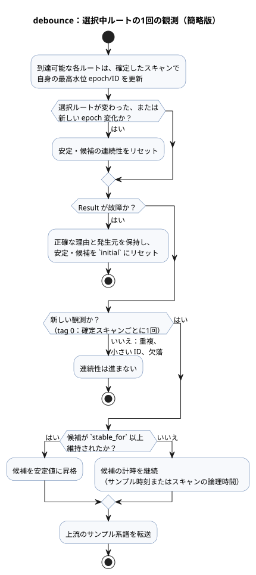

<!-- translation-source: tasks/debounce-design.md -->
[英語の原文](debounce-design.md)

# debounce の垂直契約

この契約は、`debounce`（チャタリング除去）がエンドツーエンドでどのように動作するかを説明します。対象は、ソース構文、コンパイラが出力するマニフェストのディスクリプタ、生成される非公開の VM 状態、物理センサのサンプルの数え方、そして tick（論理判断の単位）がどのように確定またはロールバックされるかです。「物理ルート」（または単に「ルート」）とは、debounce 式から静的に到達できる物理センサのソースを指します。

**構文と型**

- `signal x = debounce(source, stable_for: duration, initial: value);` は、Bool または名前付きの有限列挙型（enum）を受け付けます。
- `stable_for` は正の定数 `Duration` です。
- `initial` はペイロードの型を持ちます。

**マニフェストのディスクリプタ**

- debounce のマニフェストディスクリプタは
  `{kind:"debounce",name,payloadType,errorType,sourceMode,stableForMs,initial,clockInput,sources,states}` です。
- `errorType` は生の値では `null` です。`Result` の場合は、コンパイラが所有する故障（fault）列挙型です。
- `sourceMode` は、いずれかの物理センサルートが選択されうる場合は `sample`、それ以外は `scan` です。
- `sources` は一意な物理ルートのリストで、数値 `tag` の昇順に並びます。同順位はソース名で決定的に決まります。
- 列挙型のディスクリプタは、順序付きの `members` 配列も含みます。Bool のディスクリプタはこれを省略します。

**生成される非公開の状態**

- `states` はちょうど次のロールを持ちます：`stable`、`candidate`、`candidateActive`、`candidateSince`、`lastSourceTag`。
- 生成される各状態の名前は `__gf_debounce_<role>_<signal>` です。キャメルケースのロール名はスネークケースに変換されます。
- `stable` と `candidate` はペイロードのマシン型を使います。`candidateActive` は Bool です。残りの状態は Number です。
- 各物理ソースのエントリは `{name,tag,states:{lastEpoch,lastId}}` です。その状態名は `__gf_debounce_source_epoch_<signal>_<tag>` と `__gf_debounce_source_id_<signal>_<tag>` で、初期値はそれぞれ `0` と `-1` です。
- 状態の数：生の値の debounce は 5 個の非公開状態を持ちます。物理 debounce は、その 5 個に加えて、静的に到達可能なルートごとに 2 個を持ちます。

**物理センサからのサンプル入力**

- 物理センサのディスクリプタは、debounce 式がそのルートを観測できる場合に限り、生成入力グループ `samplePresentInput`、`sampleEpochInput`、`sampleIdInput`、`sampleTimestampInput` を割り当てます。このグループは全か無かです。4 つの入力がすべて存在するか、まったく存在しないかのどちらかです。
- *Present*（存在）とは、呼び出し側がサンプルを供給し、**かつ**コンディショナがそのサンプルについて受理済みの同一性を保持していることを意味します。
- epoch、ID、タイムスタンプ、ペイロードは、その権威ある受理済みのコンディショナのサンプルから取得します。コンディショナが無視した重複タプルや古いタプルから取得することは決してありません。
- コンパイラは、センサの正のソースノード ID を `sourceTag` として供給します。

**式を通じたサンプル系譜**

- 下位変換（lowering）された一時的な `Result` は、故障の来歴とは別にサンプル系譜 `{sourceTag,present,epoch,id,timestamp}` を運びます。
- `map` と `and_then` は上流の系譜を保持します。
- `if` と `case` は（ペイロードだけでなく）系譜のすべてのフィールドを選択します。
- 物理的な系譜を持たないコンストラクタはスキャン観測です：`sourceTag=0`、present、timestamp=`__gf_now_ms`。

**鮮度と連続性**

- ソースタグ 0 は、確定したスキャンごとに 1 回の論理観測を意味します。
- 正のタグでは、サンプルが present であり、かつ次のいずれかを満たすとき *fresh*（新しい）とみなされます：その epoch がそのルートの最高水位 epoch と異なる、または epoch が同じで ID がより大きい。
- 静的に到達可能なすべてのルートは、確定したスキャンごとに自身の最高水位状態を更新します。未選択中や故障中でも同様です。
- 重複したサンプル、ID が小さいサンプル、欠落した物理サンプルは連続性を進めません。
- 選択ルートが変わると、サンプルの有無にかかわらず、安定と候補の連続性がリセットされます。選択ルートで新しい epoch 変化が起きた場合も連続性がリセットされます。
- ルートごとの最高水位の履歴は、ルートの切り替えや故障をまたいで保持されます。そのため、あるルートに戻っても古い同一性を再生することはできません。

**故障**

- 故障は `Result` の正確な理由と発生元を保持し、安定状態と候補状態を記述された `initial` 値にリセットします。
- 新しい故障の同一性も、そのルートの最高水位状態に取り込まれます。
- 成功した debounce は上流のサンプル系譜を転送します。そのため下流の debounce ノードは、安定ペイロードが変化しなかったサンプルも含め、上流のすべての物理サンプルを参照します。

**タイミングと昇格**

- 候補の時間は、`Result` 系譜では物理サンプルのタイムスタンプを、生の値ではスキャンの論理時間を使います。
- 昇格は、`stable_for` 以上に達した最初の新しい観測で起こります。
- 遷移と同じ tick のペイロードは、1 つの純粋な次状態式を共有します。

下の図は、選択中ルートの 1 回の観測がどのように分類されるかを要約したものです。上記の規則を簡略化した図であり、生成される式の正確な評価順序ではありません。

**トレース**

- ソーストレースは、`signalMode:"debounce"` を持つ解析済みソースノード上に、共通の 5 個の非公開状態と、物理ルートごとに対になった `sourceEpoch` および `sourceId` のバインディングを記録します。

**トランザクションとロールバック**

- tick は、コンディショニングの前に、すべてのセンサおよび信号コンディショナ上で Rust が所有する 1 つのトランザクションを開始します。
- 既知の事前確定（precommit）エラーまたは VM による拒否が起きると、それらのトランザクションは VM が所有する debounce 状態および最高水位状態とともにロールバックされます。そのため再試行は、最後に完全に確定したサンプルの同一性とペイロードから始まります。
- ネイティブの確定ステータスと確定後（postcommit）のエラー処理については、[センサスキャンのトランザクション](sensor-atomicity-design.ja.md)を参照してください。これらのメモリ内トランザクションは、永続的な再起動用チェックポイントを提供しません。
