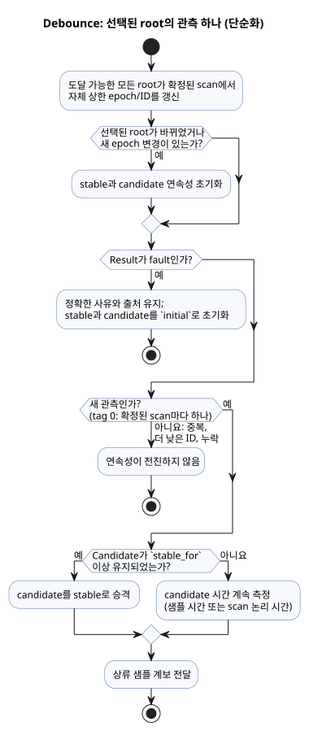

<!-- translation-source: tasks/debounce-design.md -->
[영문 원문](debounce-design.md)

# Debounce 수직 통합 계약

이 계약은 `debounce`가 처음부터 끝까지 어떻게 동작하는지 설명합니다. 소스 구문, 컴파일러가 내보내는 manifest descriptor, 컴파일러가 생성하는 VM private state, 물리 센서 샘플을 세는 방식, 그리고 tick이 확정되거나 rollback되는 방식을 다룹니다. "물리 root"(또는 간단히 "root")는 debounce 식이 정적으로 도달할 수 있는 물리 센서 소스를 말합니다.

**구문과 타입**

- `signal x = debounce(source, stable_for: duration, initial: value);`는 Bool 또는 이름 있는 유한 enum을 받습니다.
- `stable_for`는 양의 상수 `Duration`입니다.
- `initial`은 payload 타입을 가집니다.

**Manifest descriptor**

- Debounce manifest descriptor는
  `{kind:"debounce",name,payloadType,errorType,sourceMode,stableForMs,initial,clockInput,sources,states}`입니다.
- `errorType`은 원시값에서는 `null`입니다. `Result`에서는 컴파일러가 소유한 fault enum입니다.
- 선택될 수 있는 물리 센서 root가 하나라도 있으면 `sourceMode`는 `sample`입니다. 그렇지 않으면 `scan`입니다.
- `sources`는 중복 없는 물리 root 목록이며 숫자 `tag` 오름차순으로 정렬합니다. 동률이면 소스 이름으로 결정적으로 순서를 정합니다.
- Enum descriptor에는 순서가 있는 `members` 배열도 들어 있습니다. Bool descriptor에는 이 배열이 없습니다.

**생성되는 private state**

- `states`에는 정확히 `stable`, `candidate`, `candidateActive`, `candidateSince`, `lastSourceTag` 역할만 있습니다.
- 생성되는 각 상태의 이름은 `__gf_debounce_<role>_<signal>`입니다. camel case 역할 이름은 snake case로 변환합니다.
- `stable`과 `candidate`는 payload 기계 타입을 씁니다. `candidateActive`는 Bool입니다. 나머지 상태는 Number입니다.
- 각 물리 소스 항목은 `{name,tag,states:{lastEpoch,lastId}}`입니다. 상태 이름은 `__gf_debounce_source_epoch_<signal>_<tag>`와 `__gf_debounce_source_id_<signal>_<tag>`이며, 각각 `0`과 `-1`로 초기화합니다.
- 상태 개수: 원시 debounce에는 private state가 5개 있습니다. 물리 debounce에는 이 5개에 더해 정적으로 도달 가능한 root마다 2개가 더 있습니다.

**물리 센서의 샘플 입력**

- 물리 센서 descriptor는 debounce 식이 해당 root를 관측할 수 있을 때만 생성 입력 묶음 `samplePresentInput`, `sampleEpochInput`, `sampleIdInput`, `sampleTimestampInput`을 할당합니다. 이 묶음은 전부 아니면 전무입니다. 네 입력이 모두 있거나 하나도 없습니다.
- *Present*는 호출자가 샘플을 공급했고 **동시에** conditioner가 그 샘플에 대해 수용된 identity를 가지고 있다는 뜻입니다.
- Epoch, ID, 타임스탬프, payload는 권위 있는, 수용된 conditioner 샘플에서 가져옵니다. conditioner가 무시한 중복 tuple이나 더 오래된 tuple에서 가져오는 일은 절대 없습니다.
- 컴파일러는 센서의 양수 source node ID를 `sourceTag`로 공급합니다.

**식을 거치는 샘플 계보**

- Lowering된 임시 `Result`는 fault provenance와 별도로 샘플 계보 `{sourceTag,present,epoch,id,timestamp}`를 담습니다.
- `map`과 `and_then`은 상류 계보를 보존합니다.
- `if`와 `case`는 payload만이 아니라 모든 계보 필드를 선택합니다.
- 물리 계보가 없는 생성자는 scan 관측입니다. 즉 `sourceTag=0`, present, timestamp=`__gf_now_ms`입니다.

**새로움과 연속성**

- Source tag 0은 확정된 scan마다 논리 관측 하나를 뜻합니다.
- 양의 tag에서 샘플이 present이고, epoch가 해당 root의 상한(high-water) epoch와 다르거나 epoch가 같으면서 ID가 더 크면 그 샘플은 *새* 샘플입니다.
- 정적으로 도달 가능한 모든 root는 선택되지 않았거나 fault 상태여도 확정된 scan마다 자체 상한 상태를 갱신합니다.
- 중복 샘플, ID가 더 낮은 샘플, 누락된 물리 샘플은 연속성을 전진시키지 않습니다.
- 선택된 root가 바뀌면 샘플 존재 여부와 관계없이 stable과 candidate의 연속성을 초기화합니다. 선택된 root에서 새 샘플의 epoch가 바뀌어도 연속성을 초기화합니다.
- Root별 상한 이력은 root 전환과 fault를 거쳐도 유지됩니다. 따라서 이전 root로 돌아가도 옛 identity를 재생할 수 없습니다.

**Fault**

- Fault는 `Result`의 정확한 사유와 출처를 유지하며, stable과 candidate 상태를 작성자가 지정한 `initial` 값으로 초기화합니다.
- 새 fault identity도 해당 root의 상한 상태에 소비됩니다.
- 성공한 debounce는 상류 샘플 계보를 전달합니다. 따라서 하류 debounce node는 stable payload가 바뀌지 않은 샘플까지 포함해 모든 상류 물리 샘플을 봅니다.

**타이밍과 승격**

- Candidate 시간은 `Result` 계보에서는 물리 샘플 타임스탬프를, 원시값에서는 scan의 논리 시간을 씁니다.
- 승격은 `stable_for` 이상이 된 첫 새 관측에서 일어납니다.
- 전이와 같은 tick의 payload는 하나의 순수 다음 상태 식을 공유합니다.

아래 다이어그램은 선택된 root의 관측 하나가 어떻게 분류되는지 요약합니다. 위 규칙을 단순화한 그림이며, 생성된 식의 정확한 평가 순서를 나타내지는 않습니다.

**Trace**

- Source trace는 `signalMode:"debounce"`인 파싱된 source node에 공통 private state 5개와, 모든 물리 root에 대해 짝을 이루는 `sourceEpoch`, `sourceId` binding을 기록합니다.

**트랜잭션과 rollback**

- Tick은 conditioning 전에 모든 센서와 signal conditioner에서 Rust가 소유하는 트랜잭션 하나를 시작합니다.
- 알려진 precommit 거부나 VM 거부가 일어나면 그 트랜잭션들을 VM이 소유한 debounce 상태 및 상한 상태와 함께 rollback합니다. 따라서 재시도는 마지막으로 완전히 확정된 샘플 identity와 payload에서 시작합니다.
- Native commit 상태와 postcommit 오류 처리는 [센서 scan 트랜잭션](sensor-atomicity-design.ko.md)을 참조하세요. 이 메모리 내 트랜잭션은 재부팅에도 남는 영속 checkpoint를 제공하지 않습니다.
