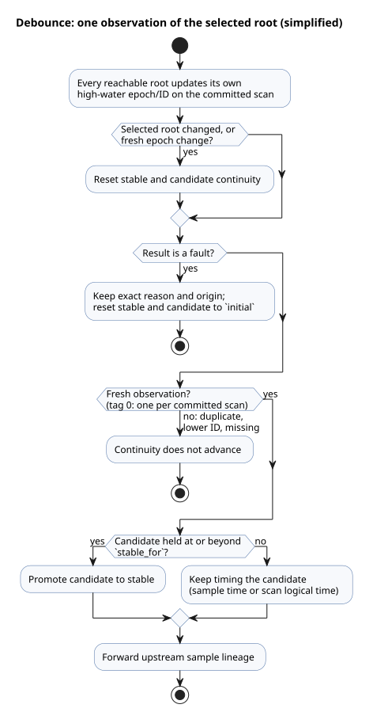

# Debounce vertical contract

This contract describes how `debounce` works end to end: the source syntax, the
manifest descriptor the compiler emits, the private VM states it generates, how
physical sensor samples are counted, and how a tick commits or rolls back. A
"physical root" (or simply "root") is a physical sensor source that a debounce
expression can statically reach.

**Syntax and types**

- `signal x = debounce(source, stable_for: duration, initial: value);` accepts a
  Bool or a named finite enum.
- `stable_for` is a positive constant `Duration`.
- `initial` has the payload type.

**Manifest descriptor**

- A debounce manifest descriptor is
  `{kind:"debounce",name,payloadType,errorType,sourceMode,stableForMs,initial,clockInput,sources,states}`.
- `errorType` is `null` for raw values. For a `Result` it is the
  compiler-owned fault enum.
- `sourceMode` is `sample` when any physical sensor root can be selected.
  Otherwise it is `scan`.
- `sources` is the list of unique physical roots, sorted by ascending numeric
  `tag`. The source name breaks ties deterministically.
- Enum descriptors also contain the ordered `members` array. Bool descriptors
  omit it.

**Generated private states**

- `states` has exactly these roles: `stable`, `candidate`, `candidateActive`,
  `candidateSince`, and `lastSourceTag`.
- Each generated state is named `__gf_debounce_<role>_<signal>`. Camel-case role
  names are converted to snake case.
- `stable` and `candidate` use the payload machine type. `candidateActive` is
  Bool. The remaining states are Number.
- Each physical source entry is `{name,tag,states:{lastEpoch,lastId}}`. Its
  state names are `__gf_debounce_source_epoch_<signal>_<tag>` and
  `__gf_debounce_source_id_<signal>_<tag>`, initialized to `0` and `-1`.
- State count: a raw debounce has five private states. A physical debounce has
  those five plus two for every statically reachable root.

**Sample inputs from physical sensors**

- A physical sensor descriptor allocates the generated input group
  `samplePresentInput`, `sampleEpochInput`, `sampleIdInput`, and
  `sampleTimestampInput` only when a debounce expression can observe that root.
  The group is all-or-none: either all four inputs exist or none do.
- *Present* means the caller supplied a sample **and** the conditioner holds an
  accepted identity for it.
- Epoch, ID, timestamp, and payload come from that authoritative, accepted
  conditioner sample. They never come from a duplicate or older tuple that the
  conditioner ignored.
- The compiler supplies the sensor's positive source node ID as `sourceTag`.

**Sample lineage through expressions**

- A lowered transient `Result` carries sample lineage separately from fault
  provenance: `{sourceTag,present,epoch,id,timestamp}`.
- `map` and `and_then` preserve upstream lineage.
- `if` and `case` select every lineage field (not just the payload).
- Constructors without physical lineage are scan observations: `sourceTag=0`,
  present, and timestamp=`__gf_now_ms`.

**Freshness and continuity**

- Source tag zero means one logical observation per committed scan.
- For a positive tag, a sample is *fresh* when it is present and either its
  epoch differs from that root's high-water epoch, or its epoch is the same and
  its ID is greater.
- Every statically reachable root updates its own high-water state on each
  committed scan, even while it is unselected or faulted.
- Duplicate, lower-ID, and missing physical samples do not advance continuity.
- A change of the selected root resets stable and candidate continuity,
  regardless of sample presence. A fresh epoch change on the selected root also
  resets continuity.
- The per-root high-water history survives root switches and faults. Returning to
  a root therefore cannot replay an old identity.

**Faults**

- A fault keeps its exact `Result` reason and origin, and resets the stable and
  candidate states to the authored `initial` value.
- A fresh fault identity is still consumed into that root's high-water state.
- A successful debounce forwards the upstream sample lineage. Downstream debounce
  nodes therefore see every upstream physical sample, including samples whose
  stable payload did not change.

**Timing and promotion**

- Candidate time uses the physical sample timestamp for `Result` lineage, and the
  scan's logical time for raw values.
- Promotion happens on the first fresh observation at or beyond `stable_for`.
- The transition and the same-tick payload share one pure next-state expression.

The diagram below summarizes how one observation of the selected root is
classified. It is a simplified view of the rules above, not the exact evaluation
order of the generated expression.

**Trace**

- The source trace records, on a parsed source node with
  `signalMode:"debounce"`, the five common private states plus paired
  `sourceEpoch` and `sourceId` bindings for every physical root.

**Transactions and rollback**

- A tick begins one Rust-owned transaction on every sensor and signal conditioner
  before conditioning.
- A known precommit or VM rejection rolls back those transactions together with
  the VM-owned debounce and high-water states. A retry therefore starts from the
  last fully committed sample identity and payload.
- See [sensor scan transactions](sensor-atomicity-design.md) for native commit
  status and postcommit error handling. These in-memory transactions do not
  provide durable reboot checkpoints.
