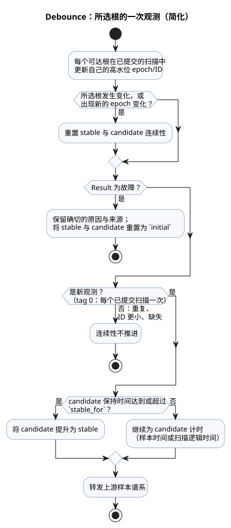

<!-- translation-source: tasks/debounce-design.md -->
[英文原文](debounce-design.md)

# Debounce 纵向契约

本契约端到端地描述 `debounce` 的工作方式：源代码语法、编译器生成的 manifest 描述符、它生成的私有 VM 状态、如何对物理传感器样本计数，以及一个 tick 如何提交或回滚。“物理根”（physical root，简称“根”）是指 debounce 表达式可以静态到达的物理传感器源。

**语法与类型**

- `signal x = debounce(source, stable_for: duration, initial: value);` 接受 Bool 或具名有限枚举。
- `stable_for` 是正的常量 `Duration`。
- `initial` 具有载荷（payload）类型。

**Manifest 描述符**

- debounce 的 manifest 描述符为
  `{kind:"debounce",name,payloadType,errorType,sourceMode,stableForMs,initial,clockInput,sources,states}`。
- 对于原始值，`errorType` 为 `null`。对于 `Result`，它是编译器拥有的故障枚举。
- 当可以选中任一物理传感器根时，`sourceMode` 为 `sample`；否则为 `scan`。
- `sources` 是唯一物理根的列表，按数值 `tag` 升序排列。源名称以确定性的方式打破并列。
- 枚举描述符还包含有序的 `members` 数组。Bool 描述符省略该数组。

**生成的私有状态**

- `states` 恰好包含以下角色：`stable`、`candidate`、`candidateActive`、`candidateSince` 和 `lastSourceTag`。
- 每个生成的状态命名为 `__gf_debounce_<role>_<signal>`。驼峰式角色名会转换为蛇形命名。
- `stable` 和 `candidate` 使用载荷的机器类型。`candidateActive` 为 Bool。其余状态为 Number。
- 每个物理源条目为 `{name,tag,states:{lastEpoch,lastId}}`。其状态名为 `__gf_debounce_source_epoch_<signal>_<tag>` 和 `__gf_debounce_source_id_<signal>_<tag>`，初始值分别为 `0` 和 `-1`。
- 状态数量：原始 debounce 有 5 个私有状态。物理 debounce 在这 5 个之外，每个静态可达的根再增加 2 个。

**来自物理传感器的样本输入**

- 仅当某个 debounce 表达式能够观测某个根时，该物理传感器描述符才会分配生成的输入组 `samplePresentInput`、`sampleEpochInput`、`sampleIdInput` 和 `sampleTimestampInput`。该组是全有或全无的：四个输入要么全部存在，要么全部不存在。
- *Present*（存在）表示调用方提供了一个样本，**并且**调理器（conditioner）为其持有一个已接受的身份标识。
- epoch、ID、时间戳和载荷都来自该权威的、已被接受的调理器样本。它们绝不来自被调理器忽略的重复元组或更旧的元组。
- 编译器将传感器的正源节点 ID 作为 `sourceTag` 提供。

**表达式中的样本谱系**

- 降级后的瞬态 `Result` 将样本谱系（sample lineage）与故障来源分开携带：`{sourceTag,present,epoch,id,timestamp}`。
- `map` 和 `and_then` 保留上游谱系。
- `if` 和 `case` 选择每一个谱系字段（而不仅仅是载荷）。
- 没有物理谱系的构造器属于扫描观测：`sourceTag=0`、present，且 timestamp=`__gf_now_ms`。

**新鲜度与连续性**

- 源 tag 为零表示每个已提交的扫描对应一次逻辑观测。
- 对于正 tag，当样本存在，并且其 epoch 与该根的高水位 epoch 不同，或者 epoch 相同而 ID 更大时，该样本是*新鲜的*（fresh）。
- 每个静态可达的根在每次已提交的扫描中都会更新自己的高水位状态，即使它未被选中或处于故障状态。
- 重复的、ID 更小的以及缺失的物理样本不会推进连续性。
- 所选根发生变化时，无论样本是否存在，都会重置 stable 与 candidate 的连续性。所选根上出现新的 epoch 变化时也会重置连续性。
- 每个根的高水位历史在根切换和故障之后依然保留。因此回到某个根时，不会重放旧的身份标识。

**故障**

- 故障保留其确切的 `Result` 原因和来源，并将 stable 与 candidate 状态重置为编写的 `initial` 值。
- 新的故障身份标识仍会计入该根的高水位状态。
- 成功的 debounce 会转发上游样本谱系。因此下游的 debounce 节点能看到每一个上游物理样本，包括稳定载荷未发生变化的样本。

**计时与提升**

- 对于 `Result` 谱系，candidate 的时间使用物理样本时间戳；对于原始值，使用扫描的逻辑时间。
- 提升发生在达到或超过 `stable_for` 的第一个新鲜观测上。
- 状态转移与同一 tick 的载荷共享同一个纯的下一状态表达式。

下图概括了所选根的一次观测是如何被分类的。它是上述规则的简化视图，并不是生成表达式的确切求值顺序。

**追踪**

- 源追踪在 `signalMode:"debounce"` 的已解析源节点上，记录 5 个公共私有状态，以及每个物理根成对的 `sourceEpoch` 和 `sourceId` 绑定。

**事务与回滚**

- 一个 tick 在调理之前，会在每个传感器和信号调理器上开启一个由 Rust 拥有的事务。
- 已知的预提交拒绝或 VM 拒绝，会将这些事务连同 VM 拥有的 debounce 状态和高水位状态一起回滚。因此重试会从最后一次完全提交的样本身份标识和载荷开始。
- 关于原生提交状态和提交后的错误处理，参见[传感器扫描事务](sensor-atomicity-design.zh.md)。这些内存中的事务不提供持久的重启检查点。
