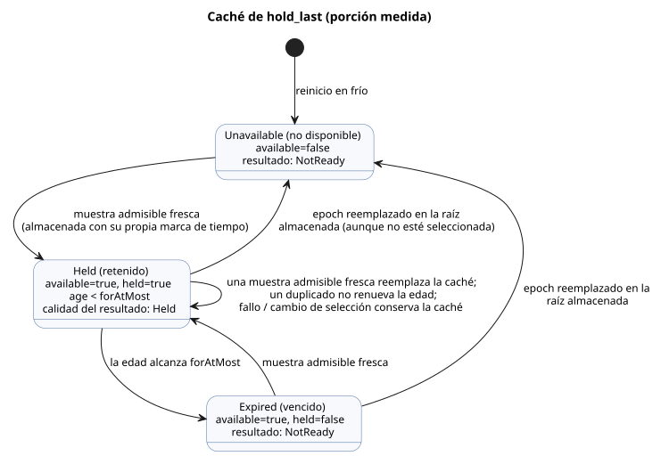

<!-- translation-source: tasks/hold-last-design.md -->
[Original en inglés](hold-last-design.md)

# Implementación de la retención acotada

- **Referencia:** §4.4, REF-04-031. El caso original de aceptación en compilación
  no cambia.
- **RED inicial:** `build/hold-last-reference-red.log`. Tanto la verificación
  como la compilación de la CLI rechazaron la señal no soportada.
- **Independencia:** este trabajo no depende de la cuestión pendiente de la
  política de observación continua de `true_for`.

`hold_last` mantiene utilizable la última muestra de sensor admisible durante un
tiempo acotado. Este documento registra el contrato de ejecución, los límites de
la traza, la titularidad y la evidencia verificada de la porción *medida*.

## Contrato de ejecución

**Restricciones.** Use las expresiones de estado existentes de la VM de Rust y la
semántica atómica de tick/registro (journal). No agregue ningún opcode nuevo,
ningún evaluador de expresiones en JS ni aumentos de los límites de recursos.

**Alcance.** La porción actual acepta evidencia física medida
`Result<T, SensorFault>`. La evidencia estimada y los contratos de incertidumbre
siguen siendo una brecha explícita en el objetivo general.

**Descriptor.** El tipo (kind) del descriptor es `hold-last`; el modo AST de
origen es `hold_last`. Campos:

- `name`, `payloadType`
- `errorType: SensorFault`, `quality: measured`
- `forAtMostMs`, `clockInput: __gf_now_ms`
- `sourceMode: sample`, `sources`, `states`
- `members`, solo para enumeraciones finitas

**Roles de estado comunes (11).** `available`, `value`, `heldSourceTag`,
`heldEpoch`, `heldId`, `heldTimestamp`, `held`, `age`, `maskedFaultPresent`,
`maskedFaultCode`, `maskedFaultOrigin`.

- `available` significa que existe un registro admisible en caché.
- `held` es la decisión de elegibilidad actual bajo el límite estricto de edad.
- `available` puede sobrevivir al vencimiento; `held` no debe hacerlo.

**Historial por raíz.** Cada raíz física mantiene estados de marca máxima
(high-water) `lastEpoch` y `lastId`, incluidas las raíces que actualmente no
están seleccionadas.

- Costo: 11 + 2 × número de raíces estados.
- Rust calcula todos los estados y los valores siguientes de forma atómica.

**Nombres y valores predeterminados.**

- Nombres: `__gf_hold_last_<snake_role>_<signal>`. El historial de origen usa
  `__gf_hold_last_source_epoch_<signal>_<tag>` y el nombre `source_id`
  correspondiente.
- Los booleanos son false de forma predeterminada. Una carga útil escalar toma
  el valor predeterminado de su tipo. Los números son cero de forma
  predeterminada, excepto `heldId`/`lastId` de origen = -1 y
  `maskedFaultCode` = 3 (NotReady).

**Comportamiento en tiempo de ejecución.**

- Una muestra admisible fresca reemplaza la caché y conserva su marca de tiempo
  original.
- Los duplicados no renuevan la edad.
- Los fallos y los cambios de selección conservan la caché.
- Un reemplazo de epoch en la propia fuente de la caché invalida la caché,
  incluso mientras esa raíz no está seleccionada.
- Un resultado retenido es Held incluso con edad cero.
- La evidencia ausente o vencida devuelve NotReady.
- La calidad de muestra de `Result` es 0 = sin fuente, 1 = medida, 2 = Held.
  Las transformaciones no pueden promover Held a medida.
- Un reinicio en frío comienza como no disponible. Restaurar un punto de control
  (checkpoint) duradero requiere demostrar por separado la continuidad de la
  fuente y del tiempo.

El diagrama de estados siguiente es una vista simplificada de las reglas de
caché anteriores. Según la Referencia del lenguaje, la retención se aplica
estrictamente antes de `for_at_most` y termina exactamente en el límite.

## Límites de la traza y de los artefactos

- `TickRecord.stateAfter` de Rust registra todos los hechos, incluidos la edad
  calculada y cualquier fallo enmascarado.
- Las vinculaciones de origen generadas y verificadas proyectan estos hechos en
  `observeSourceTrace(...).heldEvents`.
- El decodificador solo mapea los campos registrados. No calcula la edad ni la
  elegibilidad.
- La reproducción (replay) canónica en JS y las comprobaciones nativas de
  descriptor/tipo/valor predeterminado del paquete cubren los estados generados
  y las vinculaciones de entradas de muestra.
- La limitación existente de reproducción de la fuente canónica en el paquete
  nativo es un problema aparte y abierto.

## Titularidad y aceptación

| Responsable | Responsabilidad |
| --- | --- |
| Sol | Compilador, diagnósticos, pruebas de ejecución reales nativas/WASM. |
| Astra | Comprobaciones del descriptor del paquete nativo firmado y de la vinculación del bytecode. |
| Luna | Pruebas de envoltura de origen/procedencia. |
| Root | Host de JS, traza de origen, reproducción del paquete JS, integración y revisión. |

Comprobaciones requeridas:

- muestras frescas y retrasadas
- vencimiento exacto
- escaneos omitidos
- identidad de muestra duplicada y rechazada
- fallos ordinarios
- fallo A→B
- reemplazo de epoch en una raíz almacenada en caché no seleccionada
- no promoción de Held anidado
- recursos acotados
- reversión de un escaneo fallido
- reproducción
- preservación de la identidad de origen
- manipulación del descriptor firmado

## Porción medida verificada (2026-09-23)

Evidencia focalizada:

- `build/hold-last-focused-final.log`: compilador 2, diagnósticos/límites 10,
  ejecución 10; 22/22 aprobadas. La ejecución cubre la ejecución nativa real y
  ambas ABI de WASM, además de ambos hosts públicos para la reversión del
  acondicionador, la identidad de muestra rechazada, la entrega retrasada, el
  reinicio en frío y la reproducción determinista.
- `build/hold-last-provenance-focused.log`: 14/14 aprobadas (incluido un grupo
  padre). Cubre la envoltura de origen, la manipulación de vinculaciones
  generadas, el observador Held real y los descriptores de host malformados.
- `build/hold-last-signed-js.log`: aceptación de JS firmado más seis mutaciones
  de descriptor/procedencia vueltas a firmar, todas rechazadas antes de cargar
  el bytecode de destino.
- `build/hold-last-package-final.log`: suite de paquetes de Rust 23/23, incluidos
  42 escenarios de mutación de retención firmada y la validación real del
  tipo/valor predeterminado de estado en GFB. La comprobación de valor
  predeterminado faltante se observó primero en RED en
  `build/hold-last-package-binding-red.log`.
- `build/hold-last-factoring-green.log`: una cadena hold→debounce→hold emitía
  antes una intención de 5415 bytes. La propagación de calidad en el dominio de
  éxito y la factorización de expresiones puras la redujeron a 420 bytes. La
  expresión más grande de la cadena tiene 3151 bytes, dentro del límite de 4096
  que no cambió. La evaluación de fallos del selector y la reversión tienen una
  prueba de regresión explícita.

Verificación completa: `build/compiler-runtime-batch9-full.log`, código de salida 1.

| Etapa | Resultado |
| --- | --- |
| Pasos previos de Rust/nativo/WASM | Todos aprobados. |
| Pruebas de Node | 1662 pruebas: 1468 aprobadas, 30 fallidas, 164 TODO, cero omitidas. Todos los fallos corresponden a otros casos existentes de la Referencia. |
| REF-04-031 | Se aprueba sin cambios tanto en la verificación como en la compilación de la CLI. |
| Referencia ejecutable | 173/203 aprobadas. |
| Verificación del tutorial | No se ejecuta después del fallo de Node. |

Los informes se conservan en
`build/compiler-runtime-batch9-reference-results.json` y
`build/compiler-runtime-batch9-verification.json`.

**Estado.** La porción de retención medida está verificada. Sigue abierto:

- evidencia estimada/incertidumbre
- restauración duradera con una prueba explícita de continuidad
- la limitación de reproducción de la fuente canónica del paquete nativo
- el objetivo general de completar la Referencia
