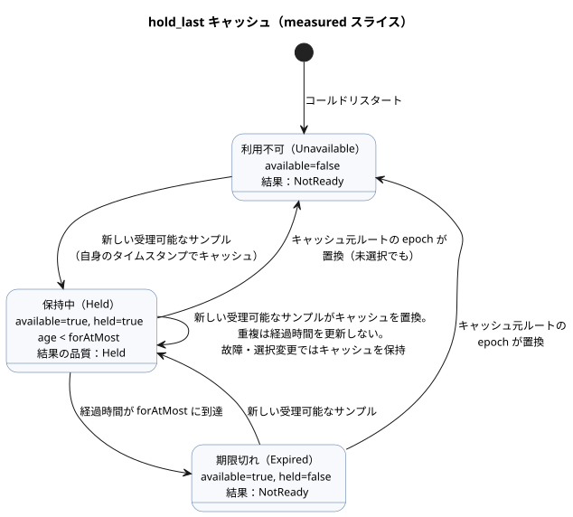

<!-- translation-source: tasks/hold-last-design.md -->
[英語の原文](hold-last-design.md)

# 有界ホールドの実装

- **参照：** §4.4、REF-04-031。元のコンパイル受理ケースは変更されていません。
- **最初の RED：** `build/hold-last-reference-red.log`。CLI の check と build の両方が、未サポートの信号を拒否しました。
- **独立性：** この作業は、保留中の `true_for` 連続観測ポリシーの問題に依存しません。

`hold_last` は、最後に受理可能だったセンサのサンプルを、有界の時間だけ利用可能な状態に保ちます。この文書は、*measured*（測定）スライスについて、実行契約、トレースの境界、担当、検証済みの証拠を記録します。

## 実行契約

**制約。** 既存の Rust VM の状態式と、アトミックな tick/ジャーナルの意味論を使います。新しいオペコード、JS の式評価器、リソース上限の引き上げは一切追加しません。

**範囲。** 現在のスライスは、測定された物理的な `Result<T, SensorFault>` の証拠を受け付けます。推定された証拠と不確実性の契約は、全体目標の中で明示的なギャップとして残っています。

**ディスクリプタ。** ディスクリプタの種類は `hold-last`、ソース AST のモードは `hold_last` です。フィールド：

- `name`、`payloadType`
- `errorType: SensorFault`、`quality: measured`
- `forAtMostMs`、`clockInput: __gf_now_ms`
- `sourceMode: sample`、`sources`、`states`
- `members`（有限列挙型のみ）

**共通の状態ロール（11 個）。** `available`、`value`、`heldSourceTag`、`heldEpoch`、`heldId`、`heldTimestamp`、`held`、`age`、`maskedFaultPresent`、`maskedFaultCode`、`maskedFaultOrigin`。

- `available` は、キャッシュされた受理可能なレコードが存在することを意味します。
- `held` は、厳密な経過時間の上限のもとでの現在の適格性の判断です。
- `available` は期限切れ後も残ってもかまいませんが、`held` は残ってはなりません。

**ルートごとの履歴。** 各物理ルートは、現在未選択のルートも含め、`lastEpoch` と `lastId` の最高水位状態を保持します。

- コスト：11 + 2 × ルート数 個の状態。
- Rust がすべての状態と次の値をアトミックに計算します。

**名前と既定値。**

- 名前：`__gf_hold_last_<snake_role>_<signal>`。ソースの履歴は `__gf_hold_last_source_epoch_<signal>_<tag>` と、対応する `source_id` の名前を使います。
- Boolean の既定値は false です。スカラーのペイロードは、その型の既定値になります。数値の既定値は 0 ですが、`heldId`/ソースの `lastId` = -1、`maskedFaultCode` = 3（NotReady）は例外です。

**実行時の振る舞い。**

- 新しい受理可能なサンプルはキャッシュを置き換え、元のタイムスタンプを保持します。
- 重複は経過時間を更新しません。
- 故障と選択の変更ではキャッシュが保持されます。
- キャッシュ元のソースで epoch が置き換わると、そのルートが未選択であってもキャッシュは無効になります。
- 保持された結果は、経過時間が 0 でも Held です。
- 欠落した証拠または期限切れの証拠は NotReady を返します。
- `Result` のサンプル品質は 0 = ソースなし、1 = 測定、2 = Held です。変換によって Held を測定に昇格させることはできません。
- コールドリスタートは利用不可の状態から始まります。永続的なチェックポイントを復元するには、ソースと時間の連続性を別途証明する必要があります。

下の状態図は、上記のキャッシュ規則を簡略化したものです。Language Reference によれば、ホールドは `for_at_most` の厳密に手前まで適用され、ちょうどその境界で終了します。

## トレースと成果物の境界

- Rust の `TickRecord.stateAfter` は、計算された経過時間やマスクされた故障を含め、すべての事実を記録します。
- 検証済みの生成ソースバインディングは、これらの事実を `observeSourceTrace(...).heldEvents` に投影します。
- デコーダは記録されたフィールドを対応付けるだけです。経過時間や適格性は計算しません。
- 正本ソースによる JS のリプレイと、ネイティブパッケージのディスクリプタ/型/既定値のチェックが、生成された状態とサンプル入力のバインディングをカバーします。
- 既存のネイティブパッケージにおける正本ソースのリプレイの制限は、別の未解決の問題です。

## 担当と受け入れ

| 担当 | 責任 |
| --- | --- |
| Sol | コンパイラ、診断、実際のネイティブ/WASM 実行テスト。 |
| Astra | ネイティブ署名済みパッケージのディスクリプタとバイトコードのバインディングのチェック。 |
| Luna | ソースエンベロープ/来歴のテスト。 |
| Root | JS ホスト、ソーストレース、JS パッケージのリプレイ、統合とレビュー。 |

必須のチェック：

- 新しいサンプルと遅延したサンプル
- 正確な期限切れ
- 取りこぼしたスキャン
- 重複したサンプルの同一性と拒否されたサンプルの同一性
- 通常の故障
- A→B の故障
- 未選択のキャッシュ済みルートでの epoch の置換
- ネストした Held が昇格しないこと
- 有界のリソース
- 失敗したスキャンのロールバック
- リプレイ
- ソースの同一性の保持
- 署名済みディスクリプタの改ざん

## 検証済みの measured スライス（2026-09-23）

対象を絞った証拠：

- `build/hold-last-focused-final.log`：コンパイラ 2、診断/境界 10、実行 10。22/22 合格。実行は、実際のネイティブと両方の WASM ABI に加え、両方の公開ホストについて、コンディショナのロールバック、拒否されたサンプルの同一性、遅延配信、コールドリスタート、決定的なリプレイをカバーします。
- `build/hold-last-provenance-focused.log`：14/14 合格（1 つの親グループを含む）。ソースエンベロープ、生成バインディングの改ざん、実際の Held オブザーバ、不正なホストディスクリプタをカバーします。
- `build/hold-last-signed-js.log`：署名済み JS の受け入れに加え、再署名したディスクリプタ/来歴の 6 つの改変。いずれも対象バイトコードの読み込み前に拒否されました。
- `build/hold-last-package-final.log`：Rust パッケージスイート 23/23。42 個の署名済みホールド改変シナリオと、実際の GFB 状態の型/既定値の検証を含みます。欠けていた既定値のチェックは、最初に `build/hold-last-package-binding-red.log` で RED として観測されました。
- `build/hold-last-factoring-green.log`：hold→debounce→hold の連鎖は以前、5,415 バイトの意図を出力していました。成功ドメインでの品質伝播と純粋な式のくくり出しにより、これは 420 バイトに減りました。連鎖の中で最大の式は 3,151 バイトで、変更されていない 4,096 の上限内に収まります。セレクタの故障評価とロールバックには、明示的な回帰テストがあります。

完全なゲート：`build/compiler-runtime-batch9-full.log`、終了コード 1。

| 段階 | 結果 |
| --- | --- |
| Rust/ネイティブ/WASM の前段ステップ | すべて合格。 |
| Node テスト | 1,662 テスト：合格 1,468、失敗 30、TODO 164、スキップ 0。失敗はすべて、既存の他の Reference ケースです。 |
| REF-04-031 | 変更なしのまま、CLI の check と build の両方に合格。 |
| 実行可能な Reference | 173/203 合格。 |
| チュートリアルの検証 | Node の失敗の後には実行されません。 |

レポートは `build/compiler-runtime-batch9-reference-results.json` と `build/compiler-runtime-batch9-verification.json` に保存されています。

**状況。** measured ホールドのスライスは検証済みです。未解決のもの：

- 推定された証拠/不確実性
- 明示的な連続性証明を伴う永続的な復元
- ネイティブパッケージにおける正本ソースのリプレイの制限
- Reference 全体の完了目標
