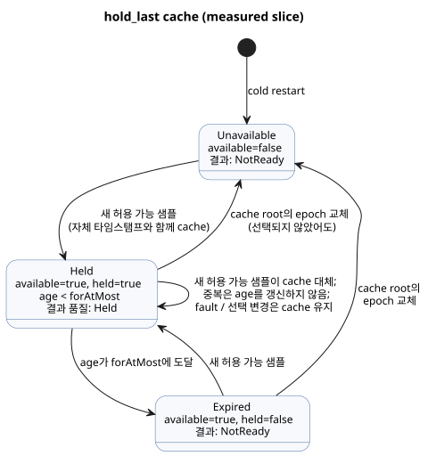

<!-- translation-source: tasks/hold-last-design.md -->
[영문 원문](hold-last-design.md)

# 범위가 제한된 hold 구현

- **Reference:** §4.4, REF-04-031. 원래의 컴파일 수용 사례는 변경하지 않았습니다.
- **최초 RED:** `build/hold-last-reference-red.log`. CLI 검사와 build가 모두
  지원하지 않는 signal을 거부했습니다.
- **독립성:** 이 작업은 미결인 `true_for` 연속 관측 정책 질문에 의존하지
  않습니다.

`hold_last`는 마지막으로 허용 가능한 센서 샘플을 제한된 시간 동안 계속 사용할 수 있게 유지합니다. 이 문서는 *measured* slice에 대한 실행 계약, trace 경계, 소유권, 검증된 증거를 기록합니다.

## 실행 계약

**제약.** 기존 Rust VM 상태 식과 원자적 tick/journal 의미를 사용합니다.
새 opcode, JS 식 평가기, 자원 한계 확대는 추가하지 않습니다.

**범위.** 현재 slice는 measured 물리 `Result<T, SensorFault>` 증거를
받습니다. Estimated 증거와 불확실성 계약은 전체 목표에서 명시적인 미완료
항목으로 남습니다.

**Descriptor.** Descriptor kind는 `hold-last`이고, 소스 AST mode는
`hold_last`입니다. 필드는 다음과 같습니다.

- `name`, `payloadType`
- `errorType: SensorFault`, `quality: measured`
- `forAtMostMs`, `clockInput: __gf_now_ms`
- `sourceMode: sample`, `sources`, `states`
- `members`, 유한 enum에만 해당

**공통 상태 역할(11개).** `available`, `value`, `heldSourceTag`,
`heldEpoch`, `heldId`, `heldTimestamp`, `held`, `age`, `maskedFaultPresent`,
`maskedFaultCode`, `maskedFaultOrigin`.

- `available`은 허용 가능한 cache 기록이 있다는 뜻입니다.
- `held`는 엄격한 age 상한에 따른 현재의 적격성 판단입니다.
- `available`은 만료 뒤에도 유지될 수 있지만, `held`는 그래서는 안 됩니다.

**Root별 이력.** 각 물리 root는 현재 선택되지 않은 root를 포함해
`lastEpoch`와 `lastId` 상한(high-water) 상태를 유지합니다.

- 비용: 상태 11 + 2 × root 수.
- 모든 상태와 다음 값은 Rust가 원자적으로 계산합니다.

**이름과 기본값.**

- 이름: `__gf_hold_last_<snake_role>_<signal>`. 소스 이력은
  `__gf_hold_last_source_epoch_<signal>_<tag>`와 이에 대응하는 `source_id`
  이름을 사용합니다.
- Boolean의 기본값은 false입니다. Scalar payload의 기본값은 해당 타입의
  기본값입니다. 숫자의 기본값은 0이며, 예외는 `heldId`/소스 `lastId` = -1과
  `maskedFaultCode` = 3 (NotReady)입니다.

**런타임 동작.**

- 새로운 허용 가능 샘플은 cache를 대체하며 원래 타임스탬프를 유지합니다.
- 중복 샘플은 age를 갱신하지 않습니다.
- Fault와 선택 변경은 cache를 보존합니다.
- Cache 자신의 소스에서 epoch가 교체되면, 그 root가 선택되지 않은 동안에도
  cache가 무효화됩니다.
- Held 결과는 age가 0이어도 Held입니다.
- 증거가 없거나 만료되면 NotReady를 반환합니다.
- `Result` 샘플 품질은 0 = unsourced, 1 = measured, 2 = Held입니다.
  변환은 Held를 measured로 승격할 수 없습니다.
- Cold restart는 사용할 수 없는(unavailable) 상태에서 시작합니다. 영속
  checkpoint를 복원하려면 소스와 시간의 연속성이 별도로 증명되어야 합니다.

아래 상태 다이어그램은 위 cache 규칙을 단순화한 그림입니다. Language
Reference에 따라 hold는 `for_at_most` 이전에만 엄격하게 적용되고, 정확히 그
경계에서 끝납니다.

## Trace와 산출물 경계

- Rust `TickRecord.stateAfter`는 계산된 age와 가려진(masked) fault를 포함한
  모든 사실을 기록합니다.
- 검증된 생성 소스 binding이 이 사실들을
  `observeSourceTrace(...).heldEvents`로 투영합니다.
- Decoder는 기록된 필드만 매핑합니다. Age나 적격성을 계산하지 않습니다.
- 정본 JS replay와 native package의 descriptor/type/default 검사가 생성
  상태와 샘플 입력 binding을 다룹니다.
- 기존 native package의 정본 소스 replay 한계는 별도의 미결 이슈입니다.

## 소유권과 수용 기준

| 담당 | 책임 |
| --- | --- |
| Sol | 컴파일러, 진단, 실제 native/WASM 실행 테스트. |
| Astra | Native 서명 package descriptor와 bytecode binding 검사. |
| Luna | Source envelope/provenance 테스트. |
| Root | JS host, source trace, JS package replay, 통합과 검토. |

필수 검사:

- 새 샘플과 지연된 샘플
- 정확한 만료
- 누락된 scan
- 중복 및 거부된 샘플 identity
- 일반 fault
- A→B fault
- 선택되지 않은 cache root의 epoch 교체
- 중첩 Held의 승격 금지
- 제한된 자원
- 실패한 scan의 rollback
- replay
- 소스 identity 보존
- 서명 descriptor 변조

## 검증된 measured slice (2026-09-23)

집중 증거:

- `build/hold-last-focused-final.log`: 컴파일러 2, 진단/경계 10,
  실행 10; 22/22 통과. 실행 테스트는 실제 native와 두 WASM ABI를 모두
  다루며, conditioner rollback, 거부된 샘플 identity, 지연 전달, cold
  restart, 결정적 replay에 대해 두 공개 host를 모두 다룹니다.
- `build/hold-last-provenance-focused.log`: 14/14 통과(상위 그룹 하나 포함).
  Source envelope, 생성 binding 변조, 실제 Held observer, 잘못된 host
  descriptor를 다룹니다.
- `build/hold-last-signed-js.log`: 서명 JS 수용과 다시 서명한
  descriptor/provenance 변조 6건. 모든 변조는 대상 bytecode 로딩 전에
  거부되었습니다.
- `build/hold-last-package-final.log`: Rust package suite 23/23. 서명 hold
  변조 시나리오 42건과 실제 GFB 상태 type/default 검증을 포함합니다.
  누락된 기본값 검사는 `build/hold-last-package-binding-red.log`에서 처음
  RED로 관측되었습니다.
- `build/hold-last-factoring-green.log`: hold→debounce→hold 체인은 이전에
  5,415바이트 intent를 생성했습니다. 성공 영역의 품질 전파와 순수 식
  분리(factoring)로 이를 420바이트로 줄였습니다. 체인의 가장 큰 식은
  3,151바이트로, 변경하지 않은 4,096 한계 안에 있습니다. Selector fault
  평가와 rollback에는 명시적인 회귀 테스트가 있습니다.

전체 gate: `build/compiler-runtime-batch9-full.log`, 종료 코드 1.

| 단계 | 결과 |
| --- | --- |
| Rust/native/WASM 선행 단계 | 모두 통과. |
| Node 테스트 | 테스트 1,662건: 1,468 pass, 30 fail, 164 TODO, skip 0. 실패는 모두 기존의 다른 Reference 사례입니다. |
| REF-04-031 | 변경 없이 CLI 검사와 build를 모두 통과합니다. |
| Executable Reference | 173/203 통과. |
| Tutorial 검증 | Node 실패 뒤에는 실행되지 않습니다. |

보고서는
`build/compiler-runtime-batch9-reference-results.json`과
`build/compiler-runtime-batch9-verification.json`에 보존되어 있습니다.

**상태.** Measured hold slice는 검증되었습니다. 아직 미결인 항목:

- estimated 증거/불확실성
- 명시적인 연속성 증명을 갖춘 영속 복원
- native package의 정본 소스 replay 한계
- 전체 Reference 완료 목표
