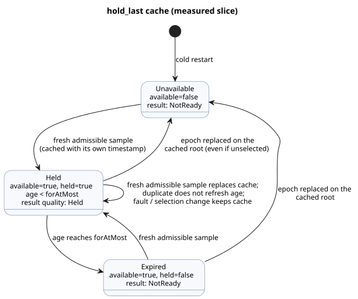

# Bounded hold implementation

- **Reference:** §4.4, REF-04-031. The original compile-accept case is unchanged.
- **Initial RED:** `build/hold-last-reference-red.log`. Both CLI check and build
  rejected the unsupported signal.
- **Independence:** this work does not depend on the pending `true_for`
  continuous-observation policy question.

`hold_last` keeps the last admissible sensor sample usable for a bounded time.
This document records the execution contract, the trace boundaries, ownership,
and the verified evidence for the *measured* slice.

## Execution contract

**Constraints.** Use the existing Rust VM state expressions and the atomic
tick/journal semantics. Add no new opcode, no JS expression evaluator, and no
increased resource limits.

**Scope.** The current slice accepts measured physical
`Result<T, SensorFault>` evidence. Estimated evidence and uncertainty contracts
remain an explicit gap in the overall goal.

**Descriptor.** The descriptor kind is `hold-last`; the source AST mode is
`hold_last`. Fields:

- `name`, `payloadType`
- `errorType: SensorFault`, `quality: measured`
- `forAtMostMs`, `clockInput: __gf_now_ms`
- `sourceMode: sample`, `sources`, `states`
- `members`, for finite enums only

**Common state roles (11).** `available`, `value`, `heldSourceTag`,
`heldEpoch`, `heldId`, `heldTimestamp`, `held`, `age`, `maskedFaultPresent`,
`maskedFaultCode`, `maskedFaultOrigin`.

- `available` means a cached admissible record exists.
- `held` is the current eligibility decision under the strict age bound.
- `available` may survive expiry; `held` must not.

**Per-root history.** Each physical root keeps `lastEpoch` and `lastId`
high-water states, including roots that are currently unselected.

- Cost: 11 + 2 × root count states.
- Rust computes all states and next values atomically.

**Names and defaults.**

- Names: `__gf_hold_last_<snake_role>_<signal>`. Source history uses
  `__gf_hold_last_source_epoch_<signal>_<tag>` and the matching `source_id`
  name.
- Booleans default to false. A scalar payload defaults to its type's default.
  Numbers default to zero, except `heldId`/source `lastId` = -1 and
  `maskedFaultCode` = 3 (NotReady).

**Runtime behavior.**

- A fresh admissible sample replaces the cache and keeps its original timestamp.
- Duplicates do not refresh the age.
- Faults and selection changes preserve the cache.
- An epoch replacement on the cache's own source invalidates the cache, even
  while that root is unselected.
- A held result is Held even at age zero.
- Missing or expired evidence returns NotReady.
- `Result` sample quality is 0 = unsourced, 1 = measured, 2 = Held.
  Transformations cannot promote Held to measured.
- A cold restart starts unavailable. Restoring a durable checkpoint requires
  separately proven source and time continuity.

The state diagram below is a simplified view of the cache rules above. Per the
Language Reference, the hold applies strictly before `for_at_most` and ends
exactly at the boundary.

## Trace and artifact boundaries

- Rust `TickRecord.stateAfter` records all facts, including the computed age and
  any masked fault.
- Verified generated source bindings project these facts into
  `observeSourceTrace(...).heldEvents`.
- The decoder only maps recorded fields. It does not calculate age or
  eligibility.
- Canonical JS replay and native package descriptor/type/default checks cover
  the generated states and sample input bindings.
- The existing native package canonical-source replay limitation is a separate,
  open issue.

## Ownership and acceptance

| Owner | Responsibility |
| --- | --- |
| Sol | Compiler, diagnostics, actual native/WASM execution tests. |
| Astra | Native signed package descriptor and bytecode binding checks. |
| Luna | Source envelope/provenance tests. |
| Root | JS host, source trace, JS package replay, integration and review. |

Required checks:

- fresh and delayed samples
- exact expiry
- missed scans
- duplicate and rejected sample identity
- ordinary faults
- A→B fault
- epoch replacement on an unselected cached root
- nested Held non-promotion
- bounded resources
- failed-scan rollback
- replay
- source identity preservation
- signed descriptor tampering

## Verified measured slice (2026-09-23)

Focused evidence:

- `build/hold-last-focused-final.log`: compiler 2, diagnostics/boundaries 10,
  execution 10; 22/22 pass. Execution covers actual native and both WASM ABIs,
  plus both public hosts for conditioner rollback, rejected sample identity,
  delayed delivery, cold restart and deterministic replay.
- `build/hold-last-provenance-focused.log`: 14/14 pass (including one parent
  group). Covers the source envelope, generated binding tampering, the actual
  Held observer, and malformed host descriptors.
- `build/hold-last-signed-js.log`: signed JS acceptance plus six re-signed
  descriptor/provenance mutations, all rejected before target bytecode loading.
- `build/hold-last-package-final.log`: Rust package suite 23/23, including 42
  signed hold mutation scenarios and actual GFB state type/default validation.
  The missing default check was first observed RED in
  `build/hold-last-package-binding-red.log`.
- `build/hold-last-factoring-green.log`: a hold→debounce→hold chain previously
  emitted a 5,415-byte intent. Successful-domain quality propagation and pure
  expression factoring reduced it to 420 bytes. The largest chain expression is
  3,151 bytes, within the unchanged 4,096 limit. Selector-fault evaluation and
  rollback have an explicit regression test.

Full gate: `build/compiler-runtime-batch9-full.log`, exit 1.

| Stage | Result |
| --- | --- |
| Rust/native/WASM presteps | All pass. |
| Node tests | 1,662 tests: 1,468 pass, 30 fail, 164 TODO, zero skip. All failures are existing, other Reference cases. |
| REF-04-031 | Passes unchanged through both CLI check and build. |
| Executable Reference | 173/203 pass. |
| Tutorial verification | Does not run after the Node failure. |

The reports are preserved in
`build/compiler-runtime-batch9-reference-results.json` and
`build/compiler-runtime-batch9-verification.json`.

**Status.** The measured hold slice is verified. Still open:

- estimated evidence/uncertainty
- durable restore with an explicit continuity proof
- the native package's canonical-source replay limitation
- the overall Reference completion goal
