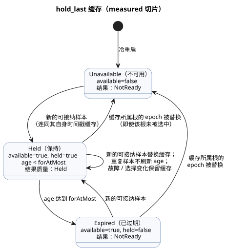

<!-- translation-source: tasks/hold-last-design.md -->
[英文原文](hold-last-design.md)

# 有界保持的实现

- **参考：** §4.4，REF-04-031。原有的“编译接受”用例保持不变。
- **初始 RED：** `build/hold-last-reference-red.log`。CLI check 和 build 都拒绝了这个不受支持的信号。
- **独立性：** 这项工作不依赖尚未定论的 `true_for` 连续观测策略问题。

`hold_last` 让最后一个可接纳的传感器样本在有界的时间内保持可用。本文档记录 *measured*（测量）切片的执行契约、追踪边界、职责归属以及已验证的证据。

## 执行契约

**约束。** 使用现有的 Rust VM 状态表达式和原子的 tick/journal 语义。不新增操作码，不引入 JS 表达式求值器，也不提高资源上限。

**范围。** 当前切片接受测量得到的物理 `Result<T, SensorFault>` 证据。估计证据和不确定性契约仍然是总体目标中一个明确的缺口。

**描述符。** 描述符 kind 为 `hold-last`；源 AST 模式为 `hold_last`。字段：

- `name`、`payloadType`
- `errorType: SensorFault`、`quality: measured`
- `forAtMostMs`、`clockInput: __gf_now_ms`
- `sourceMode: sample`、`sources`、`states`
- `members`，仅限有限枚举

**公共状态角色（11 个）。** `available`、`value`、`heldSourceTag`、`heldEpoch`、`heldId`、`heldTimestamp`、`held`、`age`、`maskedFaultPresent`、`maskedFaultCode`、`maskedFaultOrigin`。

- `available` 表示存在一条已缓存的可接纳记录。
- `held` 是在严格的 age 上限下当前的可用性判定。
- `available` 可以在过期后继续保留；`held` 不得保留。

**每个根的历史。** 每个物理根都保存 `lastEpoch` 和 `lastId` 高水位状态，包括当前未被选中的根。

- 代价：11 + 2 × 根数量 个状态。
- Rust 以原子方式计算所有状态及其下一值。

**名称与默认值。**

- 名称：`__gf_hold_last_<snake_role>_<signal>`。源历史使用 `__gf_hold_last_source_epoch_<signal>_<tag>` 以及对应的 `source_id` 名称。
- 布尔值默认为 false。标量载荷默认为其类型的默认值。数值默认为零，但 `heldId`/源 `lastId` = -1，`maskedFaultCode` = 3（NotReady）除外。

**运行时行为。**

- 新的可接纳样本会替换缓存，并保留其原始时间戳。
- 重复样本不会刷新 age。
- 故障和选择变化会保留缓存。
- 缓存所属源上的 epoch 被替换时，缓存失效，即使该根当前未被选中。
- 被保持的结果即使 age 为零也是 Held。
- 证据缺失或过期时返回 NotReady。
- `Result` 样本质量取值为 0 = 无来源，1 = 测量，2 = Held。变换不能把 Held 提升为测量。
- 冷重启从不可用状态开始。恢复持久检查点需要另行证明源与时间的连续性。

下面的状态图是上述缓存规则的简化视图。根据语言参考，保持严格地在 `for_at_most` 之前生效，并在恰好到达边界时结束。

## 追踪与产物边界

- Rust `TickRecord.stateAfter` 记录所有事实，包括计算得到的 age 以及任何被屏蔽的故障。
- 经过验证的生成源绑定将这些事实投影到 `observeSourceTrace(...).heldEvents`。
- 解码器只映射已记录的字段，不计算 age 或可用性。
- 规范 JS 重放以及原生包的描述符/类型/默认值检查覆盖了生成的状态和样本输入绑定。
- 现有的原生包规范源重放限制是另一个独立的未解决问题。

## 职责与验收

| 负责人 | 职责 |
| --- | --- |
| Sol | 编译器、诊断、实际的 native/WASM 执行测试。 |
| Astra | 原生签名包描述符与字节码绑定检查。 |
| Luna | 源信封/来源测试。 |
| Root | JS 宿主、源追踪、JS 包重放、集成与评审。 |

必需的检查：

- 新鲜样本与延迟样本
- 精确过期
- 错过的扫描
- 重复的和被拒绝的样本身份标识
- 普通故障
- A→B 故障
- 未被选中的已缓存根上的 epoch 替换
- 嵌套 Held 不被提升
- 有界资源
- 失败扫描的回滚
- 重放
- 源身份标识的保留
- 签名描述符篡改

## 已验证的测量切片（2026-09-23）

聚焦证据：

- `build/hold-last-focused-final.log`：编译器 2、诊断/边界 10、执行 10；22/22 通过。执行覆盖实际的 native 与两种 WASM ABI，并通过两个公共宿主覆盖调理器回滚、被拒绝的样本身份标识、延迟投递、冷重启以及确定性重放。
- `build/hold-last-provenance-focused.log`：14/14 通过（包括一个父分组）。覆盖源信封、生成绑定的篡改、实际的 Held 观察器，以及格式错误的宿主描述符。
- `build/hold-last-signed-js.log`：签名 JS 验收，外加六个重新签名的描述符/来源变异，全部在加载目标字节码之前被拒绝。
- `build/hold-last-package-final.log`：Rust 包测试套件 23/23，包括 42 个签名 hold 变异场景以及实际的 GFB 状态类型/默认值校验。缺失的默认值检查最初在 `build/hold-last-package-binding-red.log` 中被观测为 RED。
- `build/hold-last-factoring-green.log`：hold→debounce→hold 链此前生成了 5,415 字节的意图。成功域的质量传播和纯表达式因式分解将其减少到 420 字节。最大的链表达式为 3,151 字节，在未改变的 4,096 上限之内。选择器故障求值与回滚有明确的回归测试。

完整门禁：`build/compiler-runtime-batch9-full.log`，退出码 1。

| 阶段 | 结果 |
| --- | --- |
| Rust/native/WASM 预备步骤 | 全部通过。 |
| Node 测试 | 1,662 个测试：1,468 通过，30 失败，164 TODO，零跳过。所有失败均为已有的其他 Reference 用例。 |
| REF-04-031 | 在不修改的情况下通过 CLI check 和 build。 |
| 可执行 Reference | 173/203 通过。 |
| 教程验证 | 因 Node 失败而未运行。 |

报告保存在 `build/compiler-runtime-batch9-reference-results.json` 和 `build/compiler-runtime-batch9-verification.json` 中。

**状态。** 测量 hold 切片已验证。仍未解决：

- 估计证据/不确定性
- 带有明确连续性证明的持久恢复
- 原生包的规范源重放限制
- 总体 Reference 完成目标
