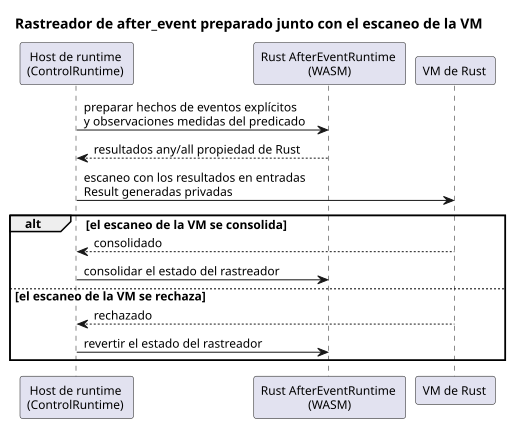

<!-- translation-source: tasks/issue-137-plan.md -->
[Original en inglés](issue-137-plan.md)

# Issue 137: porción ejecutable de `after_event`

Fecha: 2026-09-24

**Alcance.** Hacer que el caso de la Referencia `REF-04-026` se ejecute mediante
el motor `AfterEvent<32>` existente de Rust.

**Aplazado.** `REF-03-062` sigue aplazado, porque la ABI de observación natural
del proveedor y la política de validez de la clasificación aún no están
especificadas.

## Contrato

- Mantener independiente cada identidad de evento de inicio.
- Preservar la agregación explícita de `after_event_any` y `after_event_all`.
- Aceptar solo observaciones de predicado medidas y explícitas. No interpolar
  entre muestras ni tratar la cadencia de escaneo como evidencia de observación.
- Mantener los canales Result generados como privados del host de runtime.
- Preparar el rastreador antes del escaneo de la VM. Consolidar el estado del
  rastreador solo después de que el escaneo de la VM se consolide; revertirlo
  cuando el escaneo se rechace.
- Conservar la capacidad finita existente, el límite semiabierto, el acuse de
  recibo y el comportamiento ante fallos del motor de Rust.

La secuencia siguiente muestra cómo se prepara el rastreador en torno a un
escaneo de la VM (incremento de TDD 4).

## Incrementos de TDD

1. Agregar pruebas RED de compilador/runtime que demuestren que la fuente exacta
   de la Referencia se reduce a un control ejecutable, y que los canales de
   proyección generados no pueden proporcionarse como entradas ordinarias.
2. Agregar pruebas RED de runtime para identidades A/B superpuestas, el límite
   final exacto, una observación de predicado faltante (`NotReady`) y la
   reversión después de un escaneo de la VM rechazado.
3. Reducir las proyecciones `any`/`all` usadas a entradas Result generadas, y
   validar el descriptor en `ControlRuntime`.
4. Vincular cada descriptor al `AfterEventRuntime` de WASM existente. Preparar
   los hechos de eventos explícitos y las observaciones de predicado, proyectar
   los resultados propiedad de Rust y luego consolidar o revertir junto con la
   transacción de la VM.
5. Extender el transporte de escenarios y el oráculo de `REF-04-026` sin cambiar
   su fuente, su expectativa ni su estado.
6. Actualizar la documentación del límite aplazado y la prueba de puerta.
   Ejecutar, en orden: pruebas focalizadas, comprobaciones nativas/WASM, el
   simulador de la Referencia y luego el verificador del repositorio.

## Archivos esperados

- `tools/control.mjs`
- `runtimes/wasm/control-runtime.mjs`
- `tools/ghostsim.mjs`
- `tools/scenario-sensors.mjs`
- `tests/after-event-contract.test.mjs`
- `tests/after-event-control.test.mjs`
- `tests/reference-simulator.test.mjs`
- `tests/deferred-runtime-gates.test.mjs`
- `tools/verify-language.mjs`
- `docs/AFTER-EVENT-WASM-ABI.md`
- `docs/TEMPORAL-DESCRIPTOR-ARTIFACT.md`

## Decisión aplazada del responsable

`REF-03-062` necesita un contrato tipado de observación del proveedor. Debe
cubrir:

- la vinculación de proveedor y sitio
- los criterios de clasificación
- la confianza en el reloj
- la cobertura
- el vencimiento
- la incertidumbre
- las revisiones
- el mapeo de `TemporalContextFault`

Esta porción no inventará ninguna ejecución positiva de `tide_is`/`moon_is`.
