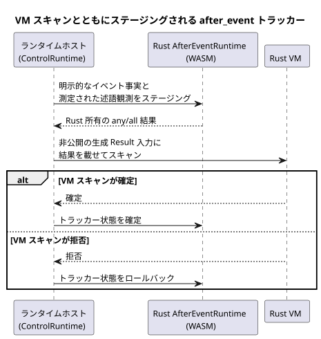

<!-- translation-source: tasks/issue-137-plan.md -->
[英語の原文](issue-137-plan.md)

# Issue 137：実行可能な `after_event` スライス

日付：2026-09-24

**範囲。** Reference ケース `REF-04-026` を、既存の Rust `AfterEvent<32>` エンジンで実行できるようにします。

**延期。** 自然現象プロバイダの観測 ABI と分類の有効性ポリシーがまだ規定されていないため、`REF-03-062` は延期のままです。

## 契約

- 開始イベントの同一性はそれぞれ独立に保つ。
- 明示的な `after_event_any` と `after_event_all` の集約を保持する。
- 明示的な測定された述語観測のみを受け付ける。サンプル間を補間せず、スキャンの周期を観測の証拠として扱わない。
- 生成された Result チャネルは、ランタイムホストにとって非公開のままにする。
- トラッカーは VM スキャンの前にステージングする。トラッカーの状態は VM スキャンが確定した後にのみ確定し、スキャンが拒否されたときはロールバックする。
- Rust エンジンの既存の有限容量、半開区間の境界、確認応答、故障の振る舞いを維持する。

下のシーケンスは、1 回の VM スキャンの前後でトラッカーがどのようにステージングされるかを示します（TDD インクリメント 4）。

## TDD のインクリメント

1. 正確な Reference ソースが実行可能な control に lowering されること、および生成された射影チャネルを通常の入力として供給できないことを証明する、RED のコンパイラ/ランタイムテストを追加する。
2. 重なり合う A/B の同一性、正確な終了境界、述語観測の欠落（`NotReady`）、拒否された VM スキャン後のロールバックについて、RED のランタイムテストを追加する。
3. 使用される `any`/`all` の射影を生成 Result 入力に lowering し、`ControlRuntime` でディスクリプタを検証する。
4. 各ディスクリプタを既存の WASM `AfterEventRuntime` にバインドする。明示的なイベント事実と述語観測をステージングし、Rust が所有する結果を射影してから、VM トランザクションとともに確定またはロールバックする。
5. シナリオのトランスポートと `REF-04-026` のオラクルを、そのソース、期待値、ステータスを変えずに拡張する。
6. 延期境界のドキュメントとゲートテストを更新する。対象を絞ったテスト、ネイティブ/WASM のチェック、Reference シミュレータ、リポジトリの検証器の順に実行する。

## 想定されるファイル

- `tools/control.mjs`
- `runtimes/wasm/control-runtime.mjs`
- `tools/ghostsim.mjs`
- `tools/scenario-sensors.mjs`
- `tests/after-event-contract.test.mjs`
- `tests/after-event-control.test.mjs`
- `tests/reference-simulator.test.mjs`
- `tests/deferred-runtime-gates.test.mjs`
- `tools/verify-language.mjs`
- `docs/AFTER-EVENT-WASM-ABI.md`
- `docs/TEMPORAL-DESCRIPTOR-ARTIFACT.md`

## 延期されたオーナーの判断

`REF-03-062` には、型付きのプロバイダ観測契約が必要です。次をカバーしなければなりません：

- プロバイダとサイトのバインディング
- 分類の基準
- クロックの信頼性
- カバレッジ
- 期限切れ
- 不確実性
- リビジョン
- `TemporalContextFault` への対応付け

このスライスでは、肯定的な `tide_is`/`moon_is` の実行を独自に作り出すことはしません。
