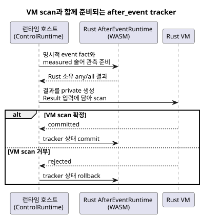

<!-- translation-source: tasks/issue-137-plan.md -->
[영문 원문](issue-137-plan.md)

# Issue 137: 실행 가능한 `after_event` slice

날짜: 2026-09-24

**범위.** Reference 사례 `REF-04-026`이 기존 Rust `AfterEvent<32>` 엔진을
통해 실행되게 합니다.

**보류.** 자연스러운 provider 관측 ABI와 분류 유효성 정책이 아직 명세되지
않았으므로 `REF-03-062`는 계속 보류합니다.

## 계약

- 모든 start event identity를 서로 독립적으로 유지합니다.
- 명시적인 `after_event_any`와 `after_event_all` 집계를 보존합니다.
- 명시적인 measured 술어 관측만 받습니다. 샘플 사이를 보간하지 않으며, scan
  주기를 관측 증거로 취급하지 않습니다.
- 생성된 Result channel은 런타임 호스트 내부에만 두는 private 영역으로
  유지합니다.
- VM scan 전에 tracker를 준비(stage)합니다. Tracker 상태는 VM scan이 확정된
  뒤에만 commit하고, scan이 거부되면 rollback합니다.
- Rust 엔진의 기존 유한 용량, 반개구간 경계, 확인 응답(acknowledgement),
  fault 동작을 유지합니다.

아래 시퀀스는 VM scan 하나를 중심으로 tracker를 준비하는 방식을 보여 줍니다
(TDD 증분 4).

## TDD 증분

1. 정확한 Reference 소스가 실행 가능한 control로 lowering되고, 생성된
   projection channel을 일반 입력으로 공급할 수 없음을 증명하는 RED
   compiler/runtime 테스트를 추가합니다.
2. 겹치는 A/B identity, 정확한 끝 경계, 누락된 술어 관측(`NotReady`), 거부된
   VM scan 이후의 rollback에 대한 RED 런타임 테스트를 추가합니다.
3. 사용된 `any`/`all` projection을 생성된 Result 입력으로 lowering하고,
   `ControlRuntime`에서 descriptor를 검증합니다.
4. 각 descriptor를 기존 WASM `AfterEventRuntime`에 바인딩합니다. 명시적인
   event fact와 술어 관측을 준비하고, Rust가 소유한 결과를 투영한 뒤, VM
   트랜잭션과 함께 commit하거나 rollback합니다.
5. 소스, 기대값, 상태를 바꾸지 않고 scenario transport와 `REF-04-026`
   oracle을 확장합니다.
6. 보류 경계 문서와 gate 테스트를 갱신합니다. 집중 테스트, native/WASM 검사,
   Reference simulator, repository verifier 순서로 실행합니다.

## 예상 파일

- `tools/control.mjs`
- `runtimes/wasm/control-runtime.mjs`
- `tools/ghostsim.mjs`
- `tools/scenario-sensors.mjs`
- `tests/after-event-contract.test.mjs`
- `tests/after-event-control.test.mjs`
- `tests/reference-simulator.test.mjs`
- `tests/deferred-runtime-gates.test.mjs`
- `tools/verify-language.mjs`
- `docs/AFTER-EVENT-WASM-ABI.md`
- `docs/TEMPORAL-DESCRIPTOR-ARTIFACT.md`

## 보류된 소유자 결정

`REF-03-062`에는 타입이 지정된 provider 관측 계약이 필요합니다. 이 계약은
다음을 다뤄야 합니다.

- provider와 site 바인딩
- 분류 기준
- clock 신뢰
- coverage
- 만료
- 불확실성
- revision
- `TemporalContextFault` 매핑

이 slice에서는 긍정적인 `tide_is`/`moon_is` 실행을 지어내지 않습니다.
