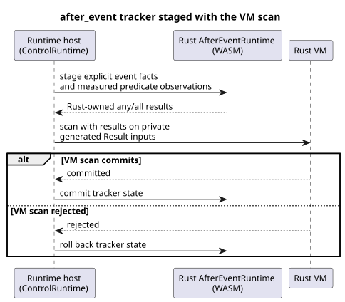

# Issue 137: executable `after_event` slice

Date: 2026-09-24

**Scope.** Make Reference case `REF-04-026` execute through the existing Rust
`AfterEvent<32>` engine.

**Deferred.** `REF-03-062` stays deferred, because the natural provider
observation ABI and the classification validity policy are still unspecified.

## Contract

- Keep every start event identity independent.
- Preserve explicit `after_event_any` and `after_event_all` aggregation.
- Accept only explicit measured predicate observations. Do not interpolate
  between samples, and do not treat scan cadence as observation evidence.
- Keep the generated Result channels private to the runtime host.
- Stage the tracker before the VM scan. Commit tracker state only after the VM
  scan commits; roll it back when the scan is rejected.
- Keep the Rust engine's existing finite capacity, half-open boundary,
  acknowledgement, and fault behavior.

The sequence below shows how the tracker is staged around one VM scan (TDD
increment 4).

## TDD increments

1. Add RED compiler/runtime tests proving that the exact Reference source lowers
   to an executable control, and that generated projection channels cannot be
   supplied as ordinary inputs.
2. Add RED runtime tests for overlapping A/B identities, the exact end boundary,
   a missing predicate observation (`NotReady`), and rollback after a rejected VM
   scan.
3. Lower the used `any`/`all` projections to generated Result inputs, and
   validate the descriptor in `ControlRuntime`.
4. Bind each descriptor to the existing WASM `AfterEventRuntime`. Stage explicit
   event facts and predicate observations, project the Rust-owned results, then
   commit or roll back with the VM transaction.
5. Extend the scenario transport and the `REF-04-026` oracle without changing
   its source, expectation, or status.
6. Update the deferred-boundary documentation and gate test. Run, in order:
   focused tests, native/WASM checks, the Reference simulator, then the
   repository verifier.

## Expected files

- `tools/control.mjs`
- `runtimes/wasm/control-runtime.mjs`
- `tools/ghostsim.mjs`
- `tools/scenario-sensors.mjs`
- `tests/after-event-contract.test.mjs`
- `tests/after-event-control.test.mjs`
- `tests/reference-simulator.test.mjs`
- `tests/deferred-runtime-gates.test.mjs`
- `tools/verify-language.mjs`
- `docs/AFTER-EVENT-WASM-ABI.md`
- `docs/TEMPORAL-DESCRIPTOR-ARTIFACT.md`

## Deferred owner decision

`REF-03-062` needs a typed provider observation contract. It must cover:

- provider and site binding
- classification criteria
- clock trust
- coverage
- expiry
- uncertainty
- revisions
- `TemporalContextFault` mapping

This slice will not invent any positive `tide_is`/`moon_is` execution.
