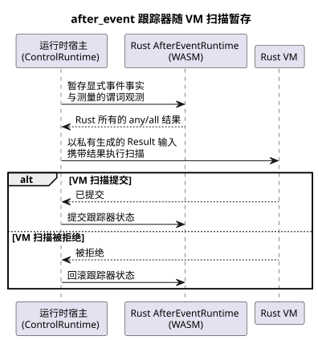

<!-- translation-source: tasks/issue-137-plan.md -->
[英文原文](issue-137-plan.md)

# Issue 137：可执行的 `after_event` 切片

日期：2026-09-24

**范围。** 让 Reference 用例 `REF-04-026` 通过现有的 Rust `AfterEvent<32>` 引擎执行。

**推迟。** `REF-03-062` 继续推迟，因为自然提供方观测 ABI 和分类有效性策略仍未规定。

## 契约

- 保持每个起始事件的身份标识彼此独立。
- 保留显式的 `after_event_any` 和 `after_event_all` 聚合。
- 只接受显式测量的谓词观测。不要在样本之间插值，也不要把扫描节奏当作观测证据。
- 生成的 Result 通道对运行时宿主保持私有。
- 在 VM 扫描之前暂存跟踪器。只有在 VM 扫描提交之后才提交跟踪器状态；扫描被拒绝时将其回滚。
- 保持 Rust 引擎现有的有限容量、半开边界、确认以及故障行为。

下面的时序图展示了跟踪器如何围绕一次 VM 扫描被暂存（TDD 增量 4）。

## TDD 增量

1. 添加 RED 的编译器/运行时测试，证明确切的 Reference 源会降级为可执行的控制，并且生成的投影通道不能作为普通输入提供。
2. 添加 RED 的运行时测试，覆盖重叠的 A/B 身份标识、精确的结束边界、缺失的谓词观测（`NotReady`），以及 VM 扫描被拒绝后的回滚。
3. 将使用到的 `any`/`all` 投影降级为生成的 Result 输入，并在 `ControlRuntime` 中验证描述符。
4. 将每个描述符绑定到现有的 WASM `AfterEventRuntime`。暂存显式的事件事实和谓词观测，投影由 Rust 拥有的结果，然后随 VM 事务提交或回滚。
5. 扩展场景传输和 `REF-04-026` 判定（oracle），不改变其源、预期或状态。
6. 更新推迟边界文档和门禁测试。按顺序运行：聚焦测试、native/WASM 检查、Reference 模拟器，然后是仓库验证器。

## 预期文件

- `tools/control.mjs`
- `runtimes/wasm/control-runtime.mjs`
- `tools/ghostsim.mjs`
- `tools/scenario-sensors.mjs`
- `tests/after-event-contract.test.mjs`
- `tests/after-event-control.test.mjs`
- `tests/reference-simulator.test.mjs`
- `tests/deferred-runtime-gates.test.mjs`
- `tools/verify-language.mjs`
- `docs/AFTER-EVENT-WASM-ABI.md`
- `docs/TEMPORAL-DESCRIPTOR-ARTIFACT.md`

## 推迟的负责人决策

`REF-03-062` 需要一个有类型的提供方观测契约。它必须涵盖：

- 提供方与站点绑定
- 分类标准
- 时钟可信度
- 覆盖范围
- 过期
- 不确定性
- 修订版
- `TemporalContextFault` 映射

本切片不会臆造任何正向的 `tide_is`/`moon_is` 执行。
