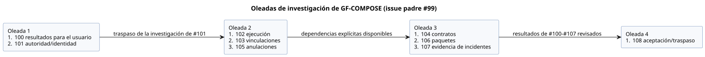

<!-- translation-source: tasks/plan.md -->
[Original en inglés](plan.md)

# Plan de investigación y diseño de GF-COMPOSE

**Estado de entrega (2026-09-20).** La publicación en GitHub y la relectura del
cuerpo exacto están completas.

| Elemento | Estado |
| --- | --- |
| Padre #99 | OPEN |
| Issues #100–#108 | CLOSED como investigación completada |
| Issues #101–#108 | Contienen instrucciones corregidas y documentos/hashes completos |
| #100 y R1 | Sin cambios |
| Conjunto de correcciones publicado | 10 documentos locales: este plan, el resumen y R2–R9 |

- No cambió ningún código de runtime, prueba ni especificación normativa del
  lenguaje.
- No se ejecutaron pruebas de runtime ni se hicieron commits ni pushes.
- La publicación corregida y su relectura están verificadas. Esto **no** afirma
  implementación, validación en Device ni aceptación física.

**Solicitud y resultados.** El usuario solicitó una investigación de
arquitectura, un documento de resumen y sub-issues de GitHub. Los resultados
acordados son menor esfuerzo, mayor explicabilidad y mayor trazabilidad para
agricultores, ingenieros de software e ingenieros de hardware.

**Dónde están los detalles.** El plan detallado, los hallazgos, el estado de las
decisiones, el orden de dependencias, los escenarios de aceptación y los puntos
de revisión están en
[Investigación sobre composición de comportamientos](../docs/BEHAVIOR-COMPOSITION-RESEARCH.es.md).

**Seguimiento de tareas.** Las tareas se siguen como sub-issues de
investigación/diseño de
[ghostflow-language #99](https://github.com/callin2/ghostflow-language/issues/99).
Use el índice ordenado de issues del resumen. No mantenga una segunda lista local
de tareas.

**Forma de cada issue hijo.**

- Cada issue hijo produce un documento de investigación acotado.
- Su descripción incluye entradas, pasos, ejemplos y comprobaciones de
  finalización precisos para un ejecutor con un modelo más pequeño.
- Las decisiones de arquitectura transversales siguen siendo puntos de revisión
  explícitos.
- La implementación, los cambios de runtime, el despliegue y la validación física
  quedan fuera de esta entrega de investigación/documentación.

## Ejecución delegada

El usuario solicitó trabajadores de menor costo para ejecutar cada issue de
investigación. El agente principal coordina solo las dependencias, las decisiones
entre documentos y la aceptación.

Reglas para los trabajadores:

- Usar `gpt-5.6-luna` con esfuerzo de razonamiento bajo.
- Comenzar sin historial de conversación heredado.
- Escribir exactamente un archivo de salida exclusivo por issue.
- No cambiar el estado de GitHub ni de git.
- Los trabajadores independientes comparten el checkout con ámbitos de escritura
  disjuntos.

| Oleada | Issues | Condición de inicio |
| --- | --- | --- |
| 1 | #100 resultados para el usuario; #101 autoridad/identidad | Lista |
| 2 | #102 ejecución; #103 vinculaciones; #105 anulaciones | Traspaso de la investigación de #101 |
| 3 | #104 contratos; #106 paquetes; #107 evidencia de incidentes | Sus dependencias explícitas están disponibles |
| 4 | #108 aceptación/traspaso | Resultados de investigación de #100–#107 revisados |

El diagrama muestra las mismas oleadas y sus condiciones de inicio.

Revisión y correcciones:

- Enviar las correcciones al trabajador responsable.
- Una pasada de revisión separada de menor costo comprueba la coherencia entre
  documentos.
- Preservar las decisiones de arquitectura no resueltas como bloqueos explícitos
  de la implementación.
- Completar la investigación no afirma composición implementada, validación de
  runtime ni evidencia de participantes/física.

## Investigación delegada completada

Los nueve resultados de investigación están completos. Cada autor usó
`gpt-5.6-luna` con esfuerzo bajo, y se realizó una revisión independiente con
Luna. Los resultados son evidencia de investigación y traspasos propuestos. No
son composición implementada ni aceptación medida por usuarios ni física.

- [R1](../docs/research/GF-COMPOSE-R1-USER-OUTCOMES.es.md)
- [R2](../docs/research/GF-COMPOSE-R2-AUTHORITY-IDENTITY.es.md)
- [R3](../docs/research/GF-COMPOSE-R3-EXECUTION.es.md)
- [R4](../docs/research/GF-COMPOSE-R4-PORTS-BINDINGS.es.md)
- [R5](../docs/research/GF-COMPOSE-R5-CONTRACTS.es.md)
- [R6](../docs/research/GF-COMPOSE-R6-OVERRIDES.es.md)
- [R7](../docs/research/GF-COMPOSE-R7-PACKAGES.es.md)
- [R8](../docs/research/GF-COMPOSE-R8-INCIDENT-EVIDENCE.es.md)
- [R9](../docs/research/GF-COMPOSE-R9-ACCEPTANCE.es.md)

Decisiones pendientes:

- Las decisiones de arquitectura pendientes de R9 se siguen en el resumen. Cada
  una bloquea solo la porción dependiente que necesita esa decisión.
- El comportamiento acordado de eventos de propiedades en vivo es una enmienda
  de diseño.
- El trabajo de mecanismo/ABI/alineación con la especificación de #89 no es un
  requisito previo general para porciones de composición no relacionadas.
- Que los issues de investigación estén cerrados no significa que el diseño esté
  implementado.
