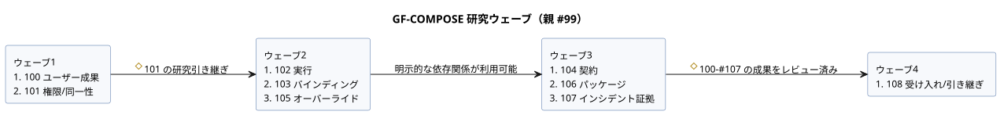

<!-- translation-source: tasks/plan.md -->
[英語の原文](plan.md)

# GF-COMPOSE の研究・設計計画

**提供状況（2026-09-20）。** GitHub への公開と、本文の完全一致の読み戻し確認は完了しています。

| 項目 | 状況 |
| --- | --- |
| 親 #99 | OPEN |
| Issue #100–#108 | 研究完了として CLOSED |
| Issue #101–#108 | 修正済みの指示と、完全な文書/ハッシュを含む |
| #100 と R1 | 変更なし |
| 公開された修正セット | ローカル文書 10 件：この計画、要約、R2–R9 |

- ランタイムのコード、テスト、規範的な言語仕様は変更していません。
- ランタイムのテスト、コミット、push は行っていません。
- 修正版の公開と読み戻しは検証済みです。これは実装、デバイスでの検証、物理的な受け入れを主張するもの**ではありません**。

**依頼と成果。** ユーザーは、アーキテクチャの研究、要約文書、GitHub のサブ issue を依頼しました。合意された成果は、農家、ソフトウェアエンジニア、ハードウェアエンジニアにとっての、作業量の削減、説明可能性の向上、追跡可能性の向上です。

**詳細の所在。** 詳細な計画、調査結果、判断の状況、依存関係の順序、受け入れシナリオ、レビューのチェックポイントは、[振る舞いの合成に関する研究](../docs/BEHAVIOR-COMPOSITION-RESEARCH.ja.md)にあります。

**タスクの追跡。** タスクは、[ghostflow-language #99](https://github.com/callin2/ghostflow-language/issues/99) の研究/設計サブ issue として追跡します。要約にある順序付きの issue 索引を使ってください。ローカルで 2 つ目のタスクリストを管理しないでください。

**各子 issue の形。**

- 各子 issue は、範囲の限られた研究文書を 1 つ作成します。
- その説明には、より小さなモデルの実行者向けに、正確な入力、手順、例、完了チェックが含まれます。
- 横断的なアーキテクチャの判断は、明示的なレビューのチェックポイントとして残します。
- 実装、ランタイムの変更、デプロイ、物理的な検証は、この研究/文書の提供の範囲外です。

## 委任による実行

ユーザーは、すべての研究 issue をより低コストのワーカーで実行するよう依頼しました。メインエージェントは、依存関係、文書をまたぐ判断、受け入れの調整だけを行います。

ワーカーの規則：

- `gpt-5.6-luna` を低い推論努力で使う。
- 会話履歴を引き継がずに開始する。
- issue ごとに、専有する出力ファイルをちょうど 1 つ書く。
- GitHub や git の状態を変更しない。
- 独立したワーカーは、書き込み範囲を重ねずにチェックアウトを共有する。

| ウェーブ | Issue | 開始条件 |
| --- | --- | --- |
| 1 | #100 ユーザー成果、#101 権限/同一性 | 準備完了 |
| 2 | #102 実行、#103 バインディング、#105 オーバーライド | #101 の研究の引き継ぎ |
| 3 | #104 契約、#106 パッケージ、#107 インシデント証拠 | 明示的な依存関係が利用可能になったとき |
| 4 | #108 受け入れ/引き継ぎ | #100–#107 の研究成果がレビュー済み |

図は、同じウェーブとその開始条件を示しています。

レビューと修正：

- 修正は担当のワーカーに送る。
- 別の低コストなレビューパスで、文書をまたぐ一貫性を確認する。
- 未解決のアーキテクチャ判断は、明示的な実装上のブロッカーとして残す。
- 研究の完了は、合成の実装、ランタイムでの検証、参加者/物理的な証拠を主張するものではない。

## 完了した委任研究

9 件の研究成果はすべて完了しています。各著者は `gpt-5.6-luna` を低い努力で使い、独立した Luna によるレビューが行われました。成果は研究上の証拠と提案された引き継ぎです。実装された合成ではなく、測定されたユーザーや物理的な受け入れでもありません。

- [R1](../docs/research/GF-COMPOSE-R1-USER-OUTCOMES.ja.md)
- [R2](../docs/research/GF-COMPOSE-R2-AUTHORITY-IDENTITY.ja.md)
- [R3](../docs/research/GF-COMPOSE-R3-EXECUTION.ja.md)
- [R4](../docs/research/GF-COMPOSE-R4-PORTS-BINDINGS.ja.md)
- [R5](../docs/research/GF-COMPOSE-R5-CONTRACTS.ja.md)
- [R6](../docs/research/GF-COMPOSE-R6-OVERRIDES.ja.md)
- [R7](../docs/research/GF-COMPOSE-R7-PACKAGES.ja.md)
- [R8](../docs/research/GF-COMPOSE-R8-INCIDENT-EVIDENCE.ja.md)
- [R9](../docs/research/GF-COMPOSE-R9-ACCEPTANCE.ja.md)

残っている判断：

- R9 に残るアーキテクチャ判断は、要約で追跡されています。それぞれ、その判断を必要とする依存スライスだけをブロックします。
- 合意されたライブプロパティのイベントの振る舞いは、設計の修正事項です。
- #89 のメカニズム/ABI/仕様整合の作業は、無関係な合成スライスにとって包括的な前提条件ではありません。
- 研究 issue が CLOSED であっても、設計が実装されたことを意味しません。
