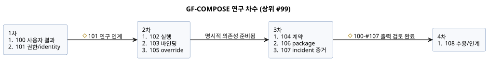

<!-- translation-source: tasks/plan.md -->
[영문 원문](plan.md)

# GF-COMPOSE 연구와 설계 계획

**전달 상태(2026-09-20).** GitHub 게시와 정확한 본문 readback이 완료되었습니다.

| 항목 | 상태 |
| --- | --- |
| 상위 #99 | OPEN |
| Issue #100–#108 | 연구 완료로 CLOSED |
| Issue #101–#108 | 수정된 지침과 전체 문서/hash 포함 |
| #100과 R1 | 변경 없음 |
| 게시된 수정 집합 | 로컬 문서 10개: 이 계획, 요약, R2–R9 |

- 런타임 코드, 테스트, 규범적 언어 명세는 변경하지 않았습니다.
- 런타임 테스트, commit, push는 하지 않았습니다.
- 수정된 게시와 readback은 검증되었습니다. 이는 구현, Device 검증, 물리적 수용을 주장하는 것이 **아닙니다**.

**요청과 결과.** 사용자는 architecture 연구, 요약 문서, GitHub 하위 issue를 요청했습니다. 합의된 결과는 농민, 소프트웨어 엔지니어, 하드웨어 엔지니어를 위한 노력 감소, 설명 가능성 향상, 추적 가능성 향상입니다.

**상세 내용의 위치.** 상세 계획, 발견 사항, 결정 상태, 의존 순서, 수용 시나리오, 검토 checkpoint는 [동작 합성 연구](../docs/BEHAVIOR-COMPOSITION-RESEARCH.ko.md)에 있습니다.

**작업 추적.** 작업은
[ghostflow-language #99](https://github.com/callin2/ghostflow-language/issues/99)의 연구/설계 하위 issue로 추적합니다. 요약에 있는 순서 있는 issue 색인을 사용하세요. 두 번째 로컬 작업 목록을 유지하지 않습니다.

**각 하위 issue의 형태.**

- 각 하위 issue는 범위가 제한된 연구 문서 하나를 만듭니다.
- 설명에는 더 작은 모델 실행자를 위한 정확한 입력, 단계, 예제, 완료 검사가 포함됩니다.
- 여러 영역에 걸친 architecture 결정은 명시적인 검토 checkpoint로 남습니다.
- 구현, 런타임 변경, 배포, 물리 검증은 이 연구/문서 전달 범위 밖입니다.

## 위임 실행

사용자는 모든 연구 issue를 저비용 작업자가 실행하도록 요청했습니다. Main agent는 의존성, 문서 간 결정, 수용만 조정합니다.

작업자 규칙:

- `gpt-5.6-luna`를 낮은 reasoning effort로 사용합니다.
- 상속받은 대화 이력 없이 시작합니다.
- Issue마다 전용 출력 파일을 정확히 하나만 작성합니다.
- GitHub나 git 상태를 변경하지 않습니다.
- 독립 작업자들은 쓰기 범위가 겹치지 않게 하여 checkout을 공유합니다.

| 차수 | Issue | 시작 조건 |
| --- | --- | --- |
| 1 | #100 사용자 결과; #101 권한/identity | 준비 완료 |
| 2 | #102 실행; #103 바인딩; #105 override | #101 연구 인계 |
| 3 | #104 계약; #106 package; #107 incident 증거 | 각자의 명시적 의존성이 준비됨 |
| 4 | #108 수용/인계 | #100–#107 연구 출력 검토 완료 |

다이어그램은 같은 차수와 시작 조건을 보여 줍니다.

검토와 수정:

- 수정 사항은 담당 작업자에게 보냅니다.
- 별도의 저비용 검토 단계가 문서 간 일관성을 확인합니다.
- 미결 architecture 결정은 명시적인 구현 차단 요인으로 보존합니다.
- 연구 완료는 구현된 합성, 런타임 검증, 참가자/물리 증거를 주장하지 않습니다.

## 완료된 위임 연구

연구 출력 9개가 모두 완료되었습니다. 각 작성자는 `gpt-5.6-luna`를 낮은 effort로 사용했고, 독립적인 Luna 검토도 수행했습니다. 이 출력은 연구 증거이자 제안된 인계 자료입니다. 구현된 합성이 아니며, 측정된 사용자 수용이나 물리적 수용도 아닙니다.

- [R1](../docs/research/GF-COMPOSE-R1-USER-OUTCOMES.ko.md)
- [R2](../docs/research/GF-COMPOSE-R2-AUTHORITY-IDENTITY.ko.md)
- [R3](../docs/research/GF-COMPOSE-R3-EXECUTION.ko.md)
- [R4](../docs/research/GF-COMPOSE-R4-PORTS-BINDINGS.ko.md)
- [R5](../docs/research/GF-COMPOSE-R5-CONTRACTS.ko.md)
- [R6](../docs/research/GF-COMPOSE-R6-OVERRIDES.ko.md)
- [R7](../docs/research/GF-COMPOSE-R7-PACKAGES.ko.md)
- [R8](../docs/research/GF-COMPOSE-R8-INCIDENT-EVIDENCE.ko.md)
- [R9](../docs/research/GF-COMPOSE-R9-ACCEPTANCE.ko.md)

남은 결정:

- R9의 남은 architecture 결정은 요약에서 추적합니다. 각 결정은 그 결정이 필요한 의존 slice만 차단합니다.
- 합의된 live-property event 동작은 설계 수정 사항입니다.
- #89 mechanism/ABI/spec-alignment 작업은 무관한 합성 slice 전체의 선행 조건이 아닙니다.
- 닫힌 연구 issue가 설계가 구현되었다는 뜻은 아닙니다.
