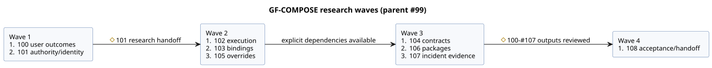

# GF-COMPOSE research and design plan

**Delivery status (2026-09-20).** GitHub publication and exact-body readback are
complete.

| Item | Status |
| --- | --- |
| Parent #99 | OPEN |
| Issues #100–#108 | CLOSED as completed research |
| Issues #101–#108 | Contain corrected instructions and full documents/hashes |
| #100 and R1 | Unchanged |
| Published correction set | 10 local documents: this plan, the summary, and R2–R9 |

- No runtime code, tests, or normative language specifications changed.
- No runtime tests, commits, or pushes were made.
- The corrected publication and readback are verified. This does **not** claim
  implementation, Device validation, or physical acceptance.

**Request and outcomes.** The user requested architecture research, a summary
document, and GitHub sub-issues. The agreed outcomes are reduced effort,
increased explainability, and increased traceability for farmers, software
engineers, and hardware engineers.

**Where the details live.** The detailed plan, findings, decision status,
dependency order, acceptance scenarios, and review checkpoints are in
[Behavior composition research](../docs/BEHAVIOR-COMPOSITION-RESEARCH.md).

**Task tracking.** Tasks are tracked as research/design sub-issues of
[ghostflow-language #99](https://github.com/callin2/ghostflow-language/issues/99).
Use the ordered issue index in the summary. Do not maintain a second local task
list.

**Shape of each child issue.**

- Each child produces one bounded research document.
- Its description includes precise inputs, steps, examples, and completion checks
  for a smaller-model executor.
- Cross-cutting architecture decisions remain explicit review checkpoints.
- Implementation, runtime changes, deployment, and physical validation are
  outside this research/documentation delivery.

## Delegated execution

The user requested lower-cost workers to execute every research issue. The main
agent coordinates only dependencies, cross-document decisions, and acceptance.

Worker rules:

- Use `gpt-5.6-luna` at low reasoning effort.
- Start with no inherited conversation history.
- Write exactly one exclusive output file per issue.
- Do not change GitHub or git state.
- Independent workers share the checkout with disjoint write scopes.

| Wave | Issues | Start condition |
| --- | --- | --- |
| 1 | #100 user outcomes; #101 authority/identity | Ready |
| 2 | #102 execution; #103 bindings; #105 overrides | #101 research handoff |
| 3 | #104 contracts; #106 packages; #107 incident evidence | Their explicit dependencies are available |
| 4 | #108 acceptance/handoff | #100–#107 research outputs reviewed |

The diagram shows the same waves and their start conditions.

Review and corrections:

- Send corrections to the responsible worker.
- A separate lower-cost review pass checks cross-document consistency.
- Preserve unresolved architecture decisions as explicit implementation blockers.
- Research completion does not claim implemented composition, runtime
  validation, or participant/physical evidence.

## Completed delegated research

All nine research outputs are complete. Each author used `gpt-5.6-luna` at low
effort, and an independent Luna review was performed. The outputs are research
evidence and proposed handoffs. They are not implemented composition, and not
measured user or physical acceptance.

- [R1](../docs/research/GF-COMPOSE-R1-USER-OUTCOMES.md)
- [R2](../docs/research/GF-COMPOSE-R2-AUTHORITY-IDENTITY.md)
- [R3](../docs/research/GF-COMPOSE-R3-EXECUTION.md)
- [R4](../docs/research/GF-COMPOSE-R4-PORTS-BINDINGS.md)
- [R5](../docs/research/GF-COMPOSE-R5-CONTRACTS.md)
- [R6](../docs/research/GF-COMPOSE-R6-OVERRIDES.md)
- [R7](../docs/research/GF-COMPOSE-R7-PACKAGES.md)
- [R8](../docs/research/GF-COMPOSE-R8-INCIDENT-EVIDENCE.md)
- [R9](../docs/research/GF-COMPOSE-R9-ACCEPTANCE.md)

Remaining decisions:

- R9's remaining architecture decisions are tracked in the summary. Each one
  blocks only the dependent slice that needs that decision.
- The agreed live-property event behavior is a design amendment.
- The #89 mechanism/ABI/spec-alignment work is not a blanket prerequisite for
  unrelated composition slices.
- Closed research issues do not mean the design is implemented.
