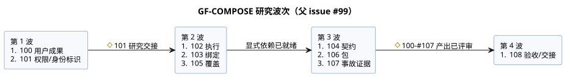

<!-- translation-source: tasks/plan.md -->
[英文原文](plan.md)

# GF-COMPOSE 研究与设计计划

**交付状态（2026-09-20）。** GitHub 发布和精确正文回读已完成。

| 项目 | 状态 |
| --- | --- |
| 父 issue #99 | OPEN |
| Issues #100–#108 | 作为已完成的研究 CLOSED |
| Issues #101–#108 | 包含更正后的说明以及完整文档/哈希 |
| #100 与 R1 | 未改变 |
| 已发布的更正集 | 10 个本地文档：本计划、摘要以及 R2–R9 |

- 没有更改运行时代码、测试或规范性语言规范。
- 没有进行运行时测试、提交或推送。
- 更正后的发布与回读已经验证。这**并不**声称已实现、已完成 Device 验证或物理验收。

**请求与成果。** 用户请求了架构研究、一份摘要文档以及 GitHub 子 issue。约定的成果是：为农户、软件工程师和硬件工程师减少工作量、提高可解释性并增强可追溯性。

**详细内容在哪里。** 详细计划、发现、决策状态、依赖顺序、验收场景和评审检查点见[行为组合研究](../docs/BEHAVIOR-COMPOSITION-RESEARCH.zh.md)。

**任务跟踪。** 任务作为 [ghostflow-language #99](https://github.com/callin2/ghostflow-language/issues/99) 的研究/设计子 issue 进行跟踪。请使用摘要中按顺序排列的 issue 索引。不要维护第二份本地任务列表。

**每个子 issue 的形式。**

- 每个子 issue 产出一份有界的研究文档。
- 其描述包含精确的输入、步骤、示例以及完成检查，供较小模型的执行者使用。
- 跨领域的架构决策保持为明确的评审检查点。
- 实现、运行时更改、部署和物理验证不在本研究/文档交付范围之内。

## 委派执行

用户要求由成本较低的工作者执行每个研究 issue。主代理只协调依赖、跨文档决策和验收。

工作者规则：

- 使用 `gpt-5.6-luna`，推理强度为 low。
- 从没有继承的对话历史开始。
- 每个 issue 恰好写一个独占的输出文件。
- 不要更改 GitHub 或 git 状态。
- 相互独立的工作者共享同一检出，写入范围互不相交。

| 波次 | Issues | 开始条件 |
| --- | --- | --- |
| 1 | #100 用户成果；#101 权限/身份标识 | 就绪 |
| 2 | #102 执行；#103 绑定；#105 覆盖 | #101 研究交接 |
| 3 | #104 契约；#106 包；#107 事故证据 | 其显式依赖已就绪 |
| 4 | #108 验收/交接 | #100–#107 研究产出已评审 |

下图展示了相同的波次及其开始条件。

评审与更正：

- 将更正发送给负责的工作者。
- 由一次单独的低成本评审检查跨文档一致性。
- 将未解决的架构决策保留为明确的实现阻碍项。
- 研究完成并不声称组合已实现、运行时已验证，或已有参与者/物理证据。

## 已完成的委派研究

全部九项研究产出均已完成。每位作者都使用了低强度的 `gpt-5.6-luna`，并进行了独立的 Luna 评审。这些产出是研究证据和提议的交接内容。它们不是已实现的组合，也不是经过测量的用户或物理验收。

- [R1](../docs/research/GF-COMPOSE-R1-USER-OUTCOMES.zh.md)
- [R2](../docs/research/GF-COMPOSE-R2-AUTHORITY-IDENTITY.zh.md)
- [R3](../docs/research/GF-COMPOSE-R3-EXECUTION.zh.md)
- [R4](../docs/research/GF-COMPOSE-R4-PORTS-BINDINGS.zh.md)
- [R5](../docs/research/GF-COMPOSE-R5-CONTRACTS.zh.md)
- [R6](../docs/research/GF-COMPOSE-R6-OVERRIDES.zh.md)
- [R7](../docs/research/GF-COMPOSE-R7-PACKAGES.zh.md)
- [R8](../docs/research/GF-COMPOSE-R8-INCIDENT-EVIDENCE.zh.md)
- [R9](../docs/research/GF-COMPOSE-R9-ACCEPTANCE.zh.md)

尚待决定的事项：

- R9 中剩余的架构决策在摘要中跟踪。每一项只阻碍需要该决策的相关切片。
- 已约定的 live 属性事件行为属于设计修订。
- #89 的机制/ABI/规范对齐工作并不是不相关组合切片的总体前提。
- 已关闭的研究 issue 并不意味着设计已经实现。
