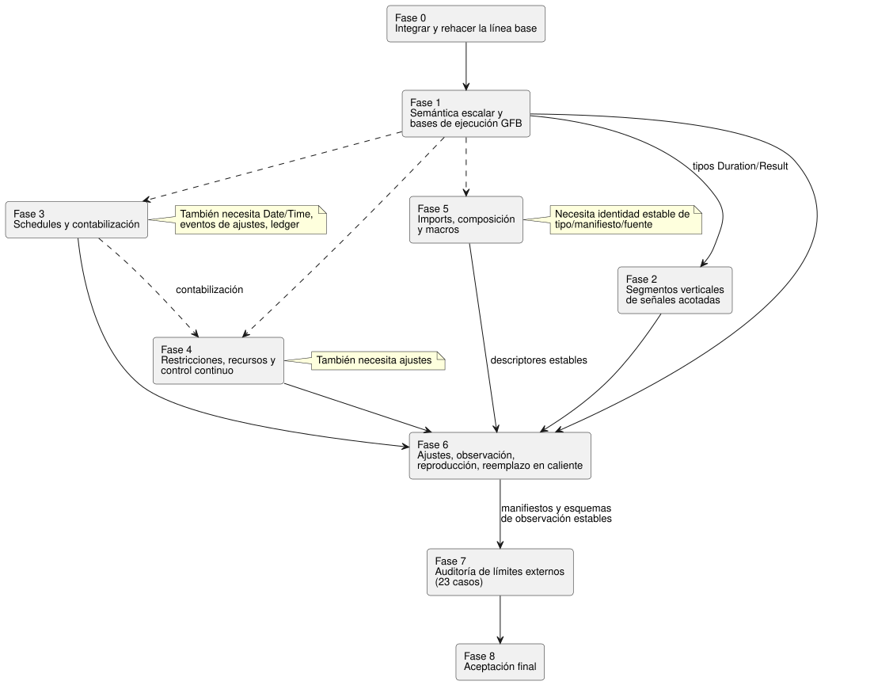

<!-- translation-source: tasks/reference-compliance-plan.en.md -->
[Original en inglés](reference-compliance-plan.en.md)

# Plan de implementación del cumplimiento de la Reference de GhostFlow

Este plan da seguimiento al trabajo necesario para que el compilador **y** el
runtime de GhostFlow implementen todo el contrato de la Language Reference, con
evidencia observable.

**En este documento**

- [Objetivo y criterios de finalización](#objetivo-y-criterios-de-finalización): el objetivo, las tres
  condiciones de finalización, los últimos resultados de la compuerta y las
  [últimas decisiones de política del usuario](#últimas-decisiones-de-política-del-usuario).
- [Principios de implementación](#principios-de-implementación) y
  [estructura de dependencias](#estructura-de-dependencias), incluidas las reglas de conflicto en archivos compartidos.
- [Progreso actual](#progreso-actual) de cada segmento de implementación.
- [Grupos de funcionalidades para los 27 casos de CLI restantes](#grupos-de-funcionalidades-para-los-27-casos-de-cli-restantes).
- [Auditoría de límites de implementación para 164 casos especificados](#auditoría-de-límites-de-implementación-para-164-casos-especificados):
  141 casos internos y 23 límites externos.
- [Fases de implementación](#fases-de-implementación) 0–8, los
  [tres primeros alcances acotados](#tres-primeros-alcances-de-implementación-acotados) y los
  [riesgos](#riesgos-y-mitigaciones).

## Objetivo y criterios de finalización

**Objetivo.** El compilador y el runtime implementan todo el contrato de la
Language Reference y dejan evidencia observable de ello. El usuario incluyó
explícitamente el runtime en el alcance de la finalización. Por lo tanto,
verifique la semántica real de ejecución en Rust/nativo/WASM junto con los
contratos de los adaptadores de host del repositorio.

La línea base actual es la última compuerta completa indicada abajo. El
historial de ejecuciones anteriores se conserva en `tests/reference/BASELINE.md`.

**Resultados de la compuerta y notas de progreso**

Los recuentos siguientes son instantáneas tomadas en momentos distintos (por
ejemplo, el catálogo de diagnósticos figura con 683 y con 687 casos en notas
diferentes). Cada nota es válida solo para la revisión que describe.

- **Última compuerta batch16.**
  - Node: 2139 casos — 1947 aprobados, 28 fallidos, 164 TODO, 0 omitidos.
  - Ejecutable de la Reference: 204 casos — 177 aprobados, 27 fallidos. Los IDs
    de fallo son los mismos que en batch15.
  - Pasaron Rust core 160, paquete nativo 28 y WASM ABI 10. Se regeneraron los
    artefactos nativos/WASM. Los tutoriales no se ejecutaron porque falló la
    compuerta de Node.
  - Evidencia: `build/compiler-runtime-batch16-reference-results.json`,
    `build/compiler-runtime-batch16-full.log`,
    `build/compiler-runtime-batch16-verification.json`.
  - Los hashes de la fuente coincidían al completarse la compuerta. Cambios
    posteriores en fixtures de versión y en la política de la Reference hacen que
    no se afirme una correspondencia de hashes *actual*.
  - Evidencia del segmento estructural GFB5: core 160, nativo 12, codificador 8 +
    afectados 44, navegador 3, nativo multilenguaje 4, catálogo 5; registros
    `build/schedule-core-green.log`, `build/gfb5-encoder-affected.log`,
    `build/gfb5-browser-green.log`, `build/gfb5-native-green.log`,
    `build/gfb5-catalog.log`.
  - El catálogo de diagnósticos actual tiene 687 casos. Siguen pendientes la
    reducción canónica, la ejecución de schedules, los proveedores/recursos y la
    reproducción.

- **Última compuerta batch15.**
  - Node: 2114 casos — 1923 aprobados, 27 fallidos, 164 TODO, 0 omitidos.
  - Ejecutable de la Reference: 204 casos — 177 aprobados, 27 fallidos. Los 27
    IDs de fallo coinciden con batch14; no hay regresiones nuevas.
  - Pasaron Rust core 142, paquete nativo 28 y WASM ABI 10. Se regeneraron los
    artefactos nativos/WASM. Los tutoriales no se ejecutaron porque falló la
    compuerta de Node.
  - Evidencia: `build/compiler-runtime-batch15-reference-results.json`,
    `build/compiler-runtime-batch15-full.log`,
    `build/compiler-runtime-batch15-verification.json`. Tras completarse, todos
    los hashes de la fuente de verificación coincidían con la fuente de ese
    momento.
- **Los 164 casos especificados** no son pruebas de ejecución de la CLI. Parte de
  la evidencia de ejecución existente está enlazada en `reference-evidence.md`;
  el mapeo y la verificación completos siguen sin terminarse.
- **Batch13** incluye el paquete nativo/la CLI con tramas (framed) y las ventanas
  anidadas basadas en mediciones. Implementa soporte anidado en el
  compilador/codificador, marcas de tiempo originales, pesos de agregación
  independientes, pruebas propias, high-water completo aguas arriba, invalidación
  por época, límites de memoria y reproducción en Rust. Seis casos de procedencia
  de valor absoluto/vencimiento/retardo/conversión también pasaron en ambos hosts
  WASM. Esta evidencia no establece que todas las operaciones temporales ni la
  migración duradera estén completas.
- **Batch14** incluye la reproducción ghost temporal independiente que conserva
  los originales, y ambas API de adaptador WASM. Reproduce los registros, puntos
  de control, pruebas anidadas e IDs de trama del programa actual; pasó la
  verificación de rotación y reintento con 1024 registros retenidos.
  - Batch15 añadió planes de recursos estáticos antes de la activación, y
    comprobaciones independientes con oráculo wasm32 de los límites de
    activación/reproducción C/C−1 y N/N−1. También pasaron las comprobaciones de
    estado/temporizador nativo/WASM con intervalos de tick largos.
  - A continuación vienen los contratos restantes de schedule/control/composición.
    Las políticas `true_for` y `after_event` están resueltas en
    `temporal-policy-decisions.md`, pero falta producir la evidencia de
    implementación. También quedan la evidencia estimada, la migración duradera y
    la identidad completa de ramas/what-if de §6.8.
- **Las correcciones de ubicación en el catálogo** añadidas después de batch13, y
  las pruebas de error tardío/reintento con la misma muestra de ambos hosts WASM,
  se incluyeron en las compuertas completas posteriores batch14/15. La evidencia
  focalizada anterior permanece en `build/window-derived-catalog-fix.log` y
  `build/window-derived-host-retry.log`.
- **Pasaron seis pruebas de diagnóstico adicionales:** cuatro casos de sitio de
  llamada del parser y dos casos de límite de bytes de ventanas anidadas. El
  catálogo de diagnósticos/límites tiene 687 casos.
  La [reproducción del adaptador temporal](temporal-adapter-replay-design.es.md) se
  entregó a través de Astra (core/ABI), Sol (adaptador JS y pruebas WASM reales),
  Luna (documentación) y root (integración/verificación); pasaron las
  comprobaciones focalizadas y la compuerta batch14.
- **Después de batch15:** se corrigió que DailySlots aceptara `timezone`/`selected`
  duplicados. Los cuatro casos RED de Luna se convirtieron en cinco casos GREEN
  que cubren tipos de error exactos, mensajes, ubicaciones originales y un control
  válido; pasaron las 231 regresiones relacionadas de root. El catálogo de
  diagnósticos tiene 683 casos. Evidencia:
  `build/compiler-schedule-duplicates-red.log`,
  `build/compiler-schedule-duplicates.log`,
  `build/schedule-duplicates-regression.log`. No se volvió a ejecutar la
  compuerta completa; los hashes de batch15 son evidencia de la fuente *anterior*
  a este cambio.
- **Siguiente implementación: admisión de pulsos Solar a cargo de Rust.** Una
  auditoría de Sol/Astra encontró que la paridad nativo/WASM actual solo
  reproduce un bit due generado por JS; no demuestra la evaluación de schedules
  ni la reversión en Rust. Conecte reloj/gap/recuperación explícitos, el `when`
  compilado, los hechos del proveedor, las observaciones propias y la
  reproducción con transacciones reales del Runtime. La política de ocurrencias
  múltiples está resuelta en `temporal-policy-decisions.md`; falta la evidencia de
  implementación.
- **Componente de reloj.** Pasaron los seis casos focalizados de
  `ScheduleClockGate` trusted-only de Sol y la suite completa de 148 casos del
  núcleo de root. Solo cambiaron los localizadores del catálogo de esas mismas
  pruebas del núcleo, movidos por Luna; los cinco casos del catálogo también
  pasaron. El alcance y la evidencia están en `tasks/schedule-clock-design.md`.
  La compuerta aún no está conectada a los schedules de la fuente, a las
  transacciones de la VM ni a la WASM ABI, así que no la cuente como menos fallos
  de la Reference ni como schedules completados. Insertar el SHA de la fuente en
  el borrador del wire entraba en conflicto con el contrato de que los cambios en
  comentarios dejan GFB sin cambios, por lo que se eliminó. La identidad de la
  fuente se conserva en metadatos de activación externos verificados.

**Condiciones de finalización.** Declare la finalización solo cuando se cumplan
las tres:

1. Cada caso ejecutable pasa por las rutas reales de `ghostc --check` y de
   compilación.
2. Los 141 casos especificados implementados internamente se enlazan con pruebas
   de ejecución independientes en el compilador, el núcleo, el runtime WASM o los
   adaptadores de host del repositorio.
3. Los 23 límites externos separan las responsabilidades del Driver, el
   renderizador y el despliegue/proveedor del éxito de la ejecución del lenguaje,
   y se auditan sus contratos de evidencia de entrada/salida/identidad/calidad/
   revisión.

Poner en verde solo los fallos restantes de la CLI **no** establece el
cumplimiento completo de la Reference. El éxito de la compilación no demuestra la
semántica del runtime, la aplicación física ni la presentación en la UI.

### Últimas decisiones de política del usuario

Las tres preguntas marcadas como no resueltas en los registros históricos de
progreso ya tienen respuesta:

| Pregunta | Decisión |
|---|---|
| `true_for` | Reconoce solo intervalos continuos cuyas observaciones reales garantiza el Driver. No estima entre mediciones. |
| `after_event` | Da seguimiento a cada evento de inicio de forma independiente y distingue sus resultados. |
| Ocurrencias múltiples del mismo schedule dentro de un intervalo de observación | Registrarlas todas como omitidas y no ejecutar ninguna. |

Avance con TDD basándose en `temporal-policy-decisions.md` y en las §3.5/§4.4 de
la Reference. Una política resuelta no significa una implementación completada.

## Principios de implementación

- **Fuentes canónicas** son `docs/reference/*.md` y
  `tests/reference/cases/*.json`. Nunca rebaje las expectativas para ajustarlas a
  la implementación actual.
- **Segmentos verticales.** Limite cada segmento, en lo posible, a una ruta
  vertical de tres a cinco archivos. Complete juntos el parser/verificación de
  tipos, el manifiesto, el runtime y las pruebas de observación reales.
- **Reutilizar primero:** `tools/control.mjs`, `tools/gfb1.mjs`,
  `tools/source-trace.mjs`, `runtimes/wasm/control-runtime.mjs`, y los módulos de
  señales, escaneo, station y solar de `crates/ghostflow-core`.
- **Ticks con fallo atómicos.** Un tick con fallo debe conservar de forma atómica
  el estado, las intenciones, los temporizadores, el estado de
  controladores/recursos y las posiciones del journal.
- **Expectativas absolutas.** La paridad nativo/WASM que da la misma respuesta
  incorrecta es insuficiente. Compare cada backend con los valores esperados
  absolutos de la Reference.
- **Procedencia tras la transformación.** Verifique el documento/la revisión de
  la fuente, el digest del bytecode y la procedencia de nodos/dependencias
  también después de la optimización, la reducción y la restauración.
- **Rehacer la línea base una sola vez.** Actualice la línea base una vez después
  de que se fusionen los cambios de los agentes en curso. No use la lista antigua
  de 44 como una cola de trabajo inmutable.

## Estructura de dependencias

Cada capa siguiente se construye sobre la anterior:

```text
Gramática y tipos semánticos de la Reference
    -> parser/verificador de tipos e informe de recursos acotados
        -> contratos de manifiesto y traza de la fuente
            -> verificador/reducción de GFB
                -> máquinas de estado del núcleo de Rust
                    -> adaptadores nativo/WASM
                        -> contratos de ajustes/proveedor/vinculación del host
                            -> evidencia del límite Driver/UI
```

Reglas de conflicto en archivos compartidos:

- Solo un agente edita cada familia de declaraciones en `tools/control.mjs`.
- El dueño del formato GFB serializa los cambios en `tools/gfb1.mjs`,
  `crates/ghostflow-core/src/lib.rs` y las recompilaciones de artefactos WASM.
  Coordine los cambios de escaneo con ese dueño si es necesario.
- Cambie el esquema del manifiesto de `runtimes/wasm/control-runtime.mjs` en el
  mismo segmento que el productor del manifiesto del compilador.
- Regenere los artefactos de versión nativos y WASM solo una vez, después del
  lote de cambios del núcleo.

## Progreso actual

| Segmento | Estado | Responsable / dificultad | Límite de conflicto |
|---|---|---|---|
| Cortocircuito de GFB y `MIN % -1` | Batch3 aprobado, incluida la codificación compacta de constantes y la ejecución de PC10 | Astra / alta | Propiedad exclusiva de `tools/gfb1.mjs`, `lib.rs`, el formato GFB y las recompilaciones de artefactos |
| Límites de Duration y estado de fallo de recuperación de sensores | Batch3 aprobado | Luna / media | Reutilizar los bloques de lexer/tipo de Duration y los resultados de `signals.rs` |
| `moving_average` compilador→manifiesto→WASM real | Pasaron 14 casos de host y dos casos relacionados de la Reference (focalizados); se conserva la evidencia de batch3 | Luna / media-baja | El segmento EMA asume los cambios de sensores completados |
| EMA compilador→manifiesto→WASM real | Evidencia de regresión de batch3 para Number/Percent y valores extremos; la conexión con Temperature corresponde al segmento de magnitudes | Sol / media | Filtros de sensores y validación de sensores del host |
| Conversiones Int dinámicas | Batch3 aprobado, incluidas conversiones, fallos y reversión nativos/WASM | Astra / alta | Opcodes 48–53 de GFB3, fallos estables y reversión atómica |
| Aritmética Duration dinámica | Conexión fuente/guarda completada; batch3 aprobado | Núcleo de Astra + fuente de Sol | Conectar juntas la aritmética tipada de la fuente y las guardas de GFB3 |
| Catálogo/tipo/runtime de magnitudes | Segmento completo; se conserva la evidencia de batch3 | Sol / alta; revisión numérica de Astra | Correspondencia de los metadatos de fuente/unidad en todos los consumidores públicos |
| Literales de tiempo etiquetados | Compilador/runtime conectados; batch4 aprobado | Fuente de Sol + paquete de Astra + pruebas auxiliares de Luna | Separado de la finalización completa de la Reference |
| Valores y transformaciones Result | Evidencia focalizada de compilador/runtime/procedencia de batch6/7; persiste la salvedad de reproducción canónica del paquete nativo de Rust | Compilador/host de Sol + núcleo de Astra | [Contrato del registro de ejecución](result-provenance-design.es.md), metadatos de la fuente y opcode 56 de GFB3 |
| Debounce Bool/enum finito/Result | Batch7 aprobado; deduplicación por sensor, nativo/WASM reales, reproducción y verificación de artefactos | Compilador/host de Sol, Rust/tamaño de código de Astra, diagnósticos de Luna, procedencia de root | [Contrato y límites restantes](debounce-design.es.md), [transacción de escaneo](sensor-atomicity-design.es.md); persisten las salvedades de reinicio duradero y de fuente canónica del paquete nativo |
| hold_last medido | Pasaron en batch9 compilador/nativo/ambos WASM, procedencia Held, TTL, futuro/dedup/época/reversión/reproducción y comprobaciones de artefactos firmados | Compilador/pruebas de Sol, paquete/tamaño de código de Astra, procedencia de Luna, integración de root | [Verificación y límites restantes](hold-last-design.es.md); quedan la calidad estimada y la restauración de continuidad duradera |
| Ajustes operativos Int | Pasó la evidencia de batch10 de compilador/manifiesto/descriptor de interacción y del límite signed32; el LIVE atómico de §5.2 no está implementado | Compilador/host de Sol + integración de root | Sigue sin demostrarse la correspondencia fuente/valor predeterminado del paquete nativo |
| Base temporal en Rust | Pasaron siete pruebas unitarias de Rust y seis pruebas de oráculo; la integración compilador/GFB/WASM ABI sigue sin terminarse | Núcleo de Astra | [Diseño de evidencia de ventanas](window-evidence-design.es.md) |

## Grupos de funcionalidades para los 27 casos de CLI restantes

| Grupo | Recuento de casos e IDs | Implementación requerida | Reutilización existente | Aceptación observable | Dependencias / dificultad |
|---|---|---|---|---|---|
| Sintaxis de schedule/proveedor/contabilización | 11: `REF-03-024`, `032`, `036`, `038`, `042`, `045`, `050`, `057`, `059`, `060`, `062` | Políticas comunes de schedule, DailySlots/Periodic/Cron/Solar/Tide, TimeSlots, WorkCalendar, sintaxis de resource/event/account y condiciones tipadas | Adaptadores de host de schedule/solar, ledger de station, traza de ocurrencias, traza de la fuente | El manifiesto conserva todas las políticas obligatorias y las identidades de proveedor; los vectores reales de cruce/gap/DST/proveedor coinciden con los resultados absolutos | Fecha/hora, ajustes, contratos de proveedor / alta |
| Señales acotadas y evidencia temporal | 2: `REF-04-025`, `026` | true-for/after-event; mejorar la evidencia de reproducción y de estado acotado para agregados/tasas de ventana | Señales de Rust, temporizador continuo, dependencias de la fuente, acondicionador de ControlRuntime | Verificar en WASM real los límites semiabiertos, los escaneos dispersos/perdidos, el reinicio por fallo, los puntos de control y los límites de memoria | Duration/magnitud/Result / media–alta |
| Capacidad/restricción/recurso/control | 7: `REF-04-035`, `044`, `045`, `050`, `058`, `061`, `063` | Coincidencia de capacidades Option, fases de restricción, agregación de conjuntos finitos, políticas de arbitraje, descriptores de objetivo/degradado/adaptación | Punto fijo de restricciones, gestor de recursos de station, ajustes operativos, esquema de interacción | Separación solicitada/segura/aplicada, un ganador único, reservas atómicas, sin evasión de restricciones globales, adaptación solo como propuesta | Magnitud, Result, ajustes / alta |
| Import/composición/macro | 7: `REF-06-010`, `023`, `101`, `102`, `103`, `105`, `106` | Cierre de documentos fijado, verificación de digests, grafos de instancias/puertos tipados, límites de expansión tipada de quote/splice | Extractor literario, vinculación de digests de la cadena de herramientas, verificador de paquetes portable | Rechazo de manipulación de digest/revisión, rechazo de proveedores duplicados, el verificador ordinario se ejecuta tras la expansión tipada, rechazo de recursión/límites | Contrato de identidad de la fuente / alta |

El total es de 27 casos. Estos casos salieron antes de la cola de fallos de la
CLI: `REF-04-020` pasó en batch7, `REF-04-031` en batch9 y los casos de ventana
`REF-04-027`/`028`/`029` hacia batch13. Mantenga los aprobados de la CLI
separados de la aceptación del runtime que aún queda.

## Auditoría de límites de implementación para 164 casos especificados

### Resultados de la clasificación

| Clasificación | Recuento | Tratamiento |
|---|---:|---|
| compilador/herramientas | 22 | Producir evidencia de ejecución mediante pruebas del compilador, de la traza de la fuente y de paquetes/restauración |
| núcleo/runtime | 93 | Producir evidencia de ejecución mediante resultados absolutos en Rust/nativo/WASM y la observación de estado/journal |
| adaptador de host del repositorio | 26 | Producir evidencia de ejecución mediante pruebas de contrato deterministas de los adaptadores de schedule/ajustes/capacidades/proveedor |
| Driver/renderizador externo | 7 | Auditar los contratos de evidencia de aplicación/confirmación/cableado. El éxito del runtime del lenguaje no puede sustituirlos |
| Cabinet-view externo | 3 | Auditar los permisos de lectura/escritura basados en descriptores y la semántica de validación idéntica |
| límite de diseño | 7 | Auditoría de arquitectura de que los nuevos ámbitos de palabras clave/grafos/efectos no se mezclan de forma involuntaria |
| Host/despliegue/proveedor externo | 6 | Auditar la evidencia del sistema operativo, el almacenamiento duradero, la cobertura del proveedor y la vinculación de la instalación |
| **Total** | **164** | 141 implementaciones internas, 23 auditorías de límites externos |

A continuación figura la lista exacta de los 23 límites externos. Los otros 141
casos especificados requieren evidencia de ejecución interna del repositorio.

- Driver 7: `REF-00-002`, `REF-04-010`, `REF-04-043`, `REF-04-053`, `REF-06-005`, `REF-06-006`, `REF-08-010`
- Cabinet-view 3: `REF-00-009`, `REF-05-019`, `REF-05-020`
- Diseño 7: `REF-01-003`, `REF-01-055`, `REF-03-018`, `REF-06-001`, `REF-06-024`, `REF-08-001`, `REF-08-006`
- Host/despliegue/proveedor externo 6: `REF-06-018`, `REF-08-003`, `REF-08-004`, `REF-08-008`, `REF-08-013`, `REF-08-016`

### Grupos de funcionalidades de implementación interna

| Grupo | Base especificada | Ubicación de la implementación y aceptación | Dificultad |
|---|---|---|---|
| Fuente/procedencia/cadena de herramientas | `REF-00-001`; `REF-01-004,017,018`; `REF-04-067`; `REF-05-028`; alcance de herramientas `REF-06-003,007,011,015,025`, `REF-07-001,002,006-010`, `REF-08-002,005,011,017` | Verificar digests de documentos/artefactos, identidad de nodos, lecturas de dependencias y enlaces de explicación mediante pruebas de manipulación | Media |
| Aritmética exacta y semántica del tick | `REF-01-062-064,067,079,080,086,093,094,098,099,102-105`; `REF-07-003-005` | Valores absolutos nativo/WASM, cortocircuito, instantáneas antiguas y atomicidad de estado/intención/tick/journal en ticks rechazados | Alta |
| Result de sensores y filtrado acotado | `REF-00-007`; `REF-01-074,075,077`; `REF-04-003,005,011,012,016,019,023,024,030,032,065`; `REF-08-012` | Identidad de muestras en WASM real, N-1/N, límites exactos de obsolescencia, NotReady en recuperación, procedencia de la calidad, aislamiento de instancias | Media |
| Semántica de temporizador/ventana móvil/schedule | `REF-00-006`; `REF-03-009,013,014,016,017,019-023,026,027,029,030,035,039,040,048,049`; host interno `REF-03-010,025,028,031,037,041,047` | Observar mediante trazas las instantáneas monotónicas, ocurrencias semiabiertas, gap/retroceso/DST, IDs de evento estables y división/reservas del ledger | Alta |
| Capacidades/restricciones/recursos/modos | `REF-00-008`; `REF-04-034,036,038,039,042,046-052,055-057,060,062`; host interno `REF-04-054,064,066` | Estrategia única, punto fijo solo-false, un único escritor final, secuencia de paro, etapas de contabilización, ajustes/adaptación atómicos | Alta |
| Ajustes/observación | `REF-05-012-018,021-028,103-107`; `REF-08-009,014,015` | Posiciones de revisión/efectivas, lotes atómicos, vencimiento de superposiciones, límites de reinicio/ejecución, identidad de instantánea/evento/alarma/explicación | Media |
| Composición/reproducción/reemplazo | `REF-00-004,010`; `REF-06-002,004,008,009,012-017,019-022`; `REF-08-007` | Aislamiento de instancias, validación de escritores del grafo, reproducción con el mismo núcleo, sin entradas inventadas, intercambio en caliente atómico y migración de estado | Alta |

Enlace los IDs de catálogo de cada grupo uno a uno con nombres reales de pruebas
o con manifiestos de evidencia. Si las pruebas existentes ya demuestran la
semántica, añada solo el enlace al ID; no duplique las pruebas.

## Fases de implementación

La hoja de ruta siguiente muestra cómo dependen las fases entre sí. Las flechas
continuas son dependencias explícitas entre fases; las flechas discontinuas
indican que las fases posteriores se construyen sobre los tipos de la Fase 1 y
sobre la contabilización. Cada fase también enumera en su propia sección sus
dependencias que no son fases.



### Fase 0: Integrar el trabajo en curso y rehacer la línea base

**Descripción:** Recalcular los casos restantes reales en una única revisión que
contenga los cambios fusionados de cortocircuito/Int, Duration/recuperación de
sensores y media móvil.

**Aceptación:**

- Separar los IDs aprobados/fallidos de la Reference de los fallos de pruebas
  ajenas a la Reference.
- No promover resultados focalizados a resultados de la compuerta completa.
- Agrupar los fallos nuevos por causa raíz, por separado de los recuentos de
  fallos hoja.

**Verificación:** Un único `npm test`. Si hay cambios tras el análisis de fallos,
ejecutar solo las pruebas focalizadas afectadas y programar la compuerta de
integración final.

### Fase 1: Semántica escalar y bases de ejecución GFB

**Descripción:** Establecer primero el cortocircuito, Int exacto, Date/Time, las
constantes de magnitudes y la representación de valores Result.

**Aceptación:**

- Nativo y WASM satisfacen cada uno los valores absolutos y los fallos de la
  Reference.
- El verificador rechaza formas inválidas de opcode/tipo/pila antes de la carga.
- La reducción y la restauración conservan todas las dependencias de la fuente.

**Dependencias:** Fase 0. **Dificultad:** Alta. **Modelo:** Principalmente Astra;
Sol para segmentos acotados del parser.

### Fase 2: Segmentos verticales de señales acotadas

**Descripción:** Conectar uno por uno la media móvil, EMA, debounce, las
transformaciones Result y la evidencia temporal a través de
compilador→manifiesto→WASM real.

**Aceptación:**

- Cada operación con estado expone su límite de memoria y la propiedad de su
  estado privado en los informes de manifiesto/recursos.
- Las transiciones de estado ante fallos, muestras duplicadas, ticks repetidos y
  ticks rechazados coinciden con la Reference.
- La aceptación del compilador y la semántica del runtime se observan en el mismo
  segmento de pruebas.

**Dependencias:** tipos Duration/Result de la Fase 1. **Dificultad:** Media–alta.
**Modelo:** Luna para conexiones con motores existentes; Sol para la integración
de debounce/Result.

### Fase 3: Schedules y contabilización

**Descripción:** Establecer las políticas comunes de schedule como un único
contrato de descriptor y luego extenderlo a DailySlots, Periodic, Cron, Solar,
calendarios y mareas.

**Aceptación:**

- Todos los schedules producen identidades estables de schedule, de ocurrencia y
  de revisión del proveedor.
- Los resultados de cruce, gap, retroceso, DST, respaldo y actualización en vivo
  producen trazas absolutas idénticas en nativo, WASM y host.
- Recursos/eventos/contabilización nunca confunden las etapas solicitada, segura,
  aplicada y confirmada.

**Dependencias:** Date/Time, eventos de ajustes, ledger. **Dificultad:** Alta.
**Modelo:** Astra.

### Fase 4: Restricciones, recursos y control continuo

**Descripción:** Conectar la coincidencia de capacidades, las fases de
restricción, el arbitraje, las transiciones de modo y
objetivo/respaldo/adaptación con el núcleo de station existente y el esquema de
interacción.

**Aceptación:**

- Las solicitudes del mismo tick reservan a partir de una única instantánea;
  solo un escritor final único consolida los objetivos seguros.
- El estado de controladores, recursos y ajustes es atómico en los ticks
  rechazados.
- Las explicaciones separan la evidencia de solicitud, recorte, arbitraje y
  aplicado/confirmado.

**Dependencias:** Magnitudes, Result, ajustes, contabilización. **Dificultad:**
Alta. **Modelo:** Astra.

### Fase 5: Imports, composición y macros

**Descripción:** Implementar primero los cierres fijados y los grafos tipados.
Después, expandir quote/splice acotados antes de que se ejecute el verificador
ordinario.

**Aceptación:**

- Rechazar discrepancias exactas de revisión/digest y escritores/proveedores
  duplicados con diagnósticos deterministas.
- Aislar el estado, los temporizadores, los ajustes, las vinculaciones y la
  procedencia por instancia.
- La expansión de macros no evade la verificación de tipos, los límites de
  recursión ni los límites de AST/recursos.

**Dependencias:** Identidad estable de tipo/manifiesto/fuente. **Dificultad:**
Alta. **Modelo:** Astra.

### Fase 6: Ajustes, observación, reproducción y reemplazo en caliente

**Descripción:** Integrar el código existente de ajustes operativos,
superposiciones temporales, instantáneas de interacción, reproducción e
intercambio en caliente con el modelo de identidad de la Reference.

**Aceptación:**

- Los ajustes por lotes, el vencimiento y la reversión son eventos de revisión
  atómicos; un vencimiento obsoleto no sobrescribe valores más nuevos.
- La reproducción no inventa valores no registrados ni efectos físicos.
- Un reemplazo en caliente fallido conserva el Program anterior; un reemplazo
  exitoso crea una nueva identidad de artefacto y nuevos límites de ejecución.

**Dependencias:** Estabilización de los descriptores en las Fases 1–5.
**Dificultad:** Media–alta. **Modelo:** Sol; Astra revisa el núcleo de migración.

### Fase 7: Auditoría de límites externos

**Descripción:** Verificar los esquemas de evidencia y las responsabilidades que
exige el repositorio para los 23 casos externos. El éxito del compilador no
certifica el funcionamiento real de los dispositivos ni los cabinet-views.

**Aceptación:**

- Los contratos de Driver/renderizador separan la evidencia de lo solicitado,
  aplicado, confirmado, la calidad, la prueba de paro y el extremo físico.
- Los contratos de Cabinet-view no cambian el tipo/autoridad/validación de los
  descriptores ni crean permisos de escritura.
- Los contratos de proveedor/despliegue especifican revisión, cobertura, fallo,
  identidad duradera y operabilidad sin conexión.

**Dependencias:** Manifiestos internos y esquemas de observación estables.
**Dificultad:** Media. **Modelo:** Auditoría de Sol; la aceptación con hardware
real corresponde al entorno del usuario.

### Fase 8: Aceptación final

**Aceptación:**

- Pasan todos los casos ejecutables.
- Los 141 casos especificados internos tienen enlaces a pruebas/evidencia de
  ejecución.
- Los 23 casos externos tienen resultados de auditoría de límites, además de
  motivos de no ejecución o evidencia real del entorno.
- No hay IDs de catálogo ausentes o duplicados, ni localizadores obsoletos.
- Los artefactos nativos/WASM se regeneran a partir de la misma revisión de la
  fuente, y pasa un `npm test` completo.

## Tres primeros alcances de implementación acotados

### Segmento A — Ruta vertical de media móvil (en curso)

**Propiedad de archivos:**

- `tools/control.mjs`: parser/tipo/rango del filtro de sensores y productor del
  manifiesto
- `runtimes/wasm/control-runtime.mjs`: validador del manifiesto y reenvío de la
  configuración del acondicionador
- Una prueba de host de sensores existente: ControlRuntime WASM real N-1/N/N+1 y
  0/par/fuera de rango

**Aceptación:** `REF-04-021`, `REF-04-068`. Comprobar juntos la
aceptación/rechazo del compilador y las medias deslizantes reales en WASM.
Reutilizar `Filter::MovingAverage` de Rust sin cambios.

### Segmento B — Ruta vertical de EMA (candidato de Sol inmediatamente después del Segmento A)

**Propiedad de archivos:**

- `tools/control.mjs`: tipado de constante/rango de `ema(alpha:)` y campos del
  manifiesto
- `runtimes/wasm/control-runtime.mjs`: validación del manifiesto EMA y reenvío
  de alpha
- Una prueba de host de sensores existente: semilla con la primera muestra,
  límites de alpha, NotReady antes de la recuperación

**Aceptación:** `REF-04-022`. Verificar el rechazo de alpha `0`, `>1` y valores no
finitos, y comprobar la recurrencia real en WASM contra valores absolutos. El
Segmento B comparte archivos con el Segmento A, por lo que ambos no pueden
ejecutarse en paralelo.

### Segmento C — Debounce Bool/enum finito/Result (batch7 completado)

**Propiedad de archivos:**

- `tools/control.mjs`: tipado de la declaración, Duration positiva, descriptores
  generados de estado privado/reloj
- Reducir con las operaciones GFB existentes. Usar cinco estados comunes más dos
  estados por raíz física, sin nuevos opcodes ni límites elevados.
- Se verificaron las ABI reales nativa/ambas WASM, los hosts heredado/con tramas,
  la procedencia, los paquetes firmados y los diagnósticos.

**Aceptación:** `REF-04-020` y las pruebas específicas de debounce pasaron en
batch7. La evidencia es `build/compiler-runtime-batch7-full.log`. La evidencia de
la transacción de escaneo está documentada en
[sensor-atomicity-design.md](sensor-atomicity-design.es.md). El reinicio duradero
y la reproducción de la fuente canónica del paquete nativo siguen incompletos.

Conserve la evidencia de batch6/7 para la integración de Result. Las
funcionalidades temporales y de composición restantes siguen la cola de
implementación anterior.

## Riesgos y mitigaciones

| Riesgo | Impacto | Mitigación |
|---|---|---|
| La línea base de 44 queda obsoleta tras cambios focalizados posteriores | Implementación duplicada o recuentos de finalización incorrectos | Regenerar los resultados completos en una única revisión en la Fase 0 |
| El parser está en verde mientras la semántica del runtime sigue sin implementarse | Falso cumplimiento | Exigir la aceptación de trazas reales nativo/WASM para cada aceptación con estado |
| El manifiesto compartido crece por separado para cada funcionalidad | Divergencia del validador/restauración | Agrupar productor, validador, traza de la fuente y pruebas en un solo segmento vertical |
| Cambios concurrentes en el formato GFB | Discrepancia entre artefacto y verificador | Un único dueño del formato, una sola recompilación, comprobaciones de cabecera de bytes/versión |
| Los 164 casos especificados se mantienen solo como un recuento de TODO | Incumplimiento del objetivo general | Hacer del índice ID→prueba/evidencia un artefacto obligatorio de la compuerta final |
| El runtime interno se atribuye requisitos físicos/de UI externos | Violación del límite de responsabilidades | Auditar por separado los 23 casos externos y mantener la confirmación física como evidencia separada |
